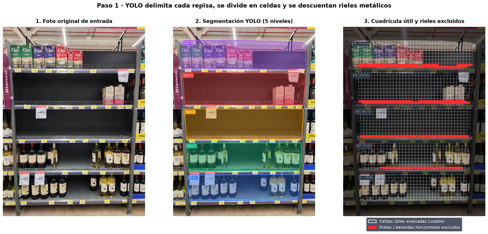
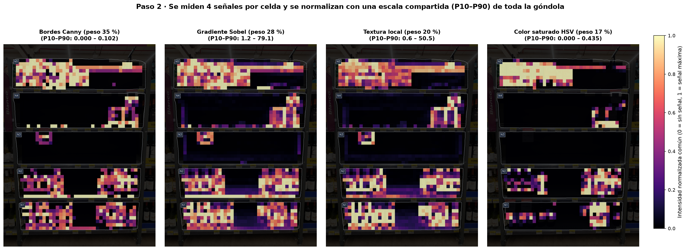
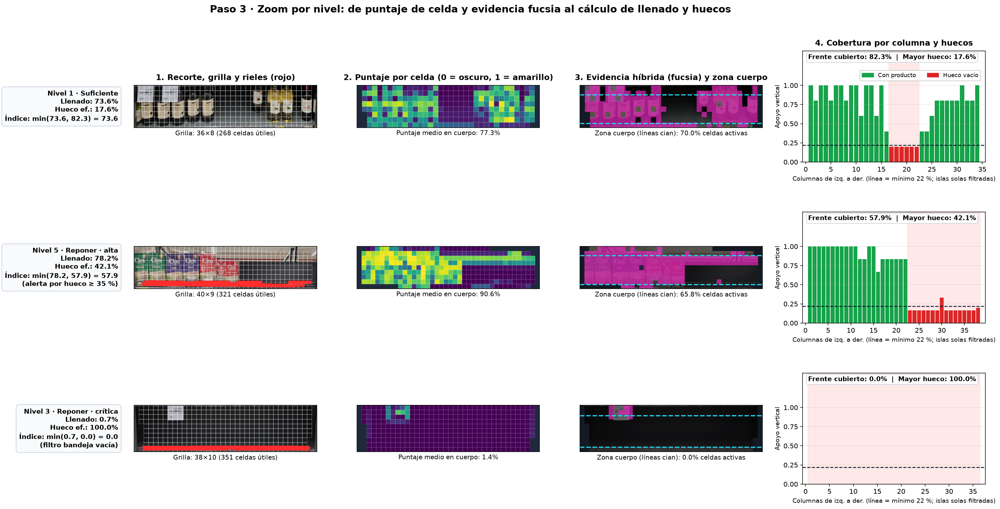
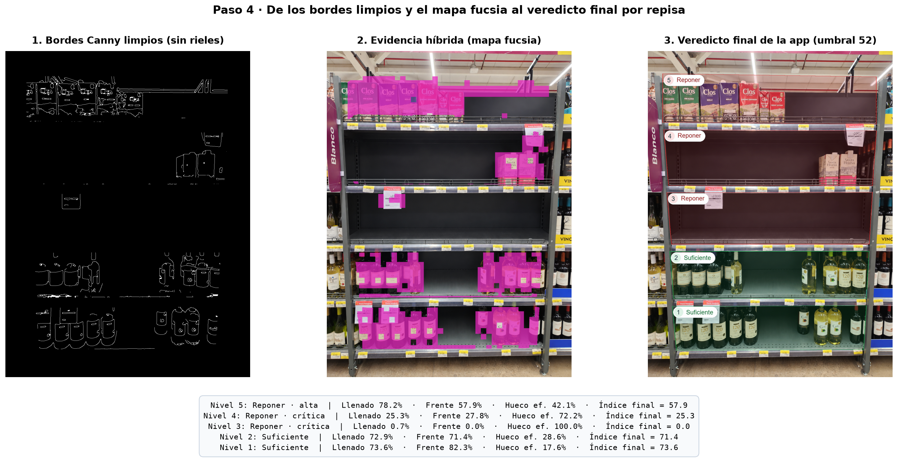

# Ejemplo visual paso a paso: cómo se calcula la ocupación

Este recorrido muestra qué ocurre por dentro cuando **Walmart Visión** analiza una góndola, usando el flujo vigente del repositorio:

- **Segmentación:** `V3-cierre-revisado-20261110` (`YOLO26n-seg`, `conf = 0,60`).
- **Estimador de disponibilidad visual:** `linea_a_20261116_v2_2_cajas_sacos_picada` (`umbral = 52`).
- **Imagen utilizada:** `lider_express_023_C_mixta.png`, una **variante sintética de `train`** (fuera de `val` y del `test` reservado `Ohiggins 3`), frontal y con ambos pilares visibles.

---

## Paso 1 · Delimitar repisas, dividir en celdas y descontar rieles

1. **YOLO (`YOLO26n-seg`)** solo delimita una máscara por cada repisa (`Nivel 1` abajo hasta `Nivel 5` arriba), abarcando tanto productos como espacios vacíos.
2. Cada máscara se recorta ligeramente en el contorno (`3 %`) y se divide en una **cuadrícula de celdas útiles** (aproximadamente `24×24` px por celda).
3. Antes de medir producto, el algoritmo detecta **líneas rectas horizontales largas** (rieles, portaprecios y barandas metálicas, resaltadas en **rojo** a la derecha) y descarta esos píxeles para que la estructura de la repisa no sume como mercadería.

---

## Paso 2 · Medir las 4 señales en cada celda con una escala común

Dentro de cada celda útil se calculan cuatro señales visuales y se normalizan entre `0` y `1` usando **los percentiles 10 y 90 compartidos de toda la góndola** (así un estante vacío, como el **Nivel 3**, no se amplifica al compararse solo consigo mismo):

- **Bordes Canny (`35 %`)** (`P10–P90: 0,000 – 0,102`): contornos definidos de cajas, etiquetas y botellas.
- **Gradiente Sobel (`28 %`)** (`P10–P90: 1,2 – 79,1`): cambios locales de intensidad y contraste.
- **Textura local (`20 %`)** (`P10–P90: 0,6 – 50,5`): variación local de brillo (ayuda a detectar envases oscuros).
- **Color saturado HSV (`17 %`)** (`P10–P90: 0,000 – 0,435`): color intenso respaldado por borde o textura (evita contar fondos lisos).

Las cuatro señales se suman con sus pesos para obtener el **puntaje por celda** (`0` a `1`):

$$\text{puntaje} = 0,35\cdot\text{bordes} + 0,28\cdot\text{gradiente} + 0,20\cdot\text{textura} + 0,17\cdot\text{color}$$

---

## Paso 3 · Zoom por nivel: del puntaje de celda al llenado y los huecos

Una celda pasa a ser **evidencia híbrida (mapa fucsia)** si su puntaje supera `0,36` o si tiene señal física absoluta clara (salvo cuando el filtro de **bandeja expuesta**, como en el **Nivel 3**, suprime el fondo liso de la repisa vacía).

En las tres filas de abajo se muestran tres casos representativos (**Nivel 1 lleno**, **Nivel 5 con hueco a la derecha** y **Nivel 3 vacío**):

1. **Llenado del cuerpo (`fill_pct`):** se mide en la franja útil (`22 %` a `90 %` de la altura, líneas cian) combinando el porcentaje de celdas fucsia y el puntaje medio.
2. **Huecos en el frente (`effective_gap_pct`):** se recorre el nivel **columna por columna de izquierda a derecha**. Una columna cuenta como cubierta (barra **verde**) si al menos el `22 %` de sus filas de soporte tiene señal fucsia; las islas aisladas de `1` columna entre huecos se filtran como ruido (por ejemplo, en la columna `30` del **Nivel 5**).
3. **Índice final y caso didáctico del Nivel 5:** el índice queda acotado por los huecos:
   $$\text{Índice} = \min(\text{llenado},\; 100 - \text{hueco efectivo})$$
   En el **Nivel 5**, el llenado del cuerpo es alto (`78,17 %`), pero el hueco continuo de la derecha (`42,11 %`) acota el índice a `min(78,17, 100 - 42,11) = 57,89` y dispara **`Reponer · alta`** por la regla de quiebre en el frente (**hueco `≥ 35 %` con menos del `68 %` del frente cubierto**).

---

## Paso 4 · Resultado final por repisa (umbral 52)

La aplicación dibuja el mapa fucsia de evidencia híbrida y clasifica cada repisa:
- **Reponer:** cuando el índice queda por debajo de **52** o hay un quiebre importante en el frente (`crítica` si índice `≤ 15` o hueco `≥ 60 %`; `alta` en el resto).
- **Suficiente:** cuando alcanza **52** o más sin alertas de huecos ni dudas de visibilidad (`Revisar`).

### Números obtenidos en esta captura

| Nivel (de arriba a abajo) | Grilla (`cols×filas`) | Llenado cuerpo | Frente cubierto | Mayor hueco | Hueco efectivo | Índice final | Veredicto |
|---|---:|---:|---:|---:|---:|---:|---|
| **Nivel 5** (arriba) | `40×9` | `78,17 %` | `57,89 %` | `42,11 %` | `42,11 %` | **`57,89`** | **Reponer · alta** *(hueco `≥ 35 %`)* |
| **Nivel 4** | `39×10` | `25,31 %` | `27,78 %` | `72,22 %` | `72,22 %` | **`25,31`** | **Reponer · crítica** |
| **Nivel 3** | `38×10` | `0,69 %` | `0,00 %` | `100,00 %` | `100,00 %` | **`0,00`** | **Reponer · crítica** |
| **Nivel 2** | `37×9` | `72,88 %` | `71,43 %` | `28,57 %` | `28,57 %` | **`71,43`** | **Suficiente** |
| **Nivel 1** (abajo) | `36×8` | `73,64 %` | `82,35 %` | `17,65 %` | `17,65 %` | **`73,64`** | **Suficiente** |

### Alcance y licencia de las figuras

- El índice mide **disponibilidad visual** en el frente de la fotografía (`0–100`), no stock físico ni profundidad detrás de la primera fila. En el **Nivel 3**, la etiqueta colgante de precio superior izquierda aparece de forma tenue en los mapas intermedios, pero el filtro de bandeja vacía y el análisis de columnas la descartan (`Índice = 0,00`).
- La imagen `lider_express_023_C_mixta.png` es una **variante sintética de `train`**, autorizada por Vicente el 20/11/2026 únicamente como demostración visual en esta documentación; no concede licencia abierta al resto del dataset ni constituye una evaluación de precisión. Consulta [LICENCIAS.md](../LICENCIAS.md).

[Guía de funcionamiento](Guia_para_entender_el_proyecto.md) · [Justificación del umbral 52](Justificacion_umbral_52.md) · [Inicio](../README.md)
