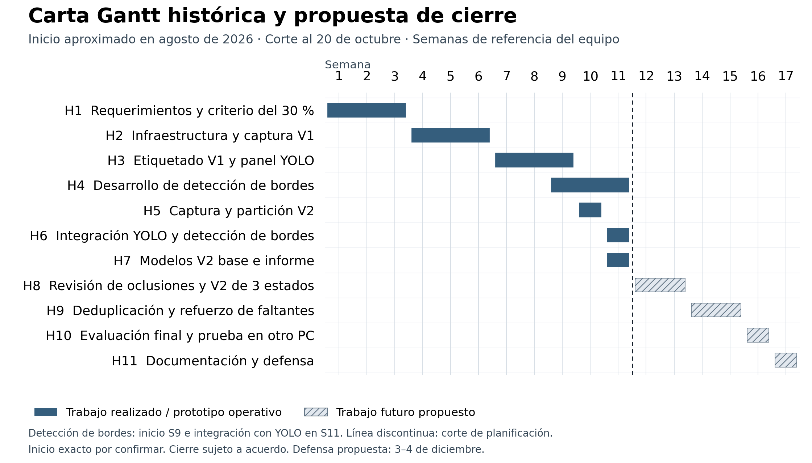

# Informe intermedio de avance
## Walmart Computer Vision

**Corte:** 20 de octubre de 2026, hora de Santiago. **Destinatario:** José Larraín. **Docente guía:** Arturo Vargas, DUOC UC.

**Equipo:** Vicente Canio, Paulo Guerra y Vicente Vilches.

**Revisión de lectura:** mantenemos el corte y los resultados del 20 de octubre. Explicamos los conceptos técnicos y conservamos la planificación desde agosto aproximado, el inicio de bordes en semana 9 y su integración con YOLO en semana 11.

Construimos un prototipo que analiza fotografías de góndolas. Busca cada nivel o repisa, dibuja su contorno y le asigna un estado de disponibilidad. También permite preparar imágenes, dibujar sus etiquetas y entrenar modelos. Conservamos cuatro ensayos: dos V1 de cuatro estados y dos V2 base de dos estados. Falta comprobar mejor las imágenes con obstáculos y ampliar las fotografías reales con faltantes.

| Indicador verificado | Resultado al corte |
|---|---|
| Imágenes propias únicas | 405: 96 reales y 309 sintéticas |
| Datos usados en V1 | 86 entrenamiento y 5 validación real |
| Datos usados en V2 base | 160 entrenamiento y 10 validación real |
| Mejor mAP50–95 de máscaras V2 | 92,79 %, YOLO26n, sobre 10 fotos reales |
| Alertas reales de validación V2 | 1 acertada de 1; cero falsas en YOLO26n |
| Modelos V2 de tres estados | Pendientes de entrenamiento y evaluación |

YOLO26 V2 encontró 50 de los 51 niveles de validación y acertó esos 50 estados. Detectó la única alerta real de reposición y no generó falsas alertas. Este resultado comprueba un caso de faltante; necesitamos más ejemplos para saber cuántos detectaría en una tienda. Separamos fotos reales y modificadas con IA. La validación sirve para elegir modelos durante el desarrollo; la prueba final sigue reservada.

El alcance es disponibilidad visual por nivel en fotografías estáticas. El sistema asigna un estado aprendido; no mide inventario de bodega, profundidad, unidades por SKU ni un porcentaje continuo de ocupación. El umbral del 30 % sigue siendo un criterio inicial de anotación pendiente de calibración con el cliente.

**Contenido:** estado y planificación; documentación técnica; resultados preliminares y 20 casos visuales; reproducibilidad y GitHub; conclusiones y plan de mejora.


<!-- page -->

## Guía de lectura del informe

El informe sigue los cinco puntos del encargo: avance, solución técnica, resultados, reproducibilidad y próximos pasos. Mostramos lo que funciona y lo que falta. Los nombres de archivos permiten localizar la evidencia; no es necesario memorizarlos para comprender los resultados.

| Concepto | Qué significa en nuestro proyecto |
|---|---|
| Nivel de góndola | Espacio de una repisa que revisamos como unidad; no contamos cada producto por separado. |
| Segmentación y máscara | Dibujar el contorno del nivel. La región dibujada se llama máscara. |
| Estado o clase | Categoría asignada al nivel, como reponer o suficiente. Un contorno correcto puede tener un estado equivocado. |
| Etiqueta o referencia | Contorno y estado revisados por personas; los usamos para enseñar al modelo y comparar resultados. |
| Entrenamiento e inferencia | Entrenar es aprender con ejemplos. Inferir es usar lo aprendido para analizar otra imagen. |
| Pesos y ensayo | Los pesos guardan lo aprendido. Un ensayo conserva esos archivos, la configuración y sus resultados. |
| Dataset y partición | El dataset es el conjunto de datos. Lo dividimos en entrenamiento, validación y prueba final. |
| Oclusión | Una persona, carro o caja tapa el nivel y puede impedir decidir su disponibilidad. |
| Versión fija o snapshot | Copia guardada de datos y etiquetas para saber exactamente con qué ejemplos trabajamos. |

Las imágenes de entrenamiento permiten aprender y revisar fallos. Las de validación permiten comparar modelos y ajustes. La prueba final se consulta después de fijar esas decisiones; usarla para escoger ajustes dejaría de ser una comprobación final independiente del desarrollo.

En los veinte casos, la imagen de referencia aparece a la izquierda y la salida del modelo a la derecha. Primero se revisa si encontró los niveles y luego si decidió bien sus estados. Antes de las tablas de resultados explicamos las métricas y mostramos un ejemplo con cifras reales.

Una explicación ampliada y un glosario están en Documentacion/Guia_para_entender_el_proyecto.md. La relación con cada requisito del encargo está en Documentacion/Revision_de_requisitos_informe.md.

<!-- page -->

## 1 Estado de avance del proyecto

Para estimar el avance, dividimos cada módulo en cuatro hitos de igual peso. Cada hito cumplido aporta 25 puntos. Hemos cerrado 28 de 36 hitos, equivalentes al 77,8 %. Es una estimación del trabajo implementado: no es la precisión del modelo ni significa que quede exactamente el 22,2 % del esfuerzo.

| Módulo | Hitos cerrados | Avance y estado | Evidencia |
|---|---|---|---|
| Datos | Captura, inventario, integridad | 75 % en desarrollo | Datos/Registros/lotes.json |
| Etiquetado en equipo | Configuración, tareas, usuarios y acceso | 100 % implementado | Infraestructura/CVAT y tareas 16, 19, 22 |
| Separación de datos | Familias, grupos, listas y comprobación | 100 % implementado | Particiones/lider_express_v2_20261019 |
| Importación y exportación | Leer etiquetas, revisar y guardar para YOLO | 100 % implementado | datos_modelos.py y conjuntos.py |
| Modelos base | V1 YOLO11/26, V2 base YOLO11/26 | 100 % para esta etapa | Cuatro ensayos en Experimentos |
| Panel | Carga, inferencia, comparación | 75 % en desarrollo | panel_modelos.py y panel_worker.py |
| Distribución | Docker, arranque, Lite V2 | 75 % en desarrollo | Infraestructura/Docker y Entregables |
| Oclusiones V2 | Lote y partición preparados | 50 % en desarrollo | 60 imágenes y tarea 22 |
| Cierre de calidad | Diagnóstico de errores | 25 % en desarrollo | evaluacion_por_imagen.json |

**Hitos restantes:** datos: ampliar faltantes reales; panel: aceptación con tres estados; distribución: instalación de Lite en otro computador físico; oclusiones: revisión del significado de las etiquetas final y ensayo de tres estados; cierre: deduplicación, prueba final y aceptación del MVP.

“Implementado” indica que existen código, configuración o artefactos comprobables. La preparación posterior de la entrega verificó el arranque Docker en CPU y la demo Lite con los cuatro modelos, sin requerir CVAT. Esto no equivale a disponibilidad garantizada del CVAT compartido ni a una prueba en otro computador físico; el registro actualizado está en reproducibilidad/VERIFICACION.md.

Los cuatro entrenamientos guardan sus pesos, ajustes, resultados, grupos de datos y versiones de programas. V2 base utilizó la copia aprobada datos_20261019_234626_3df2e643. Esa copia permite comprobar con qué se entrenó, aunque algunos textos antiguos de los lotes sigan diciendo que falta exportar. La aprobación no incluye las etiquetas con obstáculos de la tarea 22.


<!-- page -->

## 1 Planificación desde el inicio del proyecto



El proyecto comenzó aproximadamente en agosto de 2026, según la reconstrucción del equipo. La Gantt incorpora la historia de trabajo y el cierre propuesto. La detección de bordes comenzó en la semana 9 y se integró con el modelo YOLO en la semana 11.

Las semanas son referencias de organización comunicadas por el equipo, no fechas diarias confirmadas. El corte corresponde al 20 de octubre. La fecha exacta de inicio y la equivalencia calendario de las primeras semanas quedan por confirmar; el primer commit conservado es del 2 de septiembre de 2026.

La defensa del 3 o 4 de diciembre es tentativa. Los hitos futuros y sus responsables están sujetos a acuerdo; no existe una línea base aprobada que permita cuantificar retrasos en días.

<!-- page -->

## 1 Hitos y trazabilidad

| Hito y actividad | Sem. | Responsables | Estado | Evidencia y alcance |
|---|---|---|---|---|
| H1 Requerimientos y criterio del 30 % | 1–3 | Todo el equipo | Realizado | Inicio en agosto aproximado; segmentación por nivel y criterio inicial de anotación. |
| H2 Infraestructura y captura V1 | 4–6 | V. Canio / V. Vilches | Realizado | Docker/CVAT e inventarios; 37 originales y 72 variantes sintéticas. |
| H3 Etiquetado V1 y panel YOLO | 7–9 | V. Canio / P. Guerra | Realizado | 91 fotos activas; ensayos YOLO11/26 V1 y demo conservados del 15 de octubre. |
| H4 Desarrollo de detección de bordes | 9–11 | Equipo | Experimental operativo | Inicio en semana 9 informado por el equipo; script y revisiones conservados. |
| H5 Captura y partición V2 | 10 | Todo el equipo | Preparación realizada | 236 imágenes base y 60 con obstáculos; corrección de tareas 20/21 en tarea 22. |
| H6 Integración YOLO y detección de bordes | 11 | Equipo | Experimental operativo | Integración en semana 11 informada por el equipo; panel, adaptador y mapas de señal. |
| H7 Modelos V2 base e informe | 11 | Todo el equipo | Realizado | Dos ensayos V2 base; métricas, informe y entrega Lite con detección de bordes. |
| H8 Revisión de oclusiones y V2 de 3 estados | 12–13 | P. Guerra / V. Vilches | Propuesto pendiente | Cerrar revisión del significado de las etiquetas de tarea 22 y entrenar; no se declara completado. |
| H9 Deduplicación y refuerzo de faltantes | 14–15 | V. Canio / P. Guerra | Propuesto pendiente | Comparar posprocesamiento en val y ampliar casos reales sin usar test para ajustar. |
| H10 Evaluación final y prueba en otro PC | 16 | Todo el equipo | Propuesto pendiente | Separar test real/sintético/V1 y comprobar instalación de Lite en otro equipo físico. |
| H11 Documentación y defensa | 17 | Todo el equipo | Propuesto pendiente | Cierre documental y demostración; fecha sujeta a confirmación académica. |

Los rangos semanales históricos se reconstruyen con el equipo y la tabla de referencia; los artefactos permiten verificar resultados, pero no fijan por sí solos la fecha de inicio de cada actividad. El desarrollo de bordes es experimental y su integración no valida un porcentaje real de ocupación.

El hito H5 indica preparación del lote y su partición. La corrección de tareas 20/21 en la 22 no cierra la revisión del significado de las etiquetas ni acredita un entrenamiento de tres estados. La validación de Lite en otro computador sigue pendiente aunque la demo ya esté publicada.

<!-- page -->

## 1 Metodología de trabajo y riesgos

Trabajamos con un enfoque ágil e iterativo inspirado en principios de Scrum. El equipo mantuvo dos reuniones semanales para revisar avances, revisar nuevas imágenes para anotar, discutir diferencias de etiquetado, ajustar criterios y proponer ideas y mejoras. Los acuerdos orientaron el siguiente ciclo de trabajo y permitieron adaptar los datos y los componentes a los resultados observados.

Esta descripción recoge prácticas de inspección y adaptación. Con la información disponible no se atribuyen roles formales, sprints definidos ni una ejecución completa de los eventos de Scrum. Las dos reuniones semanales se describen como seguimiento del equipo; su frecuencia por sí sola no acredita Scrum formal.

Referencia metodológica: Guía Scrum 2020 de Ken Schwaber y Jeff Sutherland, https://scrumguides.org/scrum-guide.html. Para reforzar la trazabilidad se propone registrar fecha, participantes, avances, acuerdos y pendientes de cada reunión.

| Riesgo o dificultad | Evidencia y acción prioritaria |
|---|---|
| Pocos faltantes reales | V2 val contiene un nivel reponer. Capturar escenas reales adicionales y separarlas por escena y sesión. |
| Oclusiones sin validar | V2 base no aprende no_evaluable. Cerrar tarea 22 y medir los tres estados por separado. |
| Etiquetado parcial y duplicados | Revisar la región evaluada y las etiquetas; probar el filtro de duplicados en validación, sin ajustar con la prueba final. |
| Diferencias entre copias | Tarea 19 registra 1.229 niveles en un registro antiguo y 1.212 en la exportación usada. Identificar la versión y su copia fija. |
| Réplica y aceptación externa | La demo está disponible, pero falta comprobar la instalación en otro computador físico y ampliar validación. |

El cambio de dimensiones de imágenes de oclusión motivó sustituir las tareas 20/21 por la 22. Se conservan registros de corrección; falta cerrar la aprobación semántica. No se atribuye un retraso en días sin una planificación anterior verificable.

<!-- page -->

## 2 Documentación técnica de la solución

El objetivo es dibujar el espacio completo de cada nivel y clasificar su disponibilidad. V1 distingue vacío, baja disponibilidad, suficiente y no evaluable. V2 base reúne vacío y baja en reponer; V2 completo deberá añadir no_evaluable para situaciones donde un obstáculo impide decidir.


**Preparar y entrenar:** reunimos fotos, dibujamos contornos y estados en CVAT, revisamos las etiquetas y separamos los datos. Después exportamos esos ejemplos al formato de YOLO y entrenamos. Guardamos los pesos del modelo junto con la configuración y los resultados.

**Analizar una fotografía:** el usuario carga una imagen en el panel. El programa corrige su orientación, ejecuta YOLO y muestra los niveles numerados, sus estados y alertas. Este proceso se llama inferencia. Los números se ordenan de abajo hacia arriba y de izquierda a derecha.

**Revisar bordes:** un análisis opcional estudia cambios de intensidad, color y textura dentro de las máscaras. Se aplica sobre la fotografía original, antes de dibujar los colores del resultado. Permite estudiar dónde aparece la señal y sus errores; no cambia el estado decidido por YOLO ni mide todavía el porcentaje real de productos.

La confianza de una predicción es una puntuación del modelo, no el porcentaje de ocupación de la repisa. Tampoco informa cuántas unidades hay detrás de la primera fila ni las existencias de bodega.

<!-- page -->

## 2 Tecnologías y decisiones

| Tecnología o decisión | Función en el proyecto | Motivo y límite |
|---|---|---|
| Polígonos por nivel completo | Las personas dibujan la repisa incluyendo producto y vacío. | Queremos decidir reposición por nivel. Contar cada tipo de producto, o SKU, exigiría otras etiquetas y un catálogo. |
| YOLO11n y YOLO26n de segmentación | Dibujan los niveles y predicen sus estados. | Comparamos dos variantes Nano con los mismos datos dentro de cada versión. Guardamos pesos y resultados; el tamaño del archivo no demuestra consumo máximo de memoria. |
| PyTorch y Ultralytics | Ejecutan aprendizaje y análisis con YOLO. | Partimos de pesos generales ya entrenados y los adaptamos a nuestras góndolas. Versiones del ensayo: PyTorch 2.5.1+cu121 y Ultralytics 8.4.174. |
| CVAT | Permite dibujar, compartir y revisar etiquetas. | Las etiquetas enseñan al modelo qué contorno y estado esperamos. Una huella SHA-256 comprueba que el archivo no cambió, no que el dibujo sea correcto. |
| Familias y grupos de imágenes | Mantienen relacionadas la foto original y sus variantes. | Evitamos entrenar con una imagen y evaluar con una versión casi idéntica. Esta separación no prueba funcionamiento en otras tiendas. |
| OpenCV, Pillow, NumPy y Shapely | Orientan fotos y trabajan con píxeles, máscaras y formas. | Permiten preparar las imágenes y comprobar las regiones que importamos, exportamos o analizamos. |
| Bordes Canny, color y textura | Añaden mapas de señal dentro de las máscaras YOLO. | Trabajo iniciado en semana 9 e integrado en semana 11. Sirve para experimentar; fondos con textura y carteles aún pueden confundirlo. |
| Docker y panel local | Preparan servicios y permiten operar desde una interfaz. | Facilitan compartir la configuración. Los datos, pesos y accesos a CVAT se preparan aparte. |

En V2 base usamos tamaño de entrada imgsz 640; batch 2, es decir, dos imágenes por paso; seed 42 como semilla para repetir condiciones; optimizador AdamW; y paciencia 20 para detener el entrenamiento si no mejora durante ese número de épocas. Una época es un recorrido de los datos de entrenamiento.

Los ajustes quedan en args.yaml y entorno.json. En nuestro análisis adicional conservamos predicciones con confianza mínima 0,25 y asociamos cada máscara con una referencia una sola vez si su IoU alcanza 0,50. La sección de lectura de resultados explica esa coincidencia de contornos. Estos conteos no utilizan exactamente el mismo procedimiento que el mAP de Ultralytics.

<!-- page -->

## 2 Datos y preparación

| Procedencia | Reales | Sintéticas | Uso y preparación |
|---|---:|---:|---|
| V1 Lider y reserva | 37 | 0 | 30 de desarrollo y 7 reservadas |
| V1 variantes | 0 | 72 | 102 candidatas al sumar 30 reales; 11 exclusiones; 91 activas |
| V2 Líder Express | 59 | 177 | 59 familias con original y tres variantes; tarea 19 |
| V2 visibilidad limitada | 0 | 60 | Ediciones con 24 carros, 24 personas y 12 cajas; tarea 22 |
| Total único | 96 | 309 | 405 imágenes; los 435 registros incluyen referencias repetidas |

Las fotos reales fueron tomadas por el equipo en supermercado. Las variantes IA son ediciones de esas fotos, no capturas nuevas independientes. Una familia reúne una original y sus variantes. Los inventarios guardan su origen, tamaño y huella SHA-256 para comprobar cambios. En V1 excluimos imágenes por problemas de calidad; en V2 las variantes se revisan con una guía común. Sus nombres A/B/C no indican qué estado deben recibir.

**Anotación usada por los modelos:** V1 contiene 719 niveles, con 683 en train y 36 en val. La copia V2 base contiene 1.212 niveles: 816 en entrenamiento, 51 en validación real, 153 en diagnóstico sintético y 192 en reserva. Un registro anterior de tarea 19 contiene 1.229; no se suman ambas versiones.

| Destino V2 base | Originales reales | Variantes IA | Aplicación |
|---|---:|---:|---|
| Entrenamiento | 40 | 120 | 160 imágenes usadas para aprender |
| Validación | 10 | 30 | Métrica principal solo en 10 reales; 30 de diagnóstico separado |
| Prueba final | 9 | 27 | Reservadas; no usadas aquí para elegir modelos |

Distribuimos 19 grupos de imágenes relacionadas: 14 para aprender, 3 para comparar modelos y 2 para la prueba final. Una original y sus variantes van juntas para evitar que aparezcan imágenes casi iguales en entrenamiento y evaluación. Por eso hay menos escenas independientes que archivos. El verificador comprueba esta separación, sin demostrar independencia física total entre escenas.

El lote de oclusiones tiene 308 polígonos, pero hay copias guardadas con repartos de estados distintos. La revisión del 19 de octubre a las 22:27 UTC registra 256 suficientes, 41 no evaluables y 11 reponer; el registro de partición conserva otra copia de 299/9/0. Hasta cerrar la revisión no se adopta un conteo de clases definitivo.

Para la siguiente etapa se reservan 41 imágenes con obstáculos para train, 10 para val y 9 para test. Solo las aprobadas se incorporarán. Al fusionar, el entrenamiento sería 201 imágenes; la validación principal tendría 10 reales más 10 sintéticas de obstáculos, con métricas separadas. Las 30 variantes A/B/C de diagnóstico mantienen su función auxiliar. No se reportará una métrica agregada de 50 imágenes como si fueran 50 fotos reales.


<!-- page -->

## 3 Cómo interpretar las métricas

Evaluamos dos cosas distintas: si el modelo encontró el nivel y si acertó su estado. El contorno y estado revisados por personas constituyen la referencia. En las imágenes de los casos aparece a la izquierda; la predicción del modelo, a la derecha.

| Medida | Interpretación |
|---|---|
| Localizados y estados exactos | Localizados cuenta referencias encontradas. Estados exactos exige además que la categoría sea correcta. |
| Omitidos y extras | Un omitido es una referencia no encontrada. Un extra es una predicción sin referencia asociada; puede exigir revisar el modelo o las etiquetas. |
| Precisión de alertas | Alertas acertadas divididas por todas las emitidas. Indica cuántos avisos eran correctos. |
| Recall de alertas | Alertas acertadas divididas por los faltantes de referencia. Indica cuántos faltantes se detectaron. Sin faltantes de referencia no se puede medir. |
| IoU de máscara | Área compartida por predicción y referencia dividida por el área de su unión. Va de 0 a 1; un contorno idéntico obtiene 1. No mide acierto del estado. |
| mAP50 y mAP50–95 | Resumen del comportamiento por clase. mAP50 usa IoU 0,50; mAP50–95 promedia de 0,50 a 0,95 en pasos de 0,05. Aquí se informa sobre máscaras. |

**Ejemplo guardado de YOLO11 V2:** encontró los 51 niveles, acertó 48 estados y produjo una alerta correcta y cuatro falsas. Su precisión de alertas fue 1/5, o 20 %. Su recall fue 1/1, o 100 %, porque detectó el único faltante de referencia. Detectarlo no impidió que emitiera avisos equivocados.

**Ejemplo guardado de YOLO26 V2:** encontró 50 de 51 niveles, acertó esos 50 estados y emitió una alerta acertada, sin falsas alertas. Solo había un faltante real en esas diez fotos. El resultado es favorable para ese caso, pero insuficiente para estimar el comportamiento en una tienda completa.

El 92,79 % de mAP50–95 no significa 92,79 % de fotos correctas ni ese porcentaje de faltantes detectados. Leemos esta medida junto con los conteos, los errores y la cantidad de ejemplos. La confianza del modelo y la ocupación visible tampoco son esa medida.

La guía de métricas de Ultralytics explica precisión, recall y mAP: https://docs.ultralytics.com/guides/yolo-performance-metrics/. La documentación de segmentación distingue las métricas de máscaras: https://docs.ultralytics.com/tasks/segment/.

<!-- page -->

## 3 Resultados preliminares

| Modelo | mAP50 máscara | mAP50–95 máscara | Localizados | Estado exacto | Extras | Alertas acertadas | Falsas alertas |
|---|---:|---:|---:|---:|---:|---:|---:|
| YOLO11-1 | 74,47 % | 56,59 % | 35/36 | 33/36 | 12 | 0/0 | 2 |
| YOLO26-1 | 73,38 % | 62,40 % | 35/36 | 34/36 | 11 | 0/0 | 0 |
| v2_base_yolo11n_01 | 98,44 % | 86,26 % | 51/51 | 48/51 | 8 | 1/1 | 4 |
| v2_base_yolo26n_01 | 99,28 % | 92,79 % | 50/51 | 50/51 | 5 | 1/1 | 0 |

**Fuentes:** metricas_validacion.json, metricas_alertas.json y evaluacion_por_imagen.json de los cuatro ensayos. V1 usa 5 fotos reales y V2 10. Los mAP provienen del evaluador Ultralytics; los conteos se obtienen del emparejamiento propio a conf 0,25 e IoU ≥ 0,50. Sus definiciones y umbrales difieren, por lo que no deben interpretarse como la misma métrica.

YOLO26 V2 logra 50/51 estados exactos, 5 predicciones extra, una omisión y cero falsas alertas. Su precisión de alertas es 1/1 y su recall es 1/1. YOLO11 V2 localiza 51/51 niveles, acierta 48/51 estados y emite 4 falsas alertas: precisión 1/5 y recall 1/1. En V1 no hay referencias de faltantes en val y el recall de alertas no es medible.

La diferencia de mAP50–95 entre los dos modelos V2 es 6,53 puntos a favor de YOLO26. La comparación entre V1 y V2 cambia datos, clases y partición: el salto de 62,40 % a 92,79 % no puede atribuirse exclusivamente a fusionar clases.

**Selección de los 20 casos:** se conserva una selección razonada de 10 resultados completos y 10 errores relevantes. En los éxitos se priorizan escenas reales de val y cobertura de alertas; ocho son de validación real y dos son sintéticos de entrenamiento. En los fallos se priorizan alertas omitidas, falsas alertas, omisiones y problemas de referencia. No constituye un ranking estadístico único entre versiones y particiones distintas. Cada ficha identifica su modelo, origen y métricas verificadas.

La IoU media de cada ficha se calcula solo sobre niveles emparejados; puede ser alta aunque existan omisiones o errores de estado. El resultado esperado es la anotación humana congelada, que también puede contener errores. Las causas visuales se presentan como hipótesis salvo cuando están sustentadas en una auditoría previa.

No se ejecutan nuevas inferencias sobre la reserva para preparar este informe. Las ilustraciones reutilizan comparaciones ya guardadas. Los resultados en train comprueban ajuste y sirven para diagnóstico, no para demostrar generalización.


<!-- page -->

### 3 Mejor caso 1 Alerta real de reposición

**Entrada:** lider_express_040_0_original.jpg · foto real · validación. **Modelo:** v2_base_yolo26n_01.


**Esperado:** 5 niveles: 4 suficiente, 1 reponer. **Obtenido:** 5 predicciones: 4 suficiente, 1 reponer.

**Métricas:** 5/5 localizados; 5/5 estados exactos; 0 omitidos; 0 extras. IoU media de los contornos asociados 0.9271. Alertas: 1/1 acertadas, 0 omitidas y 0 falsas. Si no hay faltantes de referencia, no se calcula recall de alertas.

**Criterio de éxito:** La única referencia reponer de val se detecta y se clasifican correctamente los otros cuatro niveles. El alcance de este éxito es un caso real.

**Comprobación siguiente:** Conservar este caso para comprobar futuras mejoras y añadir faltantes reales de otras escenas.

**Trazabilidad:** registro lider_express_040_0_original.jpg en evaluacion_por_imagen.json del ensayo. Los datos completos están en Evidencias/casos_informe_20261020.json.


<!-- page -->

### 3 Mejor caso 2 Seis niveles completos

**Entrada:** lider_express_015_0_original.jpg · foto real · validación. **Modelo:** v2_base_yolo26n_01.


**Esperado:** 6 niveles: 6 suficiente. **Obtenido:** 6 predicciones: 6 suficiente.

**Métricas:** 6/6 localizados; 6/6 estados exactos; 0 omitidos; 0 extras. IoU media de los contornos asociados 0.9464. Alertas: 0/0 acertadas, 0 omitidas y 0 falsas. Si no hay faltantes de referencia, no se calcula recall de alertas.

**Criterio de éxito:** Las seis referencias se localizan con estado correcto y sin predicciones adicionales. La IoU media es alta dentro de la validación V2.

**Comprobación siguiente:** Conservar el caso para comprobar que los cambios no degradan niveles suficientes.

**Trazabilidad:** registro lider_express_015_0_original.jpg en evaluacion_por_imagen.json del ensayo. Los datos completos están en Evidencias/casos_informe_20261020.json.


<!-- page -->

### 3 Mejor caso 3 Delimitación precisa de cinco niveles

**Entrada:** lider_express_039_0_original.jpg · foto real · validación. **Modelo:** v2_base_yolo26n_01.


**Esperado:** 5 niveles: 5 suficiente. **Obtenido:** 5 predicciones: 5 suficiente.

**Métricas:** 5/5 localizados; 5/5 estados exactos; 0 omitidos; 0 extras. IoU media de los contornos asociados 0.9463. Alertas: 0/0 acertadas, 0 omitidas y 0 falsas. Si no hay faltantes de referencia, no se calcula recall de alertas.

**Criterio de éxito:** Los cinco contornos coinciden con las referencias y sus estados. No aparecen alertas de reposición sin referencia.

**Comprobación siguiente:** Repetir la evaluación bajo nuevas sesiones y condiciones de captura.

**Trazabilidad:** registro lider_express_039_0_original.jpg en evaluacion_por_imagen.json del ensayo. Los datos completos están en Evidencias/casos_informe_20261020.json.


<!-- page -->

### 3 Mejor caso 4 Máscaras de alta coincidencia

**Entrada:** lider_express_027_0_original.jpg · foto real · validación. **Modelo:** v2_base_yolo11n_01.


**Esperado:** 5 niveles: 5 suficiente. **Obtenido:** 5 predicciones: 5 suficiente.

**Métricas:** 5/5 localizados; 5/5 estados exactos; 0 omitidos; 0 extras. IoU media de los contornos asociados 0.9530. Alertas: 0/0 acertadas, 0 omitidas y 0 falsas. Si no hay faltantes de referencia, no se calcula recall de alertas.

**Criterio de éxito:** El modelo YOLO11 V2 alcanza coincidencia geométrica elevada en esta foto. Un éxito individual no reemplaza el balance global de falsas alertas.

**Comprobación siguiente:** Usar como comparación entre arquitecturas sobre la misma entrada.

**Trazabilidad:** registro lider_express_027_0_original.jpg en evaluacion_por_imagen.json del ensayo. Los datos completos están en Evidencias/casos_informe_20261020.json.


<!-- page -->

### 3 Mejor caso 5 Seis estados suficientes correctos

**Entrada:** lider_express_014_0_original.jpg · foto real · validación. **Modelo:** v2_base_yolo26n_01.


**Esperado:** 6 niveles: 6 suficiente. **Obtenido:** 6 predicciones: 6 suficiente.

**Métricas:** 6/6 localizados; 6/6 estados exactos; 0 omitidos; 0 extras. IoU media de los contornos asociados 0.9248. Alertas: 0/0 acertadas, 0 omitidas y 0 falsas. Si no hay faltantes de referencia, no se calcula recall de alertas.

**Criterio de éxito:** Se recuperan las seis referencias sin extras. La clasificación de suficiente coincide con la versión fija de las etiquetas.

**Comprobación siguiente:** Mantener este caso en las comprobaciones de geometría y orden espacial.

**Trazabilidad:** registro lider_express_014_0_original.jpg en evaluacion_por_imagen.json del ensayo. Los datos completos están en Evidencias/casos_informe_20261020.json.


<!-- page -->

### 3 Mejor caso 6 Separaciones entre productos sin falsa alerta

**Entrada:** lider_express_026_0_original.jpg · foto real · validación. **Modelo:** v2_base_yolo26n_01.


**Esperado:** 5 niveles: 5 suficiente. **Obtenido:** 5 predicciones: 5 suficiente.

**Métricas:** 5/5 localizados; 5/5 estados exactos; 0 omitidos; 0 extras. IoU media de los contornos asociados 0.9213. Alertas: 0/0 acertadas, 0 omitidas y 0 falsas. Si no hay faltantes de referencia, no se calcula recall de alertas.

**Criterio de éxito:** Los cinco niveles suficientes se clasifican correctamente a pesar de las separaciones visibles entre productos.

**Comprobación siguiente:** Ampliar ejemplos cercanos al umbral del 30 % para contrastar este comportamiento.

**Trazabilidad:** registro lider_express_026_0_original.jpg en evaluacion_por_imagen.json del ensayo. Los datos completos están en Evidencias/casos_informe_20261020.json.


<!-- page -->

### 3 Mejor caso 7 Dos módulos completos en V1

**Entrada:** REAL_04.jpg · foto real · validación. **Modelo:** YOLO26-1.


**Esperado:** 12 niveles: 12 suficiente. **Obtenido:** 12 predicciones: 12 suficiente.

**Métricas:** 12/12 localizados; 12/12 estados exactos; 0 omitidos; 0 extras. IoU media de los contornos asociados 0.8984. Alertas: 0/0 acertadas, 0 omitidas y 0 falsas. Si no hay faltantes de referencia, no se calcula recall de alertas.

**Criterio de éxito:** Se localizan doce niveles y se aciertan todos sus estados. La referencia incluye ambos módulos.

**Comprobación siguiente:** Conservar como control de fotografías con varios módulos completos.

**Trazabilidad:** registro REAL_04.jpg en evaluacion_por_imagen.json del ensayo. Los datos completos están en Evidencias/casos_informe_20261020.json.


<!-- page -->

### 3 Mejor caso 8 Dos módulos con perspectiva en V1

**Entrada:** REAL_05.jpg · foto real · validación. **Modelo:** YOLO11-1.


**Esperado:** 12 niveles: 12 suficiente. **Obtenido:** 12 predicciones: 12 suficiente.

**Métricas:** 12/12 localizados; 12/12 estados exactos; 0 omitidos; 0 extras. IoU media de los contornos asociados 0.8551. Alertas: 0/0 acertadas, 0 omitidas y 0 falsas. Si no hay faltantes de referencia, no se calcula recall de alertas.

**Criterio de éxito:** Se aciertan doce niveles bajo perspectiva. No se midió el ángulo de cámara; este caso no define un rango angular garantizado.

**Comprobación siguiente:** Capturar series con ángulos documentados para medir el efecto de la perspectiva.

**Trazabilidad:** registro REAL_05.jpg en evaluacion_por_imagen.json del ensayo. Los datos completos están en Evidencias/casos_informe_20261020.json.


<!-- page -->

### 3 Mejor caso 9 Cuatro alertas sintéticas de entrenamiento

**Entrada:** lider_express_049_B_baja.png · imagen sintética · entrenamiento. **Modelo:** v2_base_yolo26n_01.


**Esperado:** 5 niveles: 1 suficiente, 4 reponer. **Obtenido:** 5 predicciones: 4 reponer, 1 suficiente.

**Métricas:** 5/5 localizados; 5/5 estados exactos; 0 omitidos; 0 extras. IoU media de los contornos asociados 0.9701. Alertas: 4/4 acertadas, 0 omitidas y 0 falsas. Si no hay faltantes de referencia, no se calcula recall de alertas.

**Criterio de éxito:** Se aciertan cuatro alertas y un estado suficiente en una variante sintética ya vista al entrenar. Es evidencia de ajuste.

**Comprobación siguiente:** Comprobar el mismo patrón con faltantes reales fuera de entrenamiento.

**Trazabilidad:** registro lider_express_049_B_baja.png en evaluacion_por_imagen.json del ensayo. Los datos completos están en Evidencias/casos_informe_20261020.json.


<!-- page -->

### 3 Mejor caso 10 Tres estados correctos en V1

**Entrada:** EQ_01_V2.png · imagen sintética · entrenamiento. **Modelo:** YOLO26-1.


**Esperado:** 10 niveles: 6 suficiente, 2 vacio, 2 baja_disponibilidad. **Obtenido:** 10 predicciones: 2 baja_disponibilidad, 2 vacio, 6 suficiente.

**Métricas:** 10/10 localizados; 10/10 estados exactos; 0 omitidos; 0 extras. IoU media de los contornos asociados 0.9443. Alertas: 4/4 acertadas, 0 omitidas y 0 falsas. Si no hay faltantes de referencia, no se calcula recall de alertas.

**Criterio de éxito:** Se aciertan diez estados en una imagen sintética de train: seis suficientes, dos vacíos y dos bajos. No demuestra desempeño fuera de muestra.

**Comprobación siguiente:** Mantener como diagnóstico del criterio histórico V1.

**Trazabilidad:** registro EQ_01_V2.png en evaluacion_por_imagen.json del ensayo. Los datos completos están en Evidencias/casos_informe_20261020.json.


<!-- page -->

### 3 Peor caso 1 Omisión y detecciones adicionales

**Entrada:** lider_express_042_0_original.jpg · foto real · validación. **Modelo:** v2_base_yolo26n_01.


**Esperado:** 3 niveles: 3 suficiente. **Obtenido:** 6 predicciones: 6 suficiente.

**Métricas:** 2/3 localizados; 2/3 estados exactos; 1 omitidos; 4 extras. IoU media de los contornos asociados 0.8031. Alertas: 0/0 acertadas, 0 omitidas y 0 falsas. Si no hay faltantes de referencia, no se calcula recall de alertas.

**Error y causa probable:** Se emparejan dos de tres referencias y aparecen cuatro predicciones extra. El encuadre y la cobertura de anotación podrían explicar parte del error.

**Propuesta de mejora:** Revisar cada extra, completar referencias o definir ROI; repetir la medición con la misma política.

**Trazabilidad:** registro lider_express_042_0_original.jpg en evaluacion_por_imagen.json del ensayo. Los datos completos están en Evidencias/casos_informe_20261020.json.


<!-- page -->

### 3 Peor caso 2 Cuatro falsas alertas interclase

**Entrada:** lider_express_028_0_original.jpg · foto real · validación. **Modelo:** v2_base_yolo11n_01.


**Esperado:** 5 niveles: 5 suficiente. **Obtenido:** 9 predicciones: 5 suficiente, 4 reponer.

**Métricas:** 5/5 localizados; 2/5 estados exactos; 0 omitidos; 4 extras. IoU media de los contornos asociados 0.9453. Alertas: 0/0 acertadas, 0 omitidas y 4 falsas. Si no hay faltantes de referencia, no se calcula recall de alertas.

**Error y causa probable:** Se emiten nueve máscaras frente a cinco referencias suficientes. Se registran cuatro falsas alertas y solo dos estados exactos. La superposición de hipótesis es compatible con duplicados interclase.

**Propuesta de mejora:** Comparar NMS agnóstica y supresión por máscara sobre val. Verificar que no eliminen niveles vecinos legítimos.

**Trazabilidad:** registro lider_express_028_0_original.jpg en evaluacion_por_imagen.json del ensayo. Los datos completos están en Evidencias/casos_informe_20261020.json.


<!-- page -->

### 3 Peor caso 3 Fallo de no evaluable en V1

**Entrada:** REAL_29.jpg · foto real · validación. **Modelo:** YOLO11-1.


**Esperado:** 3 niveles: 1 suficiente, 2 no_evaluable. **Obtenido:** 7 predicciones: 6 suficiente, 1 baja_disponibilidad.

**Métricas:** 2/3 localizados; 1/3 estados exactos; 1 omitidos; 5 extras. IoU media de los contornos asociados 0.8558. Alertas: 0/0 acertadas, 0 omitidas y 1 falsas. Si no hay faltantes de referencia, no se calcula recall de alertas.

**Error y causa probable:** Se acierta un estado de tres y se omite un nivel. La referencia contiene dos no evaluables; la escasez de ejemplos V1 es una causa probable.

**Propuesta de mejora:** Añadir imágenes con obstáculos y etiquetas revisadas; medir cuántos niveles no evaluables reconoce e indicar cuántos se probaron.

**Trazabilidad:** registro REAL_29.jpg en evaluacion_por_imagen.json del ensayo. Los datos completos están en Evidencias/casos_informe_20261020.json.


<!-- page -->

### 3 Peor caso 4 Detecciones fuera de las referencias

**Entrada:** REAL_22.jpg · foto real · validación. **Modelo:** YOLO26-1.


**Esperado:** 6 niveles: 6 suficiente. **Obtenido:** 12 predicciones: 12 suficiente.

**Métricas:** 6/6 localizados; 6/6 estados exactos; 0 omitidos; 6 extras. IoU media de los contornos asociados 0.8808. Alertas: 0/0 acertadas, 0 omitidas y 0 falsas. Si no hay faltantes de referencia, no se calcula recall de alertas.

**Error y causa probable:** Las seis referencias centrales son correctas, pero hay seis máscaras sin referencia. Una auditoría debe determinar cuáles representan niveles reales adicionales.

**Propuesta de mejora:** Unificar cobertura de anotación e inferencia antes de atribuir todos los extras al modelo.

**Trazabilidad:** registro REAL_22.jpg en evaluacion_por_imagen.json del ensayo. Los datos completos están en Evidencias/casos_informe_20261020.json.


<!-- page -->

### 3 Peor caso 5 Cinco niveles omitidos

**Entrada:** REAL_02.jpg · foto real · entrenamiento. **Modelo:** YOLO26-1.


**Esperado:** 10 niveles: 10 suficiente. **Obtenido:** 5 predicciones: 5 suficiente.

**Métricas:** 5/10 localizados; 5/10 estados exactos; 5 omitidos; 0 extras. IoU media de los contornos asociados 0.9327. Alertas: 0/0 acertadas, 0 omitidas y 0 falsas. Si no hay faltantes de referencia, no se calcula recall de alertas.

**Error y causa probable:** Se detectan cinco de diez niveles anotados. La causa no está aislada: podrían intervenir geometría, contraste o confianza. El JSON a conf fija no demuestra que bajar el umbral recupere las cinco omisiones.

**Propuesta de mejora:** Probar distintos mínimos de confianza en validación y revisar tanto los niveles recuperados como las detecciones equivocadas.

**Trazabilidad:** registro REAL_02.jpg en evaluacion_por_imagen.json del ensayo. Los datos completos están en Evidencias/casos_informe_20261020.json.


<!-- page -->

### 3 Peor caso 6 Confusión entre vacío y baja

**Entrada:** REAL_03.jpg · foto real · entrenamiento. **Modelo:** YOLO11-1.


**Esperado:** 10 niveles: 7 vacio, 2 suficiente, 1 baja_disponibilidad. **Obtenido:** 14 predicciones: 8 vacio, 2 suficiente, 4 baja_disponibilidad.

**Métricas:** 10/10 localizados; 9/10 estados exactos; 0 omitidos; 4 extras. IoU media de los contornos asociados 0.9490. Alertas: 8/8 acertadas, 0 omitidas y 4 falsas. Si no hay faltantes de referencia, no se calcula recall de alertas.

**Error y causa probable:** Se localizan diez referencias, se aciertan nueve estados y se generan cuatro falsas alertas extra. La auditoría previa describe intrusión visual de producto vecino por perspectiva.

**Propuesta de mejora:** Revisar pertenencia al nivel y comparar la categoría reponer y filtrar duplicados conservando la decisión correcta.

**Trazabilidad:** registro REAL_03.jpg en evaluacion_por_imagen.json del ensayo. Los datos completos están en Evidencias/casos_informe_20261020.json.


<!-- page -->

### 3 Peor caso 7 No evaluable clasificado como suficiente

**Entrada:** REAL_07.jpg · foto real · entrenamiento. **Modelo:** YOLO26-1.


**Esperado:** 5 niveles: 4 suficiente, 1 no_evaluable. **Obtenido:** 10 predicciones: 10 suficiente.

**Métricas:** 5/5 localizados; 4/5 estados exactos; 0 omitidos; 5 extras. IoU media de los contornos asociados 0.9105. Alertas: 0/0 acertadas, 0 omitidas y 0 falsas. Si no hay faltantes de referencia, no se calcula recall de alertas.

**Error y causa probable:** Se aciertan cuatro estados de cinco y hay cinco predicciones extra. La referencia no evaluable se clasifica como suficiente.

**Propuesta de mejora:** Revisar referencia y cobertura del segundo módulo; entrenar la clase de oclusión con ejemplos variados.

**Trazabilidad:** registro REAL_07.jpg en evaluacion_por_imagen.json del ensayo. Los datos completos están en Evidencias/casos_informe_20261020.json.


<!-- page -->

### 3 Peor caso 8 Alerta crítica omitida

**Entrada:** REAL_11.jpg · foto real · entrenamiento. **Modelo:** YOLO26-1.


**Esperado:** 10 niveles: 9 suficiente, 1 baja_disponibilidad. **Obtenido:** 10 predicciones: 10 suficiente.

**Métricas:** 10/10 localizados; 9/10 estados exactos; 0 omitidos; 0 extras. IoU media de los contornos asociados 0.9050. Alertas: 0/1 acertadas, 1 omitidas y 0 falsas. Si no hay faltantes de referencia, no se calcula recall de alertas.

**Error y causa probable:** Las diez referencias se localizan, pero el nivel bajo se clasifica como suficiente. Se pierde la única alerta de la imagen; IoU alta no garantiza una decisión correcta.

**Propuesta de mejora:** Revisar la ocupación con dos anotadores y reforzar faltantes reales y niveles inferiores.

**Trazabilidad:** registro REAL_11.jpg en evaluacion_por_imagen.json del ensayo. Los datos completos están en Evidencias/casos_informe_20261020.json.


<!-- page -->

### 3 Peor caso 9 Discrepancia con la anotación

**Entrada:** REAL_25.jpg · foto real · entrenamiento. **Modelo:** YOLO11-1.


**Esperado:** 12 niveles: 1 vacio, 11 suficiente. **Obtenido:** 13 predicciones: 11 suficiente, 1 vacio, 1 baja_disponibilidad.

**Métricas:** 12/12 localizados; 11/12 estados exactos; 0 omitidos; 1 extras. IoU media de los contornos asociados 0.9329. Alertas: 1/1 acertadas, 0 omitidas y 1 falsas. Si no hay faltantes de referencia, no se calcula recall de alertas.

**Error y causa probable:** La predicción discrepa en un estado y emite una máscara adicional. La guía de mejora ya señala una posible etiqueta suficiente incorrecta en un nivel con poco producto.

**Propuesta de mejora:** Resolver la discrepancia humana, versionar la corrección y recalcular; no tratar la etiqueta antigua como verdad definitiva.

**Trazabilidad:** registro REAL_25.jpg en evaluacion_por_imagen.json del ensayo. Los datos completos están en Evidencias/casos_informe_20261020.json.


<!-- page -->

### 3 Peor caso 10 Dos alertas omitidas y dos falsas

**Entrada:** lider_express_032_B_baja.png · imagen sintética · entrenamiento. **Modelo:** v2_base_yolo11n_01.


**Esperado:** 6 niveles: 3 suficiente, 3 reponer. **Obtenido:** 8 predicciones: 5 suficiente, 3 reponer.

**Métricas:** 6/6 localizados; 4/6 estados exactos; 0 omitidos; 2 extras. IoU media de los contornos asociados 0.9555. Alertas: 1/3 acertadas, 2 omitidas y 2 falsas. Si no hay faltantes de referencia, no se calcula recall de alertas.

**Error y causa probable:** En una variante sintética de train, se localizan seis niveles, pero se aciertan cuatro estados. Se omiten dos alertas y se generan dos falsas alertas extra.

**Propuesta de mejora:** Comparar con YOLO26 sobre la misma entrada y revisar duplicados y producto disperso; validar el patrón en fotos reales.

**Trazabilidad:** registro lider_express_032_B_baja.png en evaluacion_por_imagen.json del ensayo. Los datos completos están en Evidencias/casos_informe_20261020.json.


<!-- page -->

## 3 Análisis comparativo y mejoras

Los mejores casos comparten niveles completos y delimitables, anotación consistente y ausencia de obstáculos que impidan decidir el estado. Las fichas muestran que ambos modelos pueden resolver múltiples módulos y perspectiva moderada, pero no se midieron sistemáticamente grados de inclinación, iluminación, reflejos, sombras ni desenfoque. No se establece un umbral angular o de luz validado.

Los errores combinan clasificación incorrecta, omisiones y predicciones adicionales. Las fichas 2 y 10 de peores casos muestran falsas alertas y decisiones incompatibles sobre un nivel; las fichas 1, 4 y 7 requieren revisar cobertura de anotación. La ficha 8 demuestra que una geometría correcta puede acompañar una alerta omitida. Para comprobar estas posibles causas, cambiaremos un aspecto a la vez y mediremos el resultado en validación.

Todavía no sabemos cuántas predicciones adicionales se deben a etiquetas incompletas: falta revisar los casos y registrar el total comparado. Tampoco se atribuyen errores de forma causal a iluminación o sombras solo por inspección visual.

**Prioridades técnicas:** mantener YOLO26 V2 como referencia provisional; ampliar faltantes reales; cerrar la revisión de oclusiones; comparar el filtro posterior de predicciones y revisar si están anotados todos los niveles; fijar el modelo, sus ajustes y las etiquetas antes de consultar la prueba final.

La validación real V2 tiene tres grupos de imágenes relacionadas y la prueba final dos. Separar originales y variantes evita imágenes casi iguales entre entrenamiento y evaluación, pero no demuestra que el modelo funcione en otros locales. Para las nuevas capturas registraremos sesión, supermercado, familia y grupo asignado.

Los entornos de entrenamiento registran una GTX 1660 SUPER. Las mediciones de inferencia con batch 1 y 2 no representan una latencia garantizada del panel ni permiten inferir fotogramas por segundo de extremo a extremo. Falta un ensayo reproducible que mida lectura, preparación, inferencia, posprocesamiento y respuesta, además de memoria CPU/GPU.

**Criterios propuestos para aceptación:** medir precisión y recall de reponer y no_evaluable por origen; indicar cuántos ejemplos se midieron y la incertidumbre cuando corresponda; comprobar omisiones y duplicados por nivel; definir con el cliente el costo aceptable de falsa alerta frente a omisión; registrar latencia completa y consumo en el hardware de demostración. Los umbrales de aceptación deben acordarse antes de consultar test.


<!-- page -->

## 4 Repositorio y reproducibilidad

La carpeta local organiza código en Herramientas, datos y versiones en Datos, resultados en Experimentos, configuración en Infraestructura y documentación en Documentacion. El README local describe decisiones, arquitectura, datasets, estado e instrucciones.

Repositorio de referencia: https://github.com/vcanio/Capstone2026. El historial Git conserva un primer commit del 2 de septiembre de 2026; el inicio aproximado en agosto procede del relato del equipo. La primera consulta del 20 de octubre, conservada en Evidencias/consulta_github_20261020.json, describía un estado anterior y no representa la publicación actual.

La preparación posterior llevó código y documentación al checkout .publicacion/repositorio y permitió publicar Walmart Lite con cuatro pesos y detección de bordes. La Release está enfocada en probar fotografías propias: no contiene el dataset ni el informe. Para desarrollar, los paquetes del laboratorio se transfieren por separado y se instalan con el preparador y --assets. El registro de comprobaciones y los límites están en reproducibilidad/VERIFICACION.md.

Desde la raíz, con Python 3.11 o 3.12 y los datos/modelos necesarios disponibles:

```powershell
python -m venv .venv-modelo
& ./.venv-modelo/Scripts/python.exe -m pip install -r Herramientas/Modelos/requirements.txt
& ./Herramientas/Modelos/iniciar_panel.ps1 -Cpu -Build
# GPU NVIDIA: omitir -Cpu con entorno Docker/GPU configurado
& ./.venv-modelo/Scripts/python.exe Herramientas/verificar_proyecto.py
& ./.venv-modelo/Scripts/python.exe Herramientas/Datos/particionar_lider_express.py --verify
```

Abrir http://localhost:8090, seleccionar V2 y v2_base_yolo26n_01, cargar la foto lider_express_040_0_original y analizar. La evaluación guardada a conf 0,25 contiene cinco niveles, cuatro suficientes y uno reponer. La demostración debe comparar contra esa configuración y referencia. Una foto propia sin etiqueta permite observar una predicción, no calcular precisión.

La demo Walmart Lite publicada incluye los cuatro modelos V1/V2 y detección de bordes; descarga dependencias en el primer arranque. Queda pendiente probarla en otro computador físico. Su ejecución local verificada no demuestra una instalación correcta en un equipo limpio.

**Verificación al corte:** auditoría correcta de 43 documentos, 270 enlaces locales, 435 registros de imágenes, 2 exportaciones compartidas y 52 archivos Python. Pasaron las 11 pruebas de datos; la suite de modelos terminó correctamente con 222 pruebas y una omitida. La partición de 296 imágenes también pasó. El registro y los logs están en Evidencias/verificacion_informe_20261020.json. La revisión anterior de planificación quedó registrada en Evidencias/verificacion_planificacion_20261020.json. Esta revisión añade explicaciones para la lectura y mantiene sus hitos; su registro está en Evidencias/verificacion_claridad_20261020.json. Las pruebas de código no sustituyen una validación del modelo ni una demostración en hardware externo.


<!-- page -->

## 5 Conclusiones y próximos pasos

Logramos preparar imágenes, etiquetarlas, entrenar y comparar modelos, y analizar fotos desde una interfaz local. Conservamos cuatro modelos con resultados e imágenes de comparación. V2 base obtiene mejores métricas de contornos en su propia validación, pero cambian los datos y las categorías respecto de V1. La detección de faltantes reales todavía se apoya en pocos ejemplos.

El panel dispone de carga de imágenes, selección de modelo, ejecución de inferencia y visualización de estados. Los artefactos demuestran implementación, mientras que la disponibilidad del despliegue y la ejecución en un equipo limpio necesitan una comprobación adicional. V2 de tres estados, deduplicación validada, prueba final y validación de Lite en otro computador permanecen pendientes.

| Actividad propuesta | Responsable propuesto | Fecha estimada | Criterio de cierre |
|---|---|---|---|
| Cerrar revisión de 308 polígonos de tarea 22 | Paulo Guerra y Vicente Vilches | 27 oct | Copia de etiquetas aprobada y diferencias resueltas |
| Entrenar y comparar V2 de tres estados | Vicente Canio y Paulo Guerra | 3 nov | Ensayos versionados y métricas por origen/clase |
| Evaluar deduplicación y referencias de bordes | Vicente Canio y Paulo Guerra | 10 nov | Comparación en validación sin empeorar niveles vecinos |
| Capturar faltantes reales independientes | Vicente Vilches y equipo | 17 nov | Nuevas escenas anotadas y partición versionada |
| Congelar modelo y ejecutar prueba final | Todo el equipo | 26 nov | Prueba real separada de los ejemplos sintéticos |
| Validar Lite V2 en otro computador físico | Vicente Canio y equipo | 26 nov | Instalación y ejecución externa verificadas; la demo ya está publicada |
| Cerrar informe y preparar defensa | Todo el equipo | 3 o 4 dic | Demostración y documentación consistentes |

Estas asignaciones y fechas son propuestas que el equipo debe acordar. El MVP es la versión mínima necesaria para comprobar la solución. Llegar a tiempo depende de aprobar las etiquetas y reunir más faltantes reales antes de fijar el modelo para la prueba final. El 77,8 % de hitos no autoriza afirmar que resta el 22,2 % del esfuerzo; la captura y validación pueden dominar el tiempo restante.

La evaluación final principal debe separar los nueve originales reales V2 de sus 27 variantes y de las nueve imágenes sintéticas con obstáculos. Las siete fotos reservadas V1 constituyen otro conjunto y deben evaluarse por separado, siempre que no hayan sido usadas para ajustar el método. Si se incorporan nuevas escenas, se crea una versión y se congela su destino antes de consultar resultados. No se combinarán 52 imágenes heterogéneas como una sola prueba real independiente.
