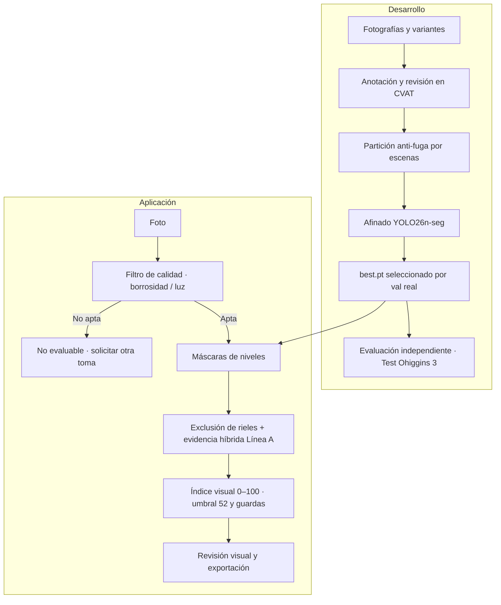
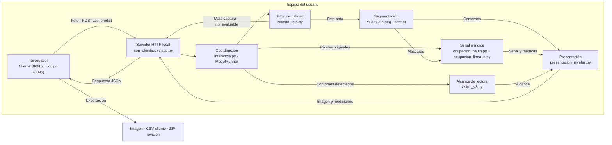

# 🛒 Walmart Computer Vision

**Análisis de disponibilidad en góndolas mediante visión por computador**

Proyecto Capstone de **DUOC UC** orientado a apoyar la inspección visual de góndolas a partir de fotografías. **Walmart Visión** reúne una app cliente y una mesa de revisión del equipo: ambas detectan niveles de góndola, delimitan su área útil y calculan un índice visual para ayudar a identificar posibles faltantes.

| 🚀 Probar la aplicación | 🎬 Demostración en video | 📖 Entender el proyecto | 🧪 Modelo y métricas |
|:---:|:---:|:---:|:---:|
| [**Descargar apps cliente y equipo**](https://github.com/vcanio/Capstone2026/releases/download/walmart-vision-apps-2026-11-13/Walmart_Vision_Cliente_y_Equipo_20261113.zip) | [**Ver video funcional (7 min)**](https://youtu.be/sN_6XPdxtKk) | [**Guía de funcionamiento**](Documentacion/Guia_para_entender_el_proyecto.md) | [**Modelo actual y métricas**](Documentacion/Modelo_V3_actual.md) |
| Windows x64 · Docker · [Notas de la versión](https://github.com/vcanio/Capstone2026/releases/tag/walmart-vision-apps-2026-11-13) | Recorrido V2; la interfaz V3 ya cambió | Niveles, ocupación y límites | V3 oficial · evaluación y límites |

[**App cliente**](Aplicacion_Cliente/README.md) · [**App del equipo**](Aplicacion/README.md) · [**Entregables**](Entregables/README.md) · [**Documentación**](Documentacion/README.md)

## Contenido

- [¿Qué hace el sistema?](#qué-hace-el-sistema)
- [Descarga e inicio rápido](#descarga-e-inicio-rápido)
- [Cómo se define un nivel](#cómo-se-define-un-nivel)
- [Cómo interpretar los resultados](#cómo-interpretar-los-resultados)
- [Modelo y evaluación](#modelo-y-evaluación)
- [Arquitectura](#arquitectura)
- [Datos y entrenamiento](#datos-y-entrenamiento)
- [Tecnologías](#tecnologías)
- [Documentación y estructura](#documentación-y-estructura)
- [Limitaciones y próximos pasos](#limitaciones-y-próximos-pasos)
- [Equipo y licencia](#equipo-y-licencia)

---

## ¿Qué hace el sistema?

A partir de una fotografía frontal de góndola, el sistema:

1. **Valida calidad básica:** [`calidad_foto.py`](Aplicacion/calidad_foto.py) filtra capturas severamente borrosas, oscuras o quemadas (`no_evaluable`) antes de inferir.
2. **Detecta y segmenta niveles:** delimita el área útil de cada repisa, incluidos los huecos sin producto.
3. **Analiza señal visual:** combina bordes, gradiente, color y textura dentro de cada máscara para estimar ocupación.
4. **Muestra alertas y facilita la revisión:** el cliente filtra alertas, guía la captura móvil en tres pasos, registra la revisión humana y exporta CSV; la app del equipo compara algoritmos ([Línea A vs basal experimental](Aplicacion/Documentacion/COMPARACION_BASAL_20261112.md)), marca errores y exporta lotes ZIP.

El sistema trabaja por repisa completa para ubicar faltantes visibles: **no cuenta unidades, no identifica SKU, no mide profundidad, no consulta inventario ni detecta personas o carros de forma automática**.

| Aplicación | Puerto | Público y uso principal |
|---|---:|---|
| **App cliente** | `8098` | Supervisores y reposición: alertas visuales, cámara móvil con selector de lente, revisión humana y CSV. |
| **App del equipo** | `8095` | Desarrollo y evaluación: comparación de ejecuciones y algoritmos, autocompletado por lotes, mapas, marcado por nivel/zona y lotes ZIP. |

---

## Descarga e inicio rápido

Descarga el paquete [**Walmart_Vision_Cliente_y_Equipo_20261113.zip**](https://github.com/vcanio/Capstone2026/releases/download/walmart-vision-apps-2026-11-13/Walmart_Vision_Cliente_y_Equipo_20261113.zip) ([notas y SHA-256](https://github.com/vcanio/Capstone2026/releases/tag/walmart-vision-apps-2026-11-13)), extrae **todo** el contenido y carga fotos propias (el dataset no se incluye).

> El paquete publicado incluye el modelo oficial **`V3-cierre-revisado-20261110`** y la regla **Línea A** (`linea_a_20261113_techo_y_panel_liso`). El filtro previo de calidad (`calidad_foto.py`) está integrado en el código fuente actual del repositorio.

### Windows x64

1. Ejecuta `Walmart_Vision/iniciar_cliente.cmd` (`8098`) o `Walmart_Vision/iniciar_equipo.cmd` (`8095`).
2. El primer inicio prepara Python 3.12 y sus dependencias dentro de la carpeta (requiere Internet). Mantén la consola abierta mientras uses la app.
3. Abre en el navegador [http://127.0.0.1:8098](http://127.0.0.1:8098) (cliente) o [http://127.0.0.1:8095](http://127.0.0.1:8095) (equipo).
4. Carga imágenes **JPG, PNG o WebP** de hasta **10 MB** y 24 megapíxeles.

### Docker (incluido macOS)

Desde la carpeta `Walmart_Vision` extraída (o desde la raíz de un clon con `compose.apps.yaml`):

```bash
docker compose -f compose.apps.yaml up --build -d --wait
```

Para detener ambas apps:

```bash
docker compose -f compose.apps.yaml down
```

La configuración de Compose está validada y la ejecución HTTP/CPU comprobada en Linux/Windows desde paquete limpio; queda pendiente la prueba física en macOS.

### Desde un clon del repositorio

En Windows, ejecuta `Aplicacion_Cliente/iniciar_cliente.cmd` o `Aplicacion/iniciar.cmd`. La confianza inicial de YOLO es **0,60** (fija en cliente; ajustable desde **0,25** en la app del equipo).

### Recomendaciones de captura y privacidad

- Usa tomas **frontales o casi frontales**, con ambos extremos del tramo visibles y evitando reflejos fuertes o desenfoque.
- Las fotos se procesan **localmente** en tu equipo y no se envían a servidores externos ni se añaden al entrenamiento.
- Cada navegador guarda localmente su sesión (`IndexedDB` en cliente, con botón *Limpiar pasillo* para borrarla). No hay sincronización entre equipos.
- Para probar sin fotos propias existe una [selección histórica de seis imágenes de ejemplo](https://drive.google.com/drive/folders/1z0-GNiRUJcVwbjLVkiDc20G2F8f9QASS?usp=sharing).

---

## Cómo se define un nivel

Un **nivel** es el área útil completa de una repisa dentro de un tramo de góndola, incluyendo tanto productos como huecos vacíos:

- **Base inferior:** superficie de apoyo del producto, **por encima del portaprecio** (excluye franja de precio y espesor frontal del estante).
- **Límite superior:** cara inferior de la repisa superior cuando existe. Si el último nivel es abierto y no tiene techo físico claro, las anotaciones proyectan la **mediana de altura** de los niveles inferiores del mismo tramo para mantener consistencia entre fotos llenas y vacías.
- **Laterales:** límites interiores del mismo tramo.

**Importante:** durante la inferencia, la app **no impone la mediana** de forma automática; YOLO predice sus propias máscaras y puede omitir o delimitar mal un nivel superior.

---

## Cómo interpretar los resultados

Los niveles se numeran **de abajo hacia arriba** (y de izquierda a derecha si comparten fila). La regla vigente (**Línea A**, `linea_a_20261113_techo_y_panel_liso`) calcula un índice visual de **0 a 100** con umbral **52**:

| Resultado | Significado |
|---|---|
| **Reponer** | Índice menor a 52 cuando la señal visual permite decidir. |
| **Suficiente** | Índice desde 52 sin señales de alerta; no certifica stock físico oculto. |
| **Revisar / Verificar** | Señal ambigua, contorno recortado o falta de medición; requiere revisar la foto. |
| **Sin niveles / No evaluable** | Captura bloqueada por baja calidad (`calidad_foto.py`) o sin niveles detectados; solicita otra toma. |

### Cómo funciona Línea A paso a paso

1. **Filtro previo de captura ([`calidad_foto.py`](Aplicacion/calidad_foto.py)):** evalúa nitidez (Laplaciano y Tenengrad) e iluminación extrema en HSV (`0` falsos rechazos en `294` capturas reales). Si la toma está severamente borrosa, oscura o quemada, la devuelve como `no_evaluable` antes de inferir.
2. **Segmentación y exclusión de rieles:** YOLO26n-seg obtiene las máscaras de cada repisa y [`ocupacion_paulo.py`](Aplicacion/ocupacion_paulo.py) lee los píxeles originales dentro de cada área, conservando Canny y excluyendo rieles/barandas horizontales.
3. **Normalización compartida y evidencia híbrida ([`ocupacion_linea_a.py`](Aplicacion/ocupacion_linea_a.py)):** normaliza `P10–P90` entre todos los niveles de la misma góndola, combina bordes, gradiente Sobel, saturación con respaldo textural (evita contar tableros lisos vacíos) y desviación local, además de descartar techo abierto sin producto.
4. **Penalización por hueco y guardas:** acota la lectura según el tramo vacío continuo más largo (`100 - max_gap_pct`), compara contra **52** y deriva a `Revisar` si hay recorte al encuadre (`near_frame` en [`vision_v3.py`](Aplicacion/vision_v3.py)) o señal ambigua.

Un valor como `70/100` indica evidencia visual de cobertura frontal, **no 70 % de inventario real**. En la app del equipo coexiste frente a la opción experimental **Basal** ([comparación](Aplicacion/Documentacion/COMPARACION_BASAL_20261112.md)).

[Línea A](Aplicacion/ocupacion_linea_a.py) · [Señal](Aplicacion/ocupacion_paulo.py) · [Filtro de calidad](Aplicacion/calidad_foto.py) · [Integración y límites](Aplicacion/Documentacion/LINEA_A_20261108.md)

---

## Modelo y evaluación

Ambas aplicaciones comparten el modelo oficial **`V3-cierre-revisado-20261110`** (`YOLO26n-seg`, clase única `Nivel`, SHA-256 `dc679fe73a7525dcffefe0381edfc39309d2ebe3f5115387100ae53cf4550af5`).

### Segmentación de niveles (`YOLO26n-seg`)

| Conjunto | Fotos | Niveles | mAP50 | mAP50–95 (M) | Emparejamiento (`conf = 0,60`) |
|---|---:|---:|---:|---:|---|
| Validación real | 11 | 55 | 99,50 % | 90,04 % | `54 TP, 0 FP, 1 FN` |
| **Test independiente (`Ohiggins 3`)** | **68** | **354** | **99,50 %** | **90,36 %** | **`354 TP, 0 FP, 0 FN`** (`68/68` exactos · `IoU` medio `93,90 %`) |

El test independiente de `Ohiggins 3` (`0` fotos en `train`/`val`) obtuvo `Precision 0,9991` y `Recall 1,0000`, con latencia media de `YOLO.predict` de **77,15 ms** en GPU (`GTX 1660 SUPER`) y **225,94 ms** en CPU (`AMD Ryzen 5 3600`, muestra de 15 fotos). El test histórico de 63 fotos quedó retirado tras incorporarse parte de sus escenas a entrenamiento.

### Clasificación de ocupación (`Línea A`, umbral 52)

Fijado en desarrollo (112 niveles con máscaras humanas: 15/16 alertas, 0 falsas alertas, 1/2 críticos reales) y validado en frío sobre **Ohiggins 3** (68 fotos no entrenadas, 354 niveles predichos por YOLO):

- **Por nivel:** Accuracy **97,74 %** · Precision **93,75 %** · Recall **83,33 %** · **F1 88,24 %** (`30 TP, 2 FP, 6 FN, 316 TN`).
- **Por foto completa:** Accuracy **92,65 %** · **F1 89,80 %**.
- **Latencia E2E (`YOLO + Línea A`):** **1.371,9 ms/foto** en GPU y **1.442,5 ms/foto** en CPU (muestra de 15 fotos).

[Evaluación en Ohiggins 3](Documentacion/Evidencias/evaluacion_test_ohiggins3_20261114.md) · [Ficha del modelo](Documentacion/Modelo_V3_actual.md) · [Registro de adopción](Documentacion/Evidencias/adopcion_cierre_revisado_20261110.md)

---

## Arquitectura

El entrenamiento y la inferencia están desacoplados: CVAT, el laboratorio interno de entrenamiento y los datasets **no son dependencias** de las aplicaciones distribuidas.



### Flujo interno de las aplicaciones

Ambas interfaces locales comparten `inferencia.py`, el modelo oficial y el motor de ocupación:



---

## Datos y entrenamiento

- **Último afinado (`V3-cierre-revisado-20261110`):** 40 épocas con **256 imágenes de entrenamiento** (203 reales y 53 sintéticas; **1.298 polígonos**) y **11 fotos reales de validación** (55 polígonos, 3 escenas).
- **Procedencia acumulada:** el peso proviene de **tres etapas propias** sobre el preentrenamiento general de `yolo26n-seg.pt`, reuniendo **519 fuentes distintas de entrenamiento por SHA-256** (299 reales y 220 sintéticas).
- **Partición y herramientas:** originales y variantes sintéticas se agrupan por escena y familia para evitar fugas entre `train`, `val` y `test`. Las anotaciones se realizaron en **CVAT** (clase única `Nivel`), con apoyo de un laboratorio interno para preparar particiones, entrenar y seguir métricas, y de la app del equipo para inspección visual. La revisión visual complementa las métricas, pero no equivale a mAP ni recall.

[Catálogo del modelo oficial](Documentacion/Evidencias/catalogo_modelo_oficial_cierre_20261110.json) · [Metodología de desarrollo y revisión](Documentacion/Metodologia_desarrollo_y_revision.md)

---

## Tecnologías

| Tecnología | Rol en el proyecto |
|---|---|
| **YOLO26n-seg** | Segmentación de instancias para localizar cada `Nivel` con su perspectiva. |
| **PyTorch + Ultralytics** | Entrenamiento fino e inferencia local. |
| **OpenCV + NumPy** | Extracción de bordes, gradiente, color, textura, calidad de captura y exclusión de rieles. |
| **Pillow** | Lectura de imágenes, corrección EXIF y renderizado de contornos/rótulos. |
| **Python + HTML/CSS/JS** | Servidores HTTP locales e interfaces web sin dependencias externas durante el uso. |
| **Docker** | Empaquetado multiplataforma para ejecución aislada. |
| **CVAT** | Anotación y revisión geométrica de polígonos durante el desarrollo. |

---

## Documentación y estructura

| Carpeta / Recurso | Contenido |
|---|---|
| [`Aplicacion/`](Aplicacion/README.md) | Mesa del equipo (`8095`), motor compartido, modelo oficial y pruebas ([guía de revisión](Aplicacion/Documentacion/REVISION_EQUIPO.md)). |
| [`Aplicacion_Cliente/`](Aplicacion_Cliente/README.md) | App cliente (`8098`), filtros de alertas, cámara móvil, revisión humana, CSV y pruebas. |
| [`Documentacion/`](Documentacion/README.md) | [Manual de uso](Documentacion/Usar_Walmart_Vision.md), [guía funcional](Documentacion/Guia_para_entender_el_proyecto.md), [modelo V3](Documentacion/Modelo_V3_actual.md), [metodología](Documentacion/Metodologia_desarrollo_y_revision.md) y [planificación](Documentacion/Planificacion_y_metodologia.md). |
| [`Entregables/`](Entregables/README.md) | Releases publicados, paquetes descargables y entregas académicas. |
| [`Fase 1/`](Fase%201/) · [`Fase 2/`](Fase%202/) | Material académico de etapas anteriores conservado en su ubicación original. |

### Material de demostración

- 🎬 [**Demostración funcional en video (7 min)**](https://youtu.be/sN_6XPdxtKk): recorrido de la versión anterior V2 (la interfaz V3 actual ya cambió).
- 🖼️ [**Imágenes de ejemplo**](https://drive.google.com/drive/folders/1z0-GNiRUJcVwbjLVkiDc20G2F8f9QASS?usp=sharing): selección histórica real y sintética para pruebas rápidas.

---

## Limitaciones y próximos pasos

- **Estantes inferiores con toma picada:** `4/6 FN` de Línea A en `Ohiggins 3` ocurrieron en el nivel inferior (`N5`/`N6`) en ángulo picado sin hueco limpio (`max_gap_pct = 0,0 %`); carteles, fondos y envases lisos también pueden confundir la señal.
- **Oclusiones por personas o carros:** [`calidad_foto.py`](Aplicacion/calidad_foto.py) filtra borrosidad y luz extrema, pero aún no existe detector automático para personas o carros tapando niveles.
- **Niveles superiores y nuevas categorías:** algunas escenas concretas (`le_g10` fotos 029/030) presentan errores en el superior, y conviene sumar más escenas independientes de categorías como papeles y huevos.
- **Persistencia compartida y macOS:** queda pendiente añadir historial persistente en servidor (SQLite) en la app cliente y validar físicamente la entrega conjunta en macOS.

---

## Equipo y licencia

**Capstone DUOC UC · 2026** — Desarrollo: **Vicente Canio**, **Paulo Guerra** y **Vicente Vilches** · Docente: **Arturo Vargas**.

El código original del equipo se distribuye bajo [AGPL-3.0-only](LICENSE) ([alcance, autoría de datos y pesos](LICENCIAS.md) · [avisos de terceros](NOTICE.md)). Las fotografías y anotaciones mantienen su autoría y no reciben licencia pública mediante este repositorio.
