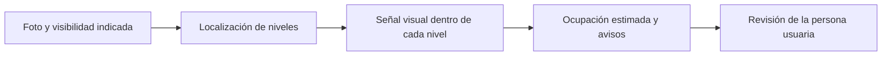

# Walmart Visión

Walmart Visión ayuda a revisar la disponibilidad visual de una góndola a partir de una fotografía. Localiza sus niveles y estima qué parte del área visible presenta señal de producto, para orientar la revisión de posibles faltantes.

> **Estado al 26 de octubre de 2026:** la versión actual es **V3**, integrada y en pruebas locales. Su nueva release todavía no se ha publicado. Las descargas existentes corresponden a versiones anteriores.

[Cómo usar la app](Documentacion/Usar_Walmart_Vision.md) · [Cómo funciona](Documentacion/Guia_para_entender_el_proyecto.md) · [Modelo actual](Documentacion/Modelo_V3_actual.md)

## Usar la app

Con el paquete V3 preparado por el equipo:

1. Abre Walmart Visión y selecciona una foto JPG, PNG o WebP.
2. Indica si la góndola se ve completa, recortada o tapada.
3. Pulsa **Analizar foto**.
4. Revisa los contornos, la ocupación estimada y los avisos de cada nivel.

El modelo y el método de análisis ya están configurados. La interfaz usa siempre niveles y detección de bordes, con confianza fija 0,60. Las fotografías se procesan localmente en memoria y no se incorporan al entrenamiento.

La [guía de uso](Documentacion/Usar_Walmart_Vision.md) explica el inicio en Windows y la ejecución con Docker. No hace falta instalar el laboratorio ni CVAT para utilizar el paquete de la app.

## Cómo funciona

El modelo **YOLO26n-seg V3** delimita una sola clase: **Nivel**. Después, otro procesamiento analiza bordes, color y textura dentro de sus máscaras. Esa señal combina superficie y cobertura horizontal para obtener una estimación de ocupación.

Las etiquetas **Reponer**, **Suficiente** y **Revisar** se generan al interpretar esa estimación y la visibilidad indicada. El modelo de niveles no aprende directamente esas decisiones.

## Qué muestran los resultados

| Resultado | Cómo interpretarlo |
|---|---|
| **Niveles** | Contornos numerados de abajo hacia arriba, con ocupación estimada o aviso. |
| **Reponer / Suficiente** | Lectura experimental: menos del 30 % / desde el 30 %, para el área detectada con visibilidad confirmada. |
| **Revisar** | Hay recorte, señal ambigua u otra limitación que impide confirmar el resultado completo. |
| **Góndola tapada** | La persona usuaria indicó que una persona tapa la góndola; se pide otra foto y no se muestran mediciones. |
| **Bordes** | Vista opcional para inspeccionar qué señales utiliza el cálculo. |
| **Comparar** | Foto original y resultado para comprobar los contornos. |

El **mapa de señal** marca en amarillo zonas con bordes, color o textura. Un cartel o el fondo también pueden activarlo: el amarillo no confirma que haya productos. La app pide revisión cuando casi toda la señal se concentra en la franja superior, como puede ocurrir con un cartel.

## Modelo y datos actuales

La app local utiliza únicamente el **best.pt del afinado V3 de papeles, huevos y superiores vacíos**. El último afinado empleó **113 fotos de entrenamiento**. El catálogo V3 contiene **469 imágenes**, organizadas por escenas y familias en **337 train / 69 val / 63 test**; una imagen train está desactivada.

La reserva de 63 fotos de test permanece sin utilizar. Los resultados de segmentación y el alcance del entrenamiento se explican en la [ficha del modelo](Documentacion/Modelo_V3_actual.md). No son una medición de la precisión de ocupación o reposición.

## Tecnologías

| Tecnología | Función en la app actual |
|---|---|
| **YOLO26n-seg · PyTorch · Ultralytics** | Localizar y segmentar niveles. |
| **OpenCV · NumPy** | Analizar bordes, color y textura dentro de cada nivel. |
| **Pillow** | Leer, orientar y presentar fotografías y resultados. |
| **Python · HTML/CSS/JavaScript** | Procesamiento local e interfaz de navegador. |
| **Docker** | Alternativa de ejecución incluida en el paquete. |

## Límites actuales

- La ocupación es experimental y sigue pendiente de calibración para V3. No cuenta unidades, no identifica SKU ni consulta inventario.
- La visibilidad se confirma manualmente. No hay detección automática de personas u obstáculos.
- Una foto recortada permite medir solo lo visible. Sin detecciones se solicita otra foto; no se interpreta como góndola vacía.
- La mediana se usó para anotar superiores abiertos; no se aplica como corrección obligatoria durante la predicción.
- Persisten dos incidencias conocidas en superiores de la familia `le_g10`: 029 sobredelimitada y 030 omitida.
- La instalación en otro equipo físico y en macOS continúa pendiente de comprobación para esta versión.

## Documentación

[Manual de uso](Documentacion/Usar_Walmart_Vision.md) · [Explicación del funcionamiento](Documentacion/Guia_para_entender_el_proyecto.md) · [Ficha del modelo](Documentacion/Modelo_V3_actual.md) · [Estado de la distribución](Entregables/README.md)

El [índice de documentación](Documentacion/README.md) reúne el material técnico y académico. La instalación del laboratorio se mantiene como consulta para el equipo de desarrollo.

## Equipo

Proyecto Capstone DUOC UC · 2026.

**Desarrollo:** Vicente Canio, Paulo Guerra y Vicente Vilches.  
**Docente:** Arturo Vargas.
