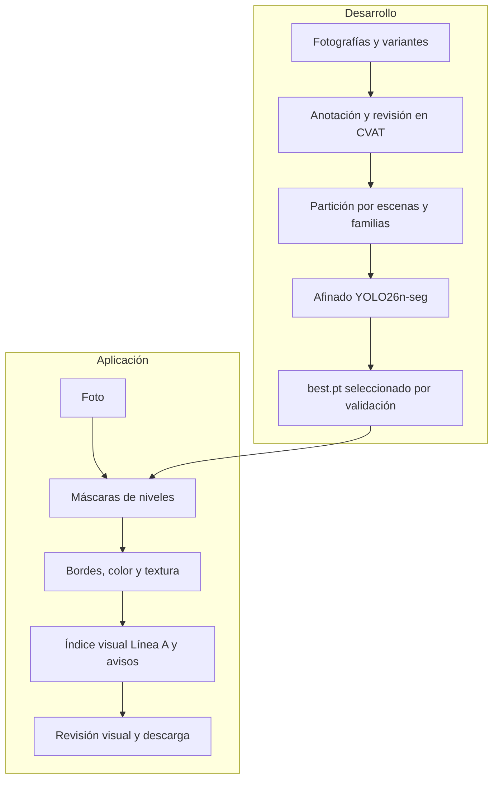
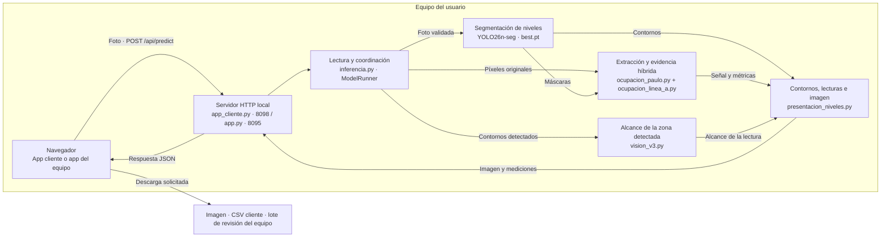

# 🛒 Walmart Computer Vision

**Análisis de disponibilidad en góndolas mediante visión por computador**

Estado documental actualizado al **14 de noviembre de 2026** · proyecto académico · versión de prueba con cierre V3 y evaluación independiente en `Ohiggins 3`.

Proyecto Capstone de **DUOC UC** orientado a apoyar la inspección visual de góndolas a partir de fotografías. **Walmart Visión** reúne una app cliente y una mesa de revisión del equipo. Ambas identifican los niveles, delimitan sus áreas útiles y calculan un índice visual para ayudar a revisar posibles faltantes.

| 🚀 Probar la aplicación | 🎬 Demostración en video | 📖 Entender el proyecto | 🧪 Explorar los resultados |
|:---:|:---:|:---:|:---:|
| [**Descargar apps cliente y equipo**](https://github.com/vcanio/Capstone2026/releases/download/walmart-vision-apps-2026-11-13/Walmart_Vision_Cliente_y_Equipo_20261113.zip) | [**Ver video funcional (7 min)**](https://youtu.be/sN_6XPdxtKk) | [**Guía de funcionamiento**](Documentacion/Guia_para_entender_el_proyecto.md) | [**Modelo actual y métricas**](Documentacion/Modelo_V3_actual.md) |
| Windows x64 · Docker · [Release del 13/11](https://github.com/vcanio/Capstone2026/releases/tag/walmart-vision-apps-2026-11-13) | Recorrido de la versión anterior V2; la interfaz V3 ya cambió | Niveles, ocupación, señal y visibilidad | Último afinado V3 · evaluación y límites |

## Entrega de cliente y equipo · 13 de noviembre

[**Descargar ambas apps con el modelo**](https://github.com/vcanio/Capstone2026/releases/download/walmart-vision-apps-2026-11-13/Walmart_Vision_Cliente_y_Equipo_20261113.zip) · [Notas y SHA-256](https://github.com/vcanio/Capstone2026/releases/tag/walmart-vision-apps-2026-11-13).

Extrae todo. Windows x64: `Walmart_Vision/iniciar_cliente.cmd` (8098) o `Walmart_Vision/iniciar_equipo.cmd` (8095). El primer inicio prepara Python/dependencias y requiere Internet. Docker: `docker compose -f compose.apps.yaml up --build -d --wait` desde `Walmart_Vision`.

[App cliente](Aplicacion_Cliente/README.md): alertas visuales, navegación móvil en tres pasos, selector de lente trasera, revisión humana y CSV. [App del equipo](Aplicacion/Documentacion/REVISION_EQUIPO.md): comparación de ejecuciones y algoritmos ([Línea A vs basal experimental](Aplicacion/Documentacion/COMPARACION_BASAL_20261112.md)), marcado por nivel/zona y lotes de revisión. Cada colega ejecuta su copia local; no hay sincronización ni alojamiento web. Carga fotos propias: el dataset no se incluye.

La entrega del 13/11 incluye **V3-cierre-revisado-20261110**, el único modelo oficial vigente compartido por ambas apps, la revisión **Línea A (`linea_a_20261113_techo_y_panel_liso`)** —con filtro textural para tableros lisos, descarte de techo abierto sin producto y conservación de extremos vacíos en estantes inclinados—, la app cliente (12/11) y la mesa de revisión del equipo actualizada (`interfaz.html` y autocompletado dual por lotes). El peso se identifica por su SHA-256 en la [ficha vigente](Documentacion/Modelo_V3_actual.md). Línea A (predeterminada en ambas apps, umbral 52) quedó evaluada el 14/11 en el test ciego de **Ohiggins 3** (68 fotos, 354 niveles): **F1 88,24 %** por nivel (**Accuracy 97,74 %**) y **F1 89,80 %** por foto ([evidencia completa](Documentacion/Evidencias/evaluacion_test_ohiggins3_20261114.md)). La opción basal en la app del equipo es experimental (umbral 30 %, sin calibrar). No miden porcentaje físico de stock ni detectan personas u obstáculos de forma automática.

## Explorar las carpetas

[**App cliente**](Aplicacion_Cliente/README.md) · [**App del equipo**](Aplicacion/README.md) · [**Modelo vigente**](Documentacion/Modelo_V3_actual.md) · [**Entregables**](Entregables/README.md) · [**Documentación**](Documentacion/README.md)

El repositorio se centra en las dos apps, el modelo oficial y su documentación. CVAT y el laboratorio GPU se explican en la [metodología](Documentacion/Metodologia_desarrollo_y_revision.md); sus fuentes anteriores siguen accesibles en el [archivo del desarrollo](Documentacion/Archivo_del_desarrollo.md). Fase 1 y Fase 2 permanecen intactas.

## Contenido

- [¿Qué hace el sistema?](#qué-hace-el-sistema)
- [Inicio rápido: Walmart Visión](#inicio-rápido-walmart-visión)
- [Qué consideramos un nivel](#qué-consideramos-un-nivel)
- [Interpretar los resultados](#interpretar-los-resultados)
- [Modelo actual y resultados](#modelo-actual-y-resultados)
- [Arquitectura y funcionamiento](#arquitectura-y-funcionamiento)
- [Datos y entrenamiento](#datos-y-entrenamiento)
- [Tecnologías](#tecnologías)
- [Decisiones técnicas y alternativas](#decisiones-técnicas-y-alternativas)
- [Documentación y recursos](#documentación-y-recursos)
- [Estado actual de la implementación](#estado-actual-de-la-implementación)
- [Limitaciones y próximos pasos](#limitaciones-y-próximos-pasos)
- [Equipo](#equipo)
- [Licencia y autoría](#licencia-y-autoría)

---

## ¿Qué hace el sistema?

El objetivo es **facilitar la revisión de niveles con posibles faltantes visibles**. A partir de una fotografía, el sistema:

1. **Detecta** cada nivel y **segmenta** su área útil, incluidos los espacios sin producto.
2. **Analiza** bordes, color y textura dentro de los niveles detectados.
3. **Estima** la ocupación visual y señala posibles necesidades de reposición.
4. **Muestra** contornos, índices y avisos para que una persona revise el resultado.
5. **Organiza el trabajo:** el cliente filtra alertas, registra la revisión humana y genera una hoja CSV; el equipo compara resultados, marca fallos y exporta lotes de revisión.

Trabajamos por nivel de góndola para ubicar posibles faltantes en una repisa completa. El sistema **no cuenta unidades, no identifica SKU, no mide profundidad ni consulta inventario**.

Las dos apps comparten motor y modelo:

| Componente | Para qué sirve | Público |
|---|---|---|
| **App cliente · 8098** | Consultar alertas, revisar niveles, registrar la revisión humana y descargar hoja CSV. | Supervisores y equipos de reposición, en pruebas. |
| **App del equipo · 8095** | Comparar análisis, revisar bordes, marcar fallos por nivel/zona y exportar lotes ZIP. | Equipo de desarrollo y evaluadores. |

**Para usar la app no necesitas instalar el laboratorio ni CVAT.**

## Inicio rápido: Walmart Visión

La entrega actual es la [**release de cliente y equipo del 13/11**](https://github.com/vcanio/Capstone2026/releases/tag/walmart-vision-apps-2026-11-13). Incluye ambas apps, un único modelo oficial y los textos de licencia. Cada persona ejecuta su copia local; GitHub distribuye los archivos y no aloja un servicio de análisis ni sincroniza sesiones.

### Windows x64

1. Descarga [Walmart_Vision_Cliente_y_Equipo_20261113.zip](https://github.com/vcanio/Capstone2026/releases/download/walmart-vision-apps-2026-11-13/Walmart_Vision_Cliente_y_Equipo_20261113.zip) y extrae **todo** el contenido.
2. Abre `Walmart_Vision/iniciar_cliente.cmd` para la app cliente, o `Walmart_Vision/iniciar_equipo.cmd` para la app del equipo.
3. El primer inicio prepara Python 3.12 y las dependencias dentro de la carpeta; necesita Internet. Deja abierta la consola mientras uses la app.
4. Carga fotos JPG, PNG o WebP de hasta **10 MB cada una** y 24 megapíxeles. Revisa los contornos y la visibilidad antes de interpretar la lectura.

| Aplicación | Dirección | Flujo principal |
|---|---|---|
| Cliente | [http://127.0.0.1:8098](http://127.0.0.1:8098) | Alertas visuales, detalle por nivel, revisión humana y CSV. |
| Equipo | [http://127.0.0.1:8095](http://127.0.0.1:8095) | Original/Niveles/Bordes/Comparar, marcado por nivel o zona y lotes ZIP. |

En ambas apps la confianza inicial de YOLO es **0,60**. El cliente la usa preconfigurada; la app del equipo permite ajustarla desde **0,25**. No es el índice visual ni una medida de stock.

### Docker, incluido macOS

Con Docker Desktop abierto, desde la carpeta `Walmart_Vision` extraída:

```bash
docker compose -f compose.apps.yaml up --build -d --wait
```

Abre las dos direcciones de la tabla. Para detener ambas apps:

```bash
docker compose -f compose.apps.yaml down
```

La entrega del 11/11 se comprobó mediante HTTP e inferencia CPU de ambas apps desde una extracción limpia, con una foto de train y cinco niveles por app. Se validó Compose; no se construyó Docker ni se probó físicamente en Mac porque el daemon estaba apagado. [Evidencia y alcance](Documentacion/Evidencias/alineacion_github_20261111.json). Las pruebas de macOS de releases anteriores siguen siendo antecedentes, no una verificación nueva de esta entrega.

### Desde un clon

El repositorio incluye el peso oficial y el preparador Windows. Ejecuta `Aplicacion_Cliente/iniciar_cliente.cmd` o `Aplicacion/iniciar.cmd`. En Docker, ejecuta el comando anterior desde la raíz del clon, donde está `compose.apps.yaml`.

### Fotografías y privacidad

Toma fotos **frontales o casi frontales**, con la cámara nivelada, ambos extremos del tramo y las superficies de apoyo visibles. Evita desenfoque, reflejos fuertes y tomas oblicuas. Para una góndola larga, utiliza varias tomas de tramos completos. No existe un ángulo máximo validado ni un detector automático que certifique la visibilidad.

Las fotos se procesan en el equipo y no se incorporan al entrenamiento. La app del equipo guarda la sesión del lote en el navegador local y permite eliminarla; el cliente conserva fotos, resultados y revisión humana por foto en IndexedDB y los recupera al recargar. «Limpiar pasillo» borra definitivamente ese recorrido guardado. No hay sincronización entre computadores. Para devolver observaciones del modelo se comparte manualmente el lote ZIP exportado por la app del equipo.

El dataset y el catálogo local de demostración no vienen en el ZIP: carga fotos propias. Hay una [selección histórica de seis imágenes de ejemplo](https://drive.google.com/drive/folders/1z0-GNiRUJcVwbjLVkiDc20G2F8f9QASS?usp=sharing), tres reales y tres sintéticas, para explorar casos de la demostración anterior; no acredita precisión de la versión actual.

[Guía cliente](Aplicacion_Cliente/README.md) · [Guía de revisión del equipo](Aplicacion/Documentacion/REVISION_EQUIPO.md) · [Descargas e historial](Entregables/README.md).

## ¿Qué consideramos un nivel?

Un **nivel** es el área útil de una repisa donde pueden existir **productos y huecos**. Se dibuja un polígono para el espacio completo del mismo tramo de góndola, siguiendo su perspectiva; no se dibuja una máscara por envase ni solo la banda frontal del estante.

| Límite | Criterio de anotación |
|---|---|
| Inferior | Superficie donde apoyan los productos, **por encima del portaprecio**. Se excluyen la franja del precio y el espesor frontal del estante. |
| Superior, cuando existe | Cara inferior de la repisa o cubierta física que cierra el espacio. |
| Laterales | Límites interiores del mismo tramo; no se amplía la zona hasta pilares, suelo u otras góndolas. |
| Huecos | Forman parte del área útil, aunque no haya productos. Un nivel vacío sigue siendo un nivel. |

La región se define por la estructura y la convención de anotación, sin ajustarla a la altura de los envases. Un cartel o panel sin una superficie de apoyo asociada no crea otro nivel. Las barandas que atraviesan un nivel pueden quedar dentro de su región y deben tratarse en el análisis de señal; su exclusión automática todavía es imperfecta.

### Superior abierto: por qué acordamos usar la mediana

En una repisa superior sin techo claro era difícil fijar un límite consistente: una persona podía seguir las tapas de los envases, otra un cartel y otra una altura elegida a ojo. Al retirar los productos, esas referencias desaparecían y el mismo nivel lleno o vacío podía terminar con áreas diferentes. Eso introduce una contradicción en los ejemplos usados para enseñar al modelo.

La solución acordada fue una **convención de anotación reproducible**:

1. Si hay una cubierta o un límite físico superior claro, se respeta.
2. Si falta, se miden las alturas verticales de los niveles inferiores del **mismo tramo**. Con perspectiva se mide la altura en el centro de cada polígono.
3. Se calcula la **mediana**, conservando decimales. Con cuatro referencias de 190, 195, 210 y 220 píxeles, la mediana es **202,5 píxeles**.
4. Desde el apoyo del superior, situado **sobre el portaprecio**, se proyecta esa altura hacia arriba. No se utiliza como base, sin comprobarlo, el borde del polígono de abajo: puede representar la cara inferior del estante.
5. Se mantiene el criterio en el original y sus variantes llenas o vacías. Si la proyección sale de la foto, se recorta al encuadre y se marca **parcial**; no se reduce la altura para hacerla caber.

La mediana reduce la influencia de una altura inferior excepcional frente a un promedio simple. **No demuestra la altura física real de un espacio abierto:** fija una región comparable para anotar. Se utilizan habitualmente al menos tres inferiores medibles; las excepciones autorizadas con dos referencias son casos documentados, no una regla general.

**La app no recalcula ni fuerza la mediana al analizar una foto.** YOLO predice sus propias máscaras a partir de lo aprendido; puede omitir un superior o delimitarlo mal. Esos errores se conservan como limitaciones y deben revisarse visualmente.

[Criterio de anotación V3](Documentacion/Criterio_de_niveles.md) · [Regla completa de mediana](Documentacion/Criterio_de_niveles.md)

## Interpretar los resultados

Los niveles se numeran **de abajo hacia arriba** y de izquierda a derecha cuando comparten fila. La versión actual usa **Línea A**, revisión `linea_a_20261113_techo_y_panel_liso`, para un índice visual de **0 a 100**, con umbral **52**.

| Resultado | Significado |
|---|---|
| **Reponer** | Índice menor a 52, cuando la señal permite decidir. |
| **Suficiente** | Índice desde 52, sujeto a las reglas de revisión; no certifica stock físico. |
| **Revisar / Verificar** | Señal ambigua, contorno recortado o falta de medición; requiere revisión humana. |
| **Sin niveles detectados** | Se solicita otra toma. No detectar un nivel no significa que esté vacío. |

La app cliente presenta alertas visuales y permite registrar una revisión humana independiente del análisis. La app del equipo conserva el detalle técnico, los mapas y las herramientas de revisión. Los mensajes sobre huecos o frentes son interpretaciones de señal visible y requieren comprobar la foto.

### Cómo se obtiene el índice

1. **YOLO delimita niveles** mediante máscaras. El análisis utiliza los píxeles originales dentro de esas áreas, sin medir los colores o rótulos dibujados sobre el resultado.
2. **Se extraen bordes, gradiente, color y textura.** Se conserva Canny y la exclusión estructural de rieles para reducir su contribución a la señal.
3. **Línea A comparte la normalización entre niveles de la misma góndola**, combina evidencia híbrida y penaliza huecos continuos.
4. **Se aplican las guardas de señal ambigua y de encuadre.** Cuando la lectura lo permite, se compara el índice con 52; en los casos ambiguos se solicita revisión.

El fucsia de la vista Bordes representa la evidencia visual combinada. No confirma por sí mismo la presencia de producto. El índice no cuenta unidades, no reconstruye profundidad ni mide el inventario detrás de lo visible. Un valor 70/100 **no significa 70 % físico de stock**. La confianza YOLO de 0,60 es otro parámetro.

[Implementación portable de Línea A](Aplicacion/ocupacion_linea_a.py) · [Extracción de señal](Aplicacion/ocupacion_paulo.py) · [Integración y límites](Aplicacion/Documentacion/LINEA_A_20261108.md).

### Evidencia disponible y límites

El umbral **52** se fijó en desarrollo (112 niveles con máscaras humanas: 15/16 alertas, 0 falsas alertas, 1/2 críticos reales) y se validó en frío el **14/11** en evaluación ciega sobre **Ohiggins 3** (68 fotos independientes, 354 niveles predichos por YOLO): **Accuracy 97,74 %**, **Precision 93,75 %**, **Recall 83,33 %** y **F1 88,24 %** por nivel (**30 TP, 2 FP, 6 FN, 316 TN**), y **F1 89,80 %** por foto completa (**92,65 %** accuracy). Latencia E2E promedio en producción (`YOLO + Línea A`): **1.371,9 ms/foto** en GPU (`GTX 1660 SUPER`) y **1.442,5 ms/foto** en CPU (`AMD Ryzen 5 3600`, muestra 15 fotos). Ver [evaluación completa](Documentacion/Evidencias/evaluacion_test_ohiggins3_20261114.md).

Carteles, fondos, barandas, productos lisos y niveles inferiores en ángulo picado (`4/6 FN` en `N5/N6` con `max_gap_pct = 0,0 %`) todavía pueden confundir la señal. Las guardas de ambigüedad no son detectores automáticos de personas, obstáculos o carteles. El modelo tampoco determina si la góndola está completa.

## Modelo actual y resultados

Ambas apps comparten un único modelo oficial: **`V3-cierre-revisado-20261110`**, el `best.pt` del cierre con contornos revisados adoptado el 10 de noviembre. Su clase aprendida es **Nivel**; la ocupación se calcula después mediante Línea A (evaluada el 14/11 sobre `Ohiggins 3`).

| Modelo vigente | Último afinado | Validación | Test independiente (`Ohiggins 3`) | Distribución |
|---|---|---|---|---|
| YOLO26n-seg V3 · cierre revisado 10/11 | 256 fotos, 40 épocas | 11 reales de tres escenas | 68 fotos / 354 niveles (`0` en train) | Release de cliente y equipo del 13/11 |

| Máscaras | Fotos | Niveles | mAP50 | mAP50–95 (M) | Emparejamiento operativo (`conf = 0,60`) |
|---|---:|---:|---:|---:|---|
| Validación real | 11 | 55 | 99,50 % | 90,04 % | 54 TP, 0 FP, 1 FN |
| **Test independiente (`Ohiggins 3`)** | **68** | **354** | **99,50 %** | **90,36 %** | **354 TP, 0 FP, 0 FN** (`68/68` exactos · `IoU` media `0,9390`) |

El test histórico de **63 fotos** (`v3_458_20261023`) quedó formalmente retirado el 14/11 (19 entraron a `train` y 44 pertenecen a escenas ya vistas sin polígonos CVAT), reemplazado por las 68 fotos independientes de **Ohiggins 3** (`task 47 / job 94` en CVAT). La latencia media de `YOLO.predict` fue **77,15 ms** en GPU y **225,94 ms** en CPU (muestra 15 fotos). La adopción no certifica ausencia de errores en escenas nuevas (`R065` conserva una omisión superior en diagnóstico de train).

SHA-256 del peso: `dc679fe73a7525dcffefe0381edfc39309d2ebe3f5115387100ae53cf4550af5`.

[Evaluación test Ohiggins 3 (14/11)](Documentacion/Evidencias/evaluacion_test_ohiggins3_20261114.md) · [Ficha del modelo](Documentacion/Modelo_V3_actual.md) · [Adopción y verificación de ambas apps](Documentacion/Evidencias/adopcion_cierre_revisado_20261110.md).

## Arquitectura y funcionamiento

Separamos **aprender a localizar niveles** de **analizar una fotografía nueva**:



El modelo conserva sus máscaras originales. La estimación se calcula sobre los píxeles de la foto dentro de esas áreas; no sobre los contornos coloreados ni los rótulos dibujados en el resultado.

En las anotaciones, el superior abierto se delimita por la mediana de las alturas inferiores cuando no hay un techo físico claro. **La app no impone esa mediana durante la predicción**: el modelo puede desviarse del criterio aprendido.

[Explicación del funcionamiento](Documentacion/Guia_para_entender_el_proyecto.md) · [Criterio de niveles V3](Documentacion/Criterio_de_niveles.md) · [Regla de mediana](Documentacion/Criterio_de_niveles.md)

### Componentes de la aplicación

Las dos apps funcionan en el equipo del usuario. Sus servidores HTTP locales comparten `inferencia.py`, el modelo oficial y Línea A. El cliente filtra alertas, registra revisión humana y exporta CSV; la mesa del equipo permite comparar, registrar fallos y exportar lotes de revisión.



El diagrama representa las responsabilidades y los datos que intercambian los módulos. `ModelRunner` localiza niveles y calcula la señal visual; la persona debe revisar obstáculos y zonas tapadas. La presentación combina geometría, métricas y alcance para mostrar la lectura final. La descarga del resultado es una acción del usuario. La mesa del equipo conserva la sesión del lote en el navegador local. El cliente conserva el recorrido por foto en el navegador y lo recupera al recargar. Los archivos se comparten solo cuando el usuario los exporta y entrega.

CVAT, las particiones y el entrenador pertenecen al flujo de desarrollo del primer diagrama. **No son dependencias del visor durante la inferencia**: la app distribuida incluye el modelo y los módulos que necesita para analizar fotos.

## Datos y entrenamiento

### Datos del modelo vigente

El último afinado utilizó **256 imágenes de entrenamiento: 203 reales y 53 sintéticas**, con **1.298 polígonos**. Su validación contiene **11 fotos reales y 55 polígonos**. Las escenas y familias conservan las asignaciones documentadas; las fotos incorporadas a train dejan de ser validación independiente.

El peso deriva de **tres etapas de entrenamiento propias**, además del preentrenamiento general de `yolo26n-seg.pt`. La cadena reúne **519 fuentes distintas de train por SHA-256: 299 reales y 220 sintéticas**. Las 256 del último ensayo no representan toda su experiencia previa; estas cifras tampoco cuentan escenas independientes, aumentos internos ni preentrenamiento general.

[Catálogo vigente y alcance del recuento](Documentacion/Evidencias/catalogo_modelo_oficial_cierre_20261110.json) · [Entrenamiento, procedencia y límites](Documentacion/Entrenamiento_y_datos.md).

### Autoría, anotación y preparación

Las fotografías originales fueron tomadas por el equipo y las anotaciones fueron realizadas por el equipo usando CVAT, según lo confirmado por Vicente. El corpus incluye variantes sintéticas identificadas como tales. Se conservan los registros de revisión y las correcciones asistidas de geometría. [Autoría y condiciones de datos/pesos](LICENCIAS.md).

1. **Inventario y procedencia.** Se registran nombres, dimensiones y SHA-256. Las variantes y las vistas relacionadas se agrupan; un archivo diferente no se trata automáticamente como una escena independiente.
2. **Anotación y revisión en CVAT.** Una clase `Nivel`, con polígonos del área útil completa, incluidos los huecos. Los atributos de delimitación y oclusión registran revisión; no son clases que YOLO prediga. Se aplica el apoyo sobre el portaprecio y la mediana para el superior abierto cuando corresponde.
3. **Selección y exclusiones.** Se utilizan las decisiones y listas de la preparación congelada. Las fotos dudosas, desactivadas o excluidas no se incorporan por figurar en un catálogo más amplio.
4. **Separación por escenas.** Originales, variantes y vistas relacionadas conservan las asignaciones documentadas. Validación real y sintética se informan por separado. Sus métricas no se comparan directamente con agregados de otra partición histórica.
5. **Preparación reproducible.** Se exportan las imágenes y polígonos incluidos con sus hashes. La orientación EXIF se resuelve en copias de preparación, conservando los originales. No se abren los píxeles de test para preparar o ajustar los ensayos.

Las nuevas fotos y revisiones no cambian por sí solas el modelo publicado. Requieren una selección y preparación posteriores; **solo Vicente inicia entrenamiento desde el panel**. Las fotos cargadas en las apps no se incorporan automáticamente al entrenamiento. El dataset completo sigue fuera de la distribución pública de las apps.

### Herramientas internas de desarrollo y revisión

El equipo utilizó **CVAT para marcar y revisar los niveles mediante polígonos de la clase `Nivel`**. Se construyó además un **laboratorio interno con interfaz visual** para preparar datos, configurar los entrenamientos y seguir métricas, curvas y resultados de los ensayos. Se utilizó la GPU propia para entrenar sin depender de Colab. Sus fuentes y registros se conservan en una revisión histórica; no son dependencias de las apps actuales.

Las predicciones del modelo se inspeccionaron en la **app de revisión del equipo**, comparando fotos y contornos y registrando errores por nivel o zona. Esta revisión visual complementa la evaluación cuantitativa; no equivale a mAP o recall ni demuestra por sí sola exactitud de ocupación. [Metodología de desarrollo y revisión](Documentacion/Metodologia_desarrollo_y_revision.md).

La preparación y la revisión de datos no certifican por sí solas la precisión de ocupación ni convierten las imágenes sintéticas en evidencia de generalización. El ajuste de Línea A y la evaluación final del sistema son trabajos distintos del entrenamiento geométrico descrito aquí.

## Tecnologías

| Tecnología | Función actual | Por qué se utiliza |
|---|---|---|
| **YOLO26n-seg** | Segmentar una clase: Nivel. | Localiza el área útil de cada repisa, incluyendo espacios sin producto. |
| **PyTorch + Ultralytics** | Afinado del modelo e inferencia. | Permiten adaptar pesos preentrenados y conservar la configuración del ensayo. |
| **OpenCV + NumPy** | Bordes, color y textura dentro de las máscaras. | Aportan las señales visuales para estimar superficie y cobertura horizontal. |
| **Pillow** | Lectura, orientación y presentación de fotografías. | Permite preparar la imagen y dibujar contornos, rótulos y resultados descargables. |
| **Python + HTML/CSS/JavaScript** | Procesamiento local e interfaz de navegador. | Permiten cargar y revisar fotos sin ejecutar comandos para cada análisis. |
| **Docker** | Alternativa de ejecución del paquete. | Agrupa las dependencias para preparar el entorno. |
| **CVAT** | Anotación y revisión de datos durante el desarrollo. | Mantiene un criterio común de polígonos y atributos; no se necesita para usar la app. |

### Decisiones técnicas y alternativas

La selección técnica responde al objetivo de **revisar faltantes visibles por nivel con un conjunto acotado de imágenes y ejecución local**. Las ventajas siguientes explican el diseño; no sustituyen la evaluación de precisión ni justifican dar por resueltos los pendientes.

| Decisión | Alternativa considerada | Justificación, ventaja y límite |
|---|---|---|
| **Segmentar el área útil del nivel** | Usar solo cajas rectangulares o delimitar únicamente el frente del estante. | Una máscara permite seguir la perspectiva y definir dónde medir, incluidos los huecos; una caja puede incorporar fondo o zonas ajenas. Una banda frontal exigiría reconstruir después el espacio de productos y no resuelve el superior abierto. La máscara predicha puede equivocarse y debe revisarse. |
| **Una clase geométrica Nivel, separada de la reposición** | Aprender directamente estados como Reponer y Suficiente, como en V1/V2. | Permite mantener el mismo objetivo de localización en fotos llenas y vacías, e inspeccionar por separado un fallo de contorno y uno de ocupación. También permite modificar la interpretación de señal sin reentrenar el localizador. A cambio, la medición posterior necesita su propia validación: un buen mAP de niveles no acredita alertas correctas. |
| **YOLO26n-seg y ajuste fino de pesos existentes** | Entrenar desde cero o partir siempre de una arquitectura mayor. | Se prioriza una variante pequeña para una aplicación local y se reutilizan características aprendidas para adaptarlas a las góndolas con los datos disponibles. El último afinado parte de pesos propios V3, con optimizador nuevo y repaso de escenas anteriores. Esto evita reiniciar el aprendizaje desde cero; no demuestra que YOLO26 sea universalmente superior ni que el afinado haya mejorado globalmente al padre. |
| **Señal clásica con OpenCV y NumPy** | Entrenar otro modelo específico de ocupación o de productos. | Permite inspeccionar bordes, color y textura y ajustar reglas sin entrenar otro modelo, antes de contar con una evaluación específica de ocupación suficientemente revisada. Línea A combina evidencia híbrida con normalización por góndola y penalización por huecos; sigue siendo sensible a carteles, fondos y envases lisos. Su índice 0–100 y umbral 52 tienen ajuste preliminar. |
| **CVAT y revisión explícita de polígonos** | Exportar preanotaciones o aceptar etiquetas automáticas sin revisión. | Hace posible mantener una clase y un criterio comunes, registrar delimitaciones y oclusiones y verificar las correcciones sin confundir borrador con aprobación. La mediana aporta consistencia al superior abierto, conservando un techo físico real cuando existe. Requiere trabajo humano y no elimina la incertidumbre del contenido oculto. |
| **Python con PyTorch/Ultralytics y una interfaz web local** | Usar un servicio remoto para cada fotografía o exigir comandos en cada análisis. | El entorno integra entrenamiento e inferencia y permite compartir funciones de geometría y presentación entre laboratorio y visor. La interfaz de navegador facilita revisar fotos y descargar resultados; Pillow resuelve lectura/orientación y composición. Tras instalar dependencias, el análisis permanece en el equipo y no necesita enviar las imágenes a un servicio externo. La velocidad depende del hardware disponible. |
| **Docker como vía de ejecución en macOS** | Exigir la instalación manual de cada biblioteca y sus versiones. | Agrupa el entorno y conserva el mismo visor y modelo distribuido, reduciendo diferencias de dependencias entre equipos. La entrega conjunta incorpora Compose para las dos apps. La configuración se validó; el build actual y la prueba física en Mac siguen pendientes. La primera construcción requiere conexión y los recursos del contenedor siguen dependiendo del computador. |
| **Partición por escenas y evaluación separada de sintéticas** | Repartir cada imagen al azar y sumar todas las métricas. | Evita que variantes casi idénticas o vistas del mismo tramo inflen la evaluación al aparecer en train y val. Separar reales y sintéticas muestra qué evidencia sostiene cada resultado, mientras el test permanece reservado. Faltan escenas independientes de papeles y huevos para evaluar su generalización. |

## Documentación y recursos

| Necesidad | Recurso |
|---|---|
| Usar las apps | [Cliente](Aplicacion_Cliente/README.md) · [Equipo](Aplicacion/Documentacion/REVISION_EQUIPO.md) · [Manual](Documentacion/Usar_Walmart_Vision.md) |
| Entender el cálculo y sus límites | [Funcionamiento](Documentacion/Guia_para_entender_el_proyecto.md) |
| Identificar modelo, datos y métricas | [Modelo oficial](Documentacion/Modelo_V3_actual.md) · [Entrenamiento](Documentacion/Entrenamiento_y_datos.md) |
| Conocer cómo se trabajó | [Metodología](Documentacion/Metodologia_desarrollo_y_revision.md) · [Criterio V3](Documentacion/Criterio_de_niveles.md) |
| Comprobar o construir la entrega | [Distribución y pruebas](Distribucion/README.md) |
| Descargar versiones | [Entregables](Entregables/README.md) |
| Consultar herramientas y antecedentes | [Archivo del desarrollo](Documentacion/Archivo_del_desarrollo.md) |

### Carpetas principales

| Ruta | Contenido |
|---|---|
| [Aplicacion](Aplicacion/README.md) | Mesa del equipo (8095), motor compartido, único peso oficial y pruebas. |
| [Aplicacion_Cliente](Aplicacion_Cliente/README.md) | Cliente (8098), alertas, revisión humana, CSV y pruebas. |
| [Documentacion](Documentacion/README.md) | Uso, modelo, criterios, metodología, resultados y límites. |
| [Distribucion](Distribucion/README.md) | Verificador y empaquetador autónomos de las dos apps. |
| [Entregables](Entregables/README.md) | Enlaces a releases e informe académico fechado. |
| [Fase 1](Fase%201/) | Material académico conservado sin cambios. |
| [Fase 2](Fase%202/) | Material académico conservado sin cambios. |

### Material académico y demostración

- 🎬 [**Demostración funcional (7 min 01 s)**](https://youtu.be/sN_6XPdxtKk): recorrido de la app y casos del informe en la versión anterior V2. Conserva valor como demostración del proyecto; no muestra la interfaz V3 actual.
- 📄 [**Informe intermedio en PDF**](Entregables/Informe_Intermedio_Avance_20261020.pdf) · [fuente del informe](https://github.com/vcanio/Capstone2026/blob/2467a62974c3f5b28b0e4548bd4c0527230cc8cd/Documentacion/Informe_Intermedio_Avance_20261020.md): resultados y casos fechados, conservados como antecedente académico.
- 📅 [**Planificación y metodología**](Documentacion/Planificacion_y_metodologia.md): hitos y organización del trabajo.
- 🖼️ [**Imágenes de ejemplo**](https://drive.google.com/drive/folders/1z0-GNiRUJcVwbjLVkiDc20G2F8f9QASS?usp=sharing) · [procedencia](https://github.com/vcanio/Capstone2026/blob/2467a62974c3f5b28b0e4548bd4c0527230cc8cd/Documentacion/Ejemplos/README.md): selección real y sintética de la demostración anterior.

## Estado actual de la implementación

| Componente | Estado actual | Alcance o pendiente |
|---|---|---|
| App cliente | **Release del 13/11** | Carga de fotos, cámara con selector de lente, flujo móvil en tres pasos, filtros de alertas, revisión humana y CSV. Miniaturas y persistencia por foto; limpieza definitiva del recorrido. |
| Mesa del equipo | **Release del 13/11** | Interfaz actualizada (`interfaz.html`), comparación de ejecuciones y algoritmos (`Línea A` predeterminada / `Basal · experimental`) con autocompletado dual por lotes, etiquetado por nivel, mapas, marcado por nivel/zona, atajos, recuperación de sesión y lotes ZIP. |
| Segmentación de niveles | **Operativa** | Modelo V3 oficial, clase Nivel. Puede omitir o delimitar mal; no se impone la mediana al predecir. |
| Línea A | **Evaluada en test (`Ohiggins 3`)** | Revisión `linea_a_20261113_techo_y_panel_liso`, índice visual 0–100 y umbral 52. En 354 niveles ciegos: **Accuracy 97,74 %**, **Precision 93,75 %**, **Recall 83,33 %**, **F1 88,24 %** (`F1 89,80 %` por foto; E2E `1.371,9 ms` GPU / `1.442,5 ms` CPU). |
| Personas y obstáculos | **Revisión humana** | No hay detector automático en el flujo estable. |
| Ejecución e instalación | **HTTP e inferencia CPU comprobados desde el ZIP del 13/11** | Preparador Windows incluido; primer inicio con Internet. Compose validado; sin nueva construcción Docker ni prueba física en Mac. |
| Modelo y preparación | **Ensayo oficial terminado** | 256 train (203 reales/53 sintéticas), 11 val reales y 1.298 polígonos train. Usar las apps no inicia entrenamiento. |
| Evaluación final | **Cerrada en `Ohiggins 3` (14/11)** | 68 fotos / 354 niveles (`0` en train): YOLO `mAP50 99,50 %`, `mAP50-95(M) 90,36 %`, `354 TP / 0 FP / 0 FN`; Línea A `F1 88,24 %`. El histórico de 63 fotos quedó retirado. |
| Licencias | **Código bajo AGPL-3.0; procedencia de pesos documentada** | Autoría de datos documentada; licencia pública del dataset no concedida. Véase [LICENCIAS.md](LICENCIAS.md). |

GitHub conserva las fuentes, el peso operativo y los paquetes publicados. **No constituye un respaldo completo de los datasets, fotografías privadas, entornos ni resguardos locales.** Las releases anteriores conservan sus bytes y su alcance histórico.

## Limitaciones y próximos pasos

- **Reducir FN en niveles inferiores y señal ambigua:** `4/6 FN` en `Ohiggins 3` ocurrieron en `N5/N6` en ángulo picado (`max_gap_pct = 0,0 %`); carteles, fondos y envases lisos también pueden confundir la señal.
- **Automatizar y validar la visibilidad:** actualmente no se detectan personas u obstáculos de forma automática.
- **Revisar superiores:** en la familia `le_g10`, la foto 029 puede quedar sobredelimitada y la 030 omitir el superior.
- **Evaluar generalización:** faltan escenas independientes de papeles y huevos. El test se mantiene reservado.
- **Probar instalación en otros equipos y Docker/macOS:** las comprobaciones de esta revisión no sustituyen una nueva prueba física de la entrega conjunta en Mac.

El prototipo orienta la revisión visual. Sus índices y avisos requieren comprobar la foto y no sustituyen una medición de inventario.

## Equipo

**Capstone DUOC UC · 2026**

| Rol | Integrantes |
|---|---|
| Desarrollo | **Vicente Canio**, **Paulo Guerra** y **Vicente Vilches** |
| Docente | **Arturo Vargas** |


## Licencia y autoría

El código original del equipo se publica bajo [AGPL-3.0-only](LICENSE), por acuerdo confirmado el 10/11/2026. [Procedencia de fotos, anotaciones y pesos, alcance y condiciones](LICENCIAS.md) · [Avisos de terceros](NOTICE.md). El proyecto tiene finalidad académica; AGPL permite también usos comerciales sujetos a sus condiciones. Las fotografías y anotaciones no reciben una licencia pública por este acuerdo sobre el código.
