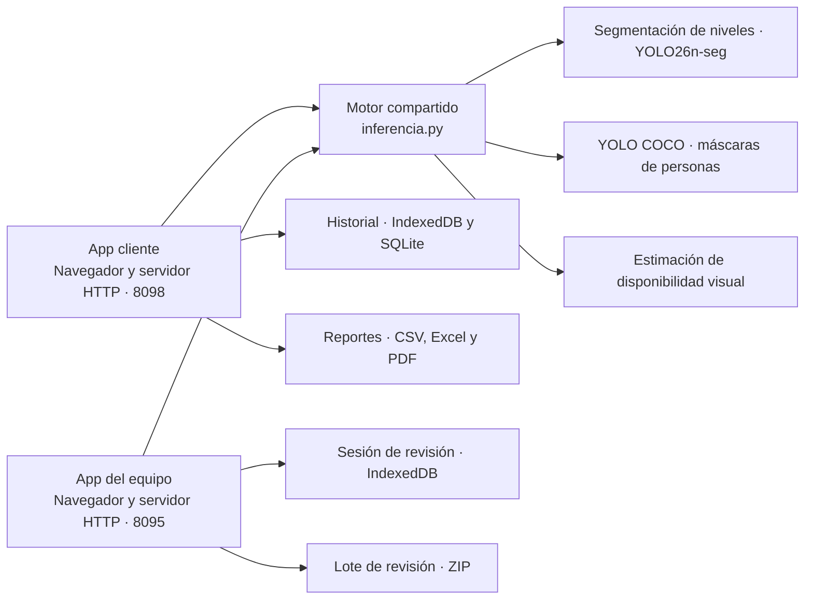
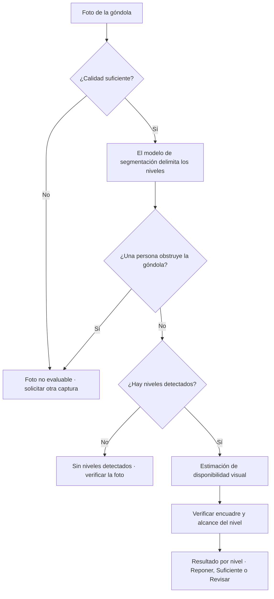

# 🛒 Walmart Computer Vision

**Análisis de disponibilidad en góndolas mediante visión por computador**

Proyecto Capstone de **DUOC UC** orientado a apoyar la inspección visual de góndolas a partir de fotografías. **Walmart Visión** reúne una app cliente y una mesa de revisión del equipo: ambas segmentan niveles de góndola, delimitan su área útil y calculan un índice visual para detectar posibles faltantes y apoyar la reposición.

| 🚀 Probar la aplicación | 🎬 Demostración en video | 📖 Entender el proyecto | 🧪 Modelo y métricas |
|:---:|:---:|:---:|:---:|
| [**Descargar apps cliente y equipo**](https://github.com/vcanio/Capstone2026/releases/download/walmart-vision-mvp-2026-11-16/Walmart_Vision_Cliente_y_Equipo_MVP_20261116.zip) | [**Ver video MVP (6 min)**](https://youtu.be/DKAqs9dVnV8) | [**Guía de funcionamiento**](Documentacion/Guia_para_entender_el_proyecto.md) | [**Modelo actual y métricas**](Documentacion/Modelo_V3_actual.md) |
| Windows x64 · Docker · [Notas MVP](https://github.com/vcanio/Capstone2026/releases/tag/walmart-vision-mvp-2026-11-16) | App cliente :8098 y casos límite | Niveles, ocupación y límites | Modelo oficial · evaluación y límites |

[**App cliente**](Aplicacion_Cliente/README.md) · [**App del equipo**](Aplicacion/README.md) · [**Entregables**](Entregables/README.md) · [**Documentación**](Documentacion/README.md)

## Contenido

- [Problemática y descripción de la solución](#problemática-y-descripción-de-la-solución)
- [Descarga e inicio rápido](#descarga-e-inicio-rápido)
- [Instalación manual y configuración](#instalación-manual-y-configuración)
- [Comprobar el funcionamiento](#comprobar-el-funcionamiento)
- [Estrategia y justificación técnica](#estrategia-y-justificación-técnica)
  - [Tecnologías y decisiones de diseño](#tecnologías-y-decisiones-de-diseño)
  - [Por qué se utiliza el umbral 52](#por-qué-se-utiliza-el-umbral-52)
- [Arquitectura de la solución](#arquitectura-de-la-solución)
- [Datasets y preparación](#datasets-y-preparación)
- [Evaluación y métricas](#evaluación-y-métricas)
  - [Casos límite y escenarios donde falla o requiere revisión](#casos-límite-y-escenarios-donde-falla-o-requiere-revisión)
- [Estado actual de la implementación](#estado-actual-de-la-implementación)
- [Documentación y estructura](#documentación-y-estructura)
- [Historial y participación del equipo](#historial-y-participación-del-equipo)
- [Equipo y licencia](#equipo-y-licencia)

---

## Problemática y descripción de la solución

Recorrer las góndolas y localizar huecos manualmente toma tiempo y depende del encuadre, la iluminación y el tipo de envase. Walmart Visión busca facilitar esa inspección: analiza fotografías y señala, por repisa, los posibles faltantes y los casos que requieren revisión o una nueva captura. Su alcance es la disponibilidad visible en la foto. El inventario, el conteo de unidades y la identificación de SKU quedan fuera del MVP.

### Funcionalidades principales

| Aplicación | Uso | Dirección local |
|---|---|---|
| [Cliente](Aplicacion_Cliente/README.md) | Consulta alertas, guía la captura móvil, guarda un historial compartido en SQLite y exporta CSV, Excel y PDF. | http://127.0.0.1:8098 |
| [Equipo](Aplicacion/README.md) | Revisa contornos y alertas, marca incidencias, compara ejecuciones y exporta lotes ZIP. | http://127.0.0.1:8095 |

Ambas apps comparten la **segmentación de niveles** con `YOLO26n-seg` y la **estimación de disponibilidad visual**. El modelo delimita cada repisa y el estimador analiza esa región para determinar si corresponde **Reponer**, **Suficiente** o **Revisar**. La app del equipo permite comparar con [Basal, un algoritmo experimental](Aplicacion/Documentacion/COMPARACION_BASAL_20261112.md).

## Descarga e inicio rápido

[Descarga el ZIP del MVP](https://github.com/vcanio/Capstone2026/releases/download/walmart-vision-mvp-2026-11-16/Walmart_Vision_Cliente_y_Equipo_MVP_20261116.zip) y extrae la carpeta completa. El ZIP trae las dos apps, el peso oficial de niveles, el peso auxiliar para personas y ocho fotos de ejemplo. El [registro de entrega](Entregables/README.md) indica el checksum y el commit fuente del ZIP.

### Windows x64

1. En la carpeta extraída **Walmart_Vision**, abre **iniciar_cliente.cmd** (8098) o **iniciar_equipo.cmd** (8095).
2. La primera ejecución necesita Internet para preparar Python 3.12 y las dependencias. Mantén abierta la consola.
3. En la app cliente, pulsa **Probar un pasillo de ejemplo** o carga fotos propias JPG, PNG o WebP de hasta **10 MB** y **24 megapíxeles**. [Ocho casos precargados](Aplicacion_Cliente/ejemplos/README.md) · [Manual de uso](Documentacion/Usar_Walmart_Vision.md).

### Docker (incluido macOS)

El [Compose conjunto](compose.apps.yaml) define las dos apps en CPU. El montaje de cliente es de solo lectura y su base SQLite necesita escritura al iniciar. Para probar el cliente con historial y reportes, usa el iniciador de Windows o la instalación manual. El equipo tiene una [configuración Docker propia](Aplicacion/DOCKER.md). El build Docker y la prueba en un Mac físico siguen pendientes de certificación.

### Desde un clon y recomendaciones de uso

En Windows, también puedes abrir **Aplicacion_Cliente/iniciar_cliente.cmd** o **Aplicacion/iniciar.cmd** desde el clon. Toma fotos frontales o casi frontales, nítidas y con ambos extremos de la góndola visibles. Las fotos se procesan localmente y el uso de las apps no incorpora imágenes al entrenamiento. [Consejos de captura](Documentacion/Guia_para_entender_el_proyecto.md#fotografías-frontales).

## Instalación manual y configuración

Requisitos: **Git y Python 3.12 de 64 bits**; conexión a Internet para instalar dependencias. La ejecución CPU no requiere GPU, CVAT ni el laboratorio. Node.js 22 es opcional para las pruebas de interfaz y se utiliza en CI. Los dos pesos necesarios ya están versionados en `Aplicacion/modelos/`.

Desde una terminal, prepara un entorno separado con las mismas versiones principales usadas en CI:

```bash
git clone https://github.com/vcanio/Capstone2026.git
cd Capstone2026
python -m venv .venv
```

Comprueba antes que `python --version` indique `3.12.x`; en Windows puedes usar `py -3.12 -m venv .venv`. Activa el entorno según tu sistema:

```powershell
# Windows PowerShell
.\.venv\Scripts\Activate.ps1
```

```bash
# Linux / macOS
source .venv/bin/activate
```

Con el entorno activo, desde la raíz del clon:

```bash
python -m pip install torch==2.5.1 torchvision==0.20.1 --index-url https://download.pytorch.org/whl/cpu
python -m pip install -r Aplicacion/requirements.txt
python -m pip check
python Aplicacion/app.py --check
python Aplicacion_Cliente/app_cliente.py --check
```

Las dependencias directas se fijan en [requirements.txt](Aplicacion/requirements.txt): Ultralytics `8.4.174`, NumPy `1.26.4`, Pillow `12.3.0` y OpenCV `4.11.0.86`. SQLite y los generadores de CSV/XLSX/PDF usan la biblioteca estándar de Python. En Linux, OpenCV puede requerir `libgl1` y `libglib2.0-0`; [Docker](Aplicacion/DOCKER.md) incluye estas bibliotecas.

Inicia cada aplicación en una terminal con ese entorno activo:

```bash
python Aplicacion_Cliente/app_cliente.py --host 127.0.0.1 --port 8098 --device cpu
```

```bash
python Aplicacion/app.py --host 127.0.0.1 --port 8095 --device cpu
```

| Configuración | Valor y ubicación |
|---|---|
| Modelo, pesos y SHA-256 | [Aplicacion/modelos.json](Aplicacion/modelos.json); ambas apps comparten el oficial `V3-cierre-revisado-20261110`. |
| Dispositivo y puerto | Opciones `--device cpu` / `--device auto`, `--port` y `--host`. `auto` aprovecha CUDA si el entorno instalado es compatible; la instalación anterior es CPU. |
| Disponibilidad visual | Índice visual `0–100`, umbral `52`; el cliente usa confianza `0,60`. La comparación basal es experimental y está disponible en equipo. |
| Persistencia cliente | `Aplicacion_Cliente/.runtime/historial_cliente.sqlite3` y `IndexedDB` del navegador. La carpeta del servidor debe permitir escritura. No se necesitan claves API ni un archivo `.env`. |
| Acceso | Por defecto solo `127.0.0.1`; Compose también publica únicamente en loopback. Acceso móvil por cámara requiere un contexto seguro permitido por el navegador. La prueba local no supone un despliegue multiusuario. |

La base SQLite persiste entre reinicios del proceso cuando su carpeta se conserva. El Compose actual monta `Aplicacion_Cliente` en solo lectura: la persistencia compartida necesita configurar almacenamiento escribible antes de usar ese flujo en contenedor. No se ha certificado ese flujo mediante un build Docker o una prueba física en Mac. Consulta las [comprobaciones y límites de ejecución](Documentacion/Verificacion_funcional.md).

## Comprobar el funcionamiento

La [guía de verificación](Documentacion/Verificacion_funcional.md) reúne comandos, resultados esperados y una pauta manual con fotos propias. Como comprobación inicial, con las dependencias instaladas:

```bash
python Distribucion/verificar.py
python Entrenamiento/preparar_datos_cvat.py --self-check
python Entrenamiento/entrenar_yolo26n_seg.py --dry-run
python Entrenamiento/evaluar_ohiggins3.py --verify-receipt
```

Se espera `estado: correcto` en el verificador y finalización sin errores en los tres scripts. `--dry-run` muestra la configuración sin entrenar; `--verify-receipt` comprueba el recibo publicado sin abrir el test ni ejecutar inferencia. **Revisar un recibo no reproduce las métricas.** Para una prueba funcional de las apps, abre sus direcciones locales, carga una foto propia y verifica contornos, estados y exportación siguiendo la guía. El [CI](https://github.com/vcanio/Capstone2026/actions/workflows/comprobar.yml) ejecuta pruebas automáticas y una comprobación HTTP/CPU de un paquete aislado con imagen generada.

---

## Estrategia y justificación técnica

### Estrategia algorítmica

1. **Comprobar la calidad.** Una foto demasiado borrosa, oscura o sobreexpuesta puede quedar como no evaluable.
2. **Localizar los niveles.** El modelo de segmentación delimita el área útil de cada repisa, incluidos los productos y los huecos. Un detector auxiliar comprueba si una persona tapa parte de la góndola. Ante una obstrucción importante, la app solicita otra foto.
3. **Medir la disponibilidad.** El estimador analiza bordes, color y textura dentro de cada nivel. Excluye estructuras como los rieles y mide los espacios vacíos a lo ancho de la repisa.
4. **Mostrar el resultado.** Se indica **Reponer** cuando el índice cae por debajo de 52 o hay un hueco importante. **Suficiente** requiere un índice desde 52 y una lectura clara. **Revisar** se usa ante recortes, obstrucciones o señales dudosas. El índice `0–100` describe la disponibilidad visual de la repisa.

La [guía de funcionamiento](Documentacion/Guia_para_entender_el_proyecto.md) desarrolla las reglas del índice, la definición de un nivel y el criterio de mediana para anotar repisas superiores abiertas.

### Tecnologías y decisiones de diseño

| Tecnología o herramienta | Qué hace y por qué se eligió |
|---|---|
| **YOLO26n-seg, Ultralytics y PyTorch** | El peso oficial `V3-cierre-revisado-20261110` se afinó para la clase `Nivel`. Las máscaras siguen la forma de cada repisa en perspectiva y permiten medir sus huecos. La variante compacta admite inferencia local en CPU. Un peso COCO auxiliar detecta personas. |
| **Estimación de disponibilidad visual con OpenCV y NumPy** | Mide bordes con Canny, cambios de intensidad con Sobel, saturación en HSV y textura. Compara los niveles con una escala común y mide los huecos del frente. Así se puede inspeccionar de dónde viene una alerta y ajustar sus reglas por separado del modelo de niveles. |
| **CVAT y scripts de Python** | CVAT permite dibujar y revisar polígonos con un criterio común. Los scripts convierten las anotaciones al formato YOLO-seg, verifican la separación por escenas y registran los parámetros del entrenamiento y la evaluación. |
| **Python, HTML, CSS, JavaScript y SQLite** | El servidor local analiza las fotos y el navegador permite revisar los resultados. SQLite guarda el historial compartido del cliente en un archivo, lo que evita instalar un servidor de base de datos adicional. |
| **Docker y GitHub Actions** | Docker declara el entorno CPU y sus dependencias. GitHub Actions automatiza la verificación de archivos, las pruebas y el arranque del paquete con inferencia CPU. Los límites de Docker se documentan por separado. |

### Por qué se utiliza el umbral 52

**52 es un punto de corte empírico del índice de disponibilidad visual, no un 52 % de stock físico ni la confianza de YOLO.** El 30 % del enunciado es una referencia inicial de disponibilidad; no se traslada directamente a este índice, que combina textura, bordes, color y huecos.

El registro inicial del 8/11 compara umbrales de **30 a 66, en pasos de 2**, usando únicamente **52 niveles de ajuste (`train`: 6 alertas y 46 suficientes)**, con máscaras humanas. Después se comprueba el punto de operación en otros **112 niveles de validación**. Son dos grupos diferentes: los 112 no fueron la muestra usada por ese barrido.

| Corte sobre el mismo índice visual | Alertas detectadas de 6 | Falsas alertas | Alertas omitidas | F1 en ajuste |
|---|---:|---:|---:|---:|
| 30 | 4 | 0 | 2 | 80,00 % |
| 44 | 5 | 0 | 1 | 90,91 % |
| 46, 48, 50, **52** o 54 | 6 | 0 | 0 | 100,00 % |
| 56 | 6 | 1 | 0 | 92,31 % |

Se justifica **conservar 52 como un corte operativo probado dentro de la meseta de buen desempeño**: en esa muestra detecta las alertas que se perdían con 30 y evita la falsa alerta que aparece al subir a 56. La validación posterior obtuvo **15/16 alertas, cero falsas alertas y F1 96,77 %**. Esto respalda el rango y el uso de 52, pero **no demuestra que 52 sea superior a 50 o 54**; el registro no contiene una regla de desempate que haga único ese número.

El ajuste es preliminar: las seis alertas iniciales eran sintéticas y la validación solo contenía dos alertas reales, de las que detectó una. Un registro ampliado posterior tampoco presenta 52 como máximo único de F1. La versión v2.2 conserva ese corte y añade reglas de huecos y revisión; necesita una calibración propia con datos nuevos para demostrar un óptimo actual. [Justificación completa, barrido ampliado y límites](Documentacion/Justificacion_umbral_52.md) · [Evidencia numérica agregada](Documentacion/Evidencias/justificacion_umbral_52.json).

## Arquitectura de la solución

### Componentes y almacenamiento

Las dos aplicaciones ejecutan el mismo motor local. El cliente guarda historial en el navegador y en SQLite. El equipo guarda su sesión en el navegador y puede compartirla mediante un lote ZIP.



### Flujo de una fotografía

El diagrama muestra la ruta predeterminada con el estimador de disponibilidad visual.



| Componente | Responsabilidad |
|---|---|
| [Pesos y manifiesto](Aplicacion/modelos.json) | Identifican el YOLO que delimita los niveles y el modelo auxiliar para personas. |
| [Motor compartido](Aplicacion/inferencia.py) | Comprueba la calidad de la foto, ejecuta los modelos y coordina el cálculo y el dibujo del resultado. |
| [Procesamiento de imagen](Aplicacion/ocupacion_paulo.py) · [Estimador de disponibilidad visual](Aplicacion/ocupacion_linea_a.py) | Preparan la señal con OpenCV y NumPy, calculan el índice y deciden la alerta. |
| [Servidor cliente](Aplicacion_Cliente/app_cliente.py) · [Servidor del equipo](Aplicacion/app.py) | Sirven las interfaces. El cliente gestiona historial SQLite y reportes. El visor del equipo organiza las ejecuciones de revisión. |
| [Entrenamiento](Entrenamiento/README.md) · [Distribución](Distribucion/README.md) | Reúnen los scripts reproducibles y las comprobaciones del producto. CVAT se usó para anotar y revisar niveles. |

### Módulos internos en ejecución local

El [recorrido del código](Aplicacion/Documentacion/LEER_CODIGO.md) conecta inferencia, oclusiones y ocupación. El [procedimiento de verificación](Documentacion/Verificacion_funcional.md) documenta la API y los resultados esperados.

## Datasets y preparación

- **Origen de los datos:** fotografías reales de góndolas capturadas por el equipo en tienda y variantes sintéticas controladas (generadas e identificadas explícitamente como apoyo al entrenamiento, sin asumirlas como evidencia de generalización real).
- **Cantidades utilizadas:**
  - **Cadena acumulada (3 etapas propias sobre `yolo26n-seg.pt`):** **519 fuentes de entrenamiento** distintas por SHA-256 (`299` reales y `220` sintéticas).
  - **Último afinado (`V3-cierre-revisado-20261110`, 40 épocas):** **256 imágenes de `train`** (`203` reales / `53` sintéticas, **1.298 polígonos**) y **11 fotos reales de `val`** (`55` polígonos, 3 escenas).
  - **Evaluación de segmentación (`Ohiggins 3`):** **68 fotos reales** y **354 polígonos `Nivel`** con `0` coincidencia en `train` o `val`.
- **Limpieza, etiquetado y preparación:**
  1. **Integridad y deduplicación:** registro de dimensiones y huella SHA-256 para evitar duplicados exactos entre particiones.
  2. **Limpieza y normalización:** exclusión documentada de tomas dudosas o no aptas y resolución de orientación EXIF en copias de preparación conservando originales intactos.
  3. **Partición por escenas:** originales, vistas cercanas y variantes sintéticas se agrupan por escena o familia al separar los datos de desarrollo. Ohiggins 3 quedó fuera de entrenamiento y validación del peso. Se comprobó que carece de duplicados exactos con esas particiones.
  4. **Etiquetado en CVAT:** clase única `Nivel`, delimitada sobre el portaprecio, excluyendo espesor frontal y aplicando la mediana en niveles superiores abiertos.

Las fotos y las anotaciones del equipo no se distribuyen como dataset público. La cadena propia documentada utiliza capturas del equipo y variantes sintéticas; los pesos generales preentrenados tienen procedencia y condiciones de uso en [Licencias](LICENCIAS.md). Los manifiestos y recibos permiten auditar cantidades y procedencia, pero la reproducción con imágenes requiere acceso autorizado a los datos privados. Cero coincidencias SHA-256 descarta duplicados exactos; por sí solo no demuestra independencia entre escenas.

**Aumentos de datos.** Durante el último ajuste fino, se aplicaron variaciones leves de rotación, posición, escala y color. Se desactivaron los volteos y las técnicas que mezclan imágenes, como Mosaic y MixUp. [Parámetros de los aumentos](Documentacion/Entrenamiento_y_datos.md#aumentos-de-datos-del-último-ensayo)

[Catálogo del modelo oficial](Documentacion/Evidencias/catalogo_modelo_oficial_cierre_20261110.json) · [Metodología de desarrollo y revisión](Documentacion/Metodologia_desarrollo_y_revision.md)

---

## Evaluación y métricas

Modelo oficial vigente: **`V3-cierre-revisado-20261110`** (SHA-256 `dc679fe73a7525dcffefe0381edfc39309d2ebe3f5115387100ae53cf4550af5`).

### Segmentación de niveles (`YOLO26n-seg`)

| Conjunto | Fotos | Niveles | mAP50 | mAP50–95 (M) | Emparejamiento (`conf = 0,60`) |
|---|---:|---:|---:|---:|---|
| Validación real | 11 | 55 | 99,50 % | 90,04 % | `54 TP, 0 FP, 1 FN` |
| **Ohiggins 3 (fuera de entrenamiento y validación)** | **68** | **354** | **99,50 %** | **90,36 %** | **`354 TP, 0 FP, 0 FN`** (`68/68` exactos · `IoU` medio `93,90 %`) |

En `Ohiggins 3`, el validador de Ultralytics registró precisión `0,9991` y recall `1,0000`. El emparejamiento operativo de la tabla es un cálculo separado con confianza fija. La latencia media de `YOLO.predict` fue de **77,15 ms** en GPU (`GTX 1660 SUPER`) y **225,94 ms** en CPU (`AMD Ryzen 5 3600`, muestra de 15 fotos).

**Cobertura de detecciones en operación multi-fecha y multi-sucursal (`3` sets reales sin post-proceso, `conf = 0,60`):**

| Set real | Fotos | Niveles detectados | Promedio / foto | Rango por foto | Fotos con niveles segmentados |
|---|---:|---:|---:|---:|---:|
| `9_11 Ohiggins` (`Ohiggins 3` · CVAT) | 68 | 354 | 5,21 | 4–6 | 68 / 68 |
| `14_11 Ohiggins` | 46 | 215 | 4,67 | 2–7 | 46 / 46 |
| `15_11 Marcoleta` (sucursal nueva) | 79 | 324 | 4,10 | 2–6 | 79 / 79 |
| **Total acumulado** | **193** | **893** | **4,63** | **2–7** | **193 / 193 (`100 %`)** |

La presencia de detecciones en `193/193` fotos no acredita que todos sus niveles sean correctos: en las otras dos capturas no se presenta aquí un emparejamiento completo con polígonos humanos. Estas cifras no son recall ni exactitud de segmentación.

### Estimación de disponibilidad visual (umbral 52)

Ajustada inicialmente sobre 52 niveles y comprobada después en 112 niveles con máscaras humanas (15/16 alertas, 0 falsas alertas, 1/2 alertas reales; [selección del corte 52](Documentacion/Justificacion_umbral_52.md)) y evaluada sobre los **354 niveles predichos por YOLO en `Ohiggins 3`** (más comparación cualitativa sobre **193 fotos / 893 niveles** en 3 capturas de tienda: `Ohiggins 9/11`, `Ohiggins 14/11` y `Marcoleta 15/11`):

| Revisión del estimador (`Ohiggins 3`, 354 niveles) | TP / FP / FN / TN | Accuracy | Precision | Recall | F1 |
|---|---|---:|---:|---:|---:|
| Línea base ciega (`linea_a_20261113_techo_y_panel_liso`) | `30 / 2 / 6 / 316` | 97,74 % | 93,75 % | 83,33 % | 88,24 % |
| **v2.2 vigente, reevaluación posterior (`linea_a_20261116_v2_2_cajas_sacos_picada`)** | **`35 / 3 / 1 / 315`** | **98,87 %** | **92,11 %** | **97,22 %** | **94,59 %** |

El etiquetado humano ciego y los resultados congelados de la línea base se conservan como antecedente. `v2.2` se revisó después de conocer casos y errores de esas imágenes: su resultado es una reevaluación sobre un conjunto ya observado, sin demostrar generalización independiente. Hace falta un nuevo conjunto sin exposición para estimar esa generalización. Los porcentajes de `v2.2` se transcriben del estado documentado; esta actualización no ejecuta una evaluación nueva.

- **Por foto completa (línea base ciega `2026-11-13`):** Accuracy **92,65 %** · **F1 89,80 %**.
- La latencia del flujo completo con la línea base fue de **1.371,9 ms/foto** en GPU y **1.442,5 ms/foto** en CPU (muestra de 15 fotos).

### Casos límite y escenarios donde falla o requiere revisión

- Una repisa cortada por el encuadre necesita revisión. Los superiores abiertos pueden quedar demasiado cortos o pasar inadvertidos.
- Los envases oscuros, las sombras, los separadores y el producto al fondo pueden alterar la lectura de huecos. Los carros u otros obstáculos requieren inspección visual.
- La zona visible ofrece evidencia para la alerta. La profundidad de stock y los productos detrás de una primera fila quedan fuera del alcance.

La [ficha del modelo](Documentacion/Modelo_V3_actual.md#casos-límite-y-fallos-conocidos) conserva los casos observados y sus métricas.

## Estado actual de la implementación

| Estado | Alcance |
|---|---|
| **Disponible en el MVP** | Cliente y equipo, segmentación de niveles, detector auxiliar de personas, estimación de disponibilidad visual y ocho ejemplos precargados. |
| **Verificado** | Pruebas de software, integridad del paquete, arranque HTTP e inferencia CPU en ambas apps. |
| **Pendiente** | Evaluación independiente del estimador de disponibilidad visual en fotos nuevas, almacenamiento escribible para SQLite en el Compose conjunto y certificación de Docker en un Mac físico. |

[Entrega y comprobaciones](Entregables/README.md) · [Límites de ejecución](Documentacion/Verificacion_funcional.md#5-empaquetado-y-límites-de-plataforma).

## Documentación y estructura

| Carpeta / Recurso | Contenido |
|---|---|
| [`Aplicacion/`](Aplicacion/README.md) | App del equipo (`8095`), motor compartido, modelo oficial y pruebas ([guía de revisión](Aplicacion/Documentacion/REVISION_EQUIPO.md)). |
| [`Aplicacion_Cliente/`](Aplicacion_Cliente/README.md) | App cliente (`8098`), filtros de alertas del modelo, cámara móvil, `SQLite`, CSV/XLSX/PDF y pruebas. |
| [`Entrenamiento/`](Entrenamiento/README.md) | Scripts reproducibles de conversión CVAT-YOLO (`seed=42`, mediana, anti-fuga) y evaluación sobre `Ohiggins 3`. |
| [`Documentacion/`](Documentacion/README.md) | [Manual de uso](Documentacion/Usar_Walmart_Vision.md), [guía funcional](Documentacion/Guia_para_entender_el_proyecto.md), [modelo de segmentación](Documentacion/Modelo_V3_actual.md), [metodología](Documentacion/Metodologia_desarrollo_y_revision.md) y [planificación](Documentacion/Planificacion_y_metodologia.md). |
| [`Distribucion/`](Distribucion/README.md) | Verificación de integridad, empaquetado autónomo y comprobación HTTP/CPU; [.github/workflows](.github/workflows/comprobar.yml) automatiza estos controles. |
| [`Entregables/`](Entregables/README.md) | Releases publicados, paquetes descargables y entregas académicas. |
| [`Fase 1/`](Fase%201/) · [`Fase 2/`](Fase%202/) | Entregables académicos del proyecto (Fase 1 histórica intacta y cierre final de Fase 2). |

La organización separa la interfaz cliente, el motor compartido, los scripts de desarrollo y la documentación. Los datasets, entornos y registros privados quedan fuera del clon público; los antecedentes publicados se localizan en [Archivo del desarrollo](Documentacion/Archivo_del_desarrollo.md).

### Material de demostración

- 🎬 [**Demostración funcional MVP en video (6 min)**](https://youtu.be/DKAqs9dVnV8): recorrido completo de la App cliente (`:8098`), casos posibles (`Suficiente`, `Reponer` + *Huecos*, filtro de calidad, oclusiones por personas con contorno ámbar sutil, casos límite `Requieren revisión`), persistencia `SQLite` y exportación CSV/XLSX/PDF.
- 🧪 [**8 casos de ejemplo precargados en la app cliente**](Aplicacion_Cliente/ejemplos/README.md): disponibles en un clic desde **Probar un pasillo de ejemplo** dentro de la aplicación descargada o clonada.
- 🖼️ [**Imágenes de ejemplo históricas (Drive)**](https://drive.google.com/drive/folders/1z0-GNiRUJcVwbjLVkiDc20G2F8f9QASS?usp=sharing): selección histórica real y sintética para pruebas adicionales.

---

## Historial y participación del equipo

El [historial de commits](https://github.com/vcanio/Capstone2026/commits/main/) conserva el avance desde las entregas académicas hasta el MVP. La [guía de participación e hitos](Documentacion/Historial_y_participacion.md) enlaza cambios comprobables de **Vicente Canio**, **Paulo Guerra** y **Vicente Vilches**, e incluye comandos para consultar autores y cambios. Los commits acreditan las modificaciones registradas; su cantidad no mide por sí sola el aporte total de cada integrante ni identifica a todos los participantes de una revisión conjunta.

## Equipo y licencia

**Capstone DUOC UC · 2026** — Desarrollo: **Vicente Canio**, **Paulo Guerra** y **Vicente Vilches** · Docente: **Arturo Vargas**.

El código original del equipo se distribuye bajo [AGPL-3.0-only](LICENSE) ([alcance, autoría de datos y pesos](LICENCIAS.md) · [avisos de terceros](NOTICE.md)). Las fotografías y anotaciones mantienen su autoría y no reciben licencia pública mediante este repositorio.
