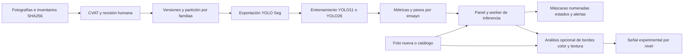
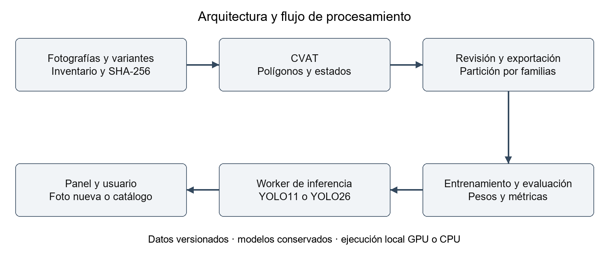

# Walmart Computer Vision

Proyecto Capstone DUOC UC para apoyar la revisión de góndolas mediante fotografías. La aplicación identifica cada nivel o repisa, dibuja su contorno y señala si necesita reposición o tiene disponibilidad suficiente. Equipo: Vicente Canio, Paulo Guerra y Vicente Vilches. Docente: Arturo Vargas. Contraparte: José Larraín.

**Primera lectura:** la [guía para entender el proyecto](Documentacion/Guia_para_entender_el_proyecto.md) explica términos como segmentación, entrenamiento, validación, IoU y mAP con ejemplos de nuestros resultados.

## Qué hace la aplicación

Al cargar una fotografía, el modelo YOLO busca los niveles de la góndola y dibuja una región sobre cada uno. Esa región se llama **máscara**. Después muestra el estado de cada nivel. V2 base utiliza `reponer` y `suficiente`; todavía no reconoce `no_evaluable`, que se necesita cuando un obstáculo impide decidir.

El análisis opcional de **detección de bordes** revisa contornos, color y textura dentro de esas regiones. Sus mapas ayudan a estudiar los resultados, pero su señal sigue siendo experimental y no representa un porcentaje real de productos.

La entrega para el usuario es **Walmart Visión**, una interfaz para probar fotos propias. El **laboratorio de desarrollo** reúne el panel de entrenamiento y CVAT para preparar datos, anotar imágenes y evaluar modelos. Un modelo entrenado guarda lo aprendido en archivos llamados **pesos**; Visión ya incluye los cuatro modelos disponibles.

**Versión descargable para probar modelos (Release):** `walmart-vision-2026-10-20`, con un único ZIP de Walmart Visión, cuatro modelos y detección de bordes. Código y metadatos están en Git. Los datos, resultados e informes del laboratorio se comparten por separado con el equipo, fuera de la Release pública.

## Alcance de la entrega y de la documentación

La documentación permite comprender la construcción del sistema y ejecutar Walmart Visión con los modelos publicados. Las herramientas de anotación y entrenamiento se explican como parte del proceso de desarrollo; su instalación y los datos utilizados quedan fuera de la distribución para usuarios finales.

| Destinatario | Recorrido |
|---|---|
| Usuario de la aplicación | Descargar Visión, cargar una fotografía y revisar niveles, estados y limitaciones. No necesita instalar el laboratorio. |
| Persona que quiere entender el proyecto | Leer la [guía conceptual](Documentacion/Guia_para_entender_el_proyecto.md) y el [mapa del código](Documentacion/Evolucion_v1_v2.md#dónde-está-cada-parte-del-código). Puede conocer el proceso sin instalar CVAT ni entrenar. |
| Equipo de desarrollo | Consultar la [guía técnica del laboratorio](Documentacion/Replicar_proyecto.md), que requiere activos y accesos gestionados por separado. |

## Empezar como usuario desde otro computador

Para **probar fotografías sin instalar el laboratorio**, descargar `Walmart_Vision_20261020.zip` de la [Release](https://github.com/vcanio/Capstone2026/releases/tag/walmart-vision-2026-10-20), extraer todo y ejecutar `Walmart_Vision/iniciar.cmd`. El primer inicio requiere Internet; prepara su propio Python y utiliza el procesador del computador (CPU). V2 base distingue reponer y suficiente, y no reconoce no evaluable.

La [guía de uso de Walmart Visión](Documentacion/Usar_Walmart_Vision.md) reúne los pasos, la interpretación de resultados, las soluciones a problemas de inicio y una pauta para comprobar la instalación en otro computador. Esa comprobación externa sigue pendiente.

Para probar con ejemplos del proyecto, descargar el ZIP desde la [carpeta de imágenes de prueba en Google Drive](https://drive.google.com/drive/folders/1z0-GNiRUJcVwbjLVkiDc20G2F8f9QASS?usp=sharing). Incluye tres fotos reales y tres variantes sintéticas, con referencias de disponibilidad suficiente, reposición y errores conocidos. La [guía de ejemplos](Documentacion/Imagenes_de_prueba.md) explica su uso y procedencia. Las imágenes se distribuyen por separado y permanecen fuera del historial Git.

### Walmart Visión en la Release

El activo para quienes solo quieren probar la aplicación es
[Walmart_Vision_20261020.zip](https://github.com/vcanio/Capstone2026/releases/download/walmart-vision-2026-10-20/Walmart_Vision_20261020.zip)
(aproximadamente 36 MiB). Incluye los cuatro modelos y el visor local. Funciona
en Windows x64 sin instalar previamente Python, Docker o CVAT; en el primer
inicio descarga Python y las dependencias. Después, las fotos se analizan
localmente en CPU y no se guardan.

**Alcance de esta demo:** detección/segmentación y estados con YOLO, y análisis
experimental de detección de bordes, color y textura. Se empieza por seleccionar V1 o V2. Las pestañas Original, Niveles, Bordes y Comparar permiten revisar la foto y sus mapas dentro del mismo visor. El archivo “Source code (zip)” generado por GitHub contiene
el código del repositorio; para ejecutar Visión hay que descargar el activo con
el nombre indicado arriba.

### Para el equipo: laboratorio de desarrollo

El laboratorio permite anotar, entrenar y evaluar. Su funcionamiento está explicado en la guía conceptual y en la arquitectura de este README. Instalarlo es un recorrido técnico opcional para continuar el desarrollo; requiere los paquetes de datos y resultados del equipo. La Release de Visión permite usar los modelos sin esos paquetes.

- [Instalación técnica, ejemplo y repetición de entrenamientos](Documentacion/Replicar_proyecto.md).
- [Guía de commit, push y publicación de los activos](Documentacion/Publicar_GitHub.md).
- [Cómo trabajar en equipo: ramas, PR y actualizaciones](Documentacion/Trabajo_en_equipo.md) · [PDF](Documentacion/Trabajo_en_equipo.pdf).
- [Verificación de la entrega](reproducibilidad/VERIFICACION.md).
- [Manifiesto de archivos y hashes](reproducibilidad/artefactos.json).

## Informe intermedio

El informe del 20 de octubre, revisado para explicar los conceptos y conservar la planificación desde agosto, contiene 20 casos visuales y las limitaciones de la evaluación. El equipo lo distribuye por separado en `Walmart_Informe_Revision_20261020.zip`; puede instalarse con `python Herramientas/Reproducibilidad/preparar.py --assets D:/Transferencias/Walmart --paquetes informe`.

- [Fuente Markdown](Documentacion/Informe_Intermedio_Avance_20261020.md).
- [Registro de la revisión de planificación](Documentacion/Evidencias/verificacion_planificacion_20261020.json).
- [Registro de la revisión de lectura y requisitos](Documentacion/Evidencias/verificacion_claridad_20261020.json).
- Versiones locales después de preparar: [PDF](Entregables/Informe_Intermedio_Avance_20261020.pdf), [Word](Entregables/Informe_Intermedio_Avance_20261020.docx) y [HTML](Entregables/Informe_Intermedio_Avance_20261020.html).

## Problema y objetivos

Una góndola puede presentar faltantes visibles aunque haya mercadería en bodega. El objetivo es apoyar la inspección mediante fotografías, localizando niveles, identificando disponibilidad crítica y mostrando resultados revisables. El proyecto incluye datos propios, anotación humana y comparación de modelos. La entrega documenta la ejecución de la aplicación con pesos publicados; repetir los ensayos del laboratorio requiere los activos de desarrollo.

El prototipo clasifica estados aprendidos; no cuenta SKU, mide profundidad o consulta inventario. La confianza de YOLO no es el porcentaje de ocupación. El 30 % es un criterio inicial de anotación pendiente de calibración.

| Perfil | Estados y criterio |
|---|---|
| V1 operativo | `vacio` sin producto visible propio; `baja_disponibilidad` con producto y menos del 30 % del ancho; `suficiente` desde el 30 %; `no_evaluable` cuando no se puede decidir. |
| V2 base operativo | `reponer` reúne vacío y baja; `suficiente` mantiene el criterio del 30 %. |
| V2 completo pendiente | Añade `no_evaluable` para oclusiones que pueden cambiar la decisión. |

## Tecnologías y justificación

| Tecnología o decisión | Qué hace aquí | Por qué la usamos |
|---|---|---|
| YOLO11n-seg y YOLO26n-seg | Dibujan el contorno de cada nivel y predicen su estado. | Necesitamos analizar repisas completas. Comparamos ambas variantes Nano con la misma preparación dentro de cada versión. |
| PyTorch y Ultralytics | Permiten entrenar y ejecutar YOLO. | Partimos de pesos generales ya entrenados y los ajustamos con imágenes propias, en vez de aprender todo desde cero. |
| Polígonos por nivel completo | Cada dibujo manual incluye los productos y el espacio vacío de una repisa. | Queremos decidir si reponer un nivel; contar cada producto requeriría otras etiquetas y un catálogo por SKU, es decir, por tipo específico de producto. |
| OpenCV, Pillow, NumPy y Shapely | Preparan imágenes, operan con sus píxeles y comprueban regiones. | Necesitamos orientar fotos, trabajar con máscaras y validar sus formas antes de analizar o exportar. |
| Bordes Canny, color y textura | Marcan cambios de intensidad y señales dentro de las máscaras YOLO. | Nos permiten estudiar contornos y fondos problemáticos con mapas visibles. Esta señal no modifica el estado de YOLO. |
| CVAT | Permite dibujar y revisar etiquetas entre compañeros. | Las personas deben acordar el contorno y el estado que el modelo aprenderá. |
| Familias y grupos de imágenes | Mantienen una foto y sus variantes en el mismo grupo de datos. | Evitamos evaluar con una imagen casi igual a otra usada para entrenar. Esto reduce la fuga de datos; no demuestra funcionamiento en otras tiendas. |
| Python y HTML/CSS/JavaScript | Conectan los procesos con el panel local. | Permiten cargar una foto, ejecutar el modelo y revisar resultados desde una interfaz. |
| Docker Compose | Prepara los servicios y dependencias del laboratorio. | Facilita compartir la configuración de ejecución. Los datos y pesos se instalan por separado. |

**Versiones del entrenamiento conservado:** PyTorch 2.5.1+cu121 y Ultralytics 8.4.174. La configuración exacta se guarda en `entorno.json` y `entrenamiento/args.yaml` de cada ensayo.

Fusionar vacío y baja en `reponer` refleja la misma acción de reposición y reduce distinciones ambiguas. V1 y V2 también cambian dataset y partición, por lo que la mejora de métricas no puede atribuirse solo a esa fusión.

## Arquitectura y procesamiento





El recorrido tiene dos partes. **Para preparar el modelo**, reunimos fotos, dibujamos etiquetas en CVAT, separamos los datos y entrenamos. **Para usarlo**, cargamos una foto, ejecutamos el modelo y mostramos contornos, estados y alertas. Este uso se llama **inferencia**.

El panel importa las anotaciones sin cambiar los dibujos de CVAT y exige revisión antes de exportar. Cada ensayo guarda su configuración, una copia fija de los datos (**snapshot**), los pesos y la evaluación. Las detecciones se numeran de abajo hacia arriba y de izquierda a derecha. Los criterios exactos para comparar contornos se explican en la guía de lectura y en el informe.

## Detección de bordes

El panel completo incorpora **YOLO + detección de bordes**, con la revisión 2 del
20 de octubre. YOLO localiza y clasifica los niveles; el algoritmo de detección de bordes
analiza bordes Canny, color y textura dentro de sus máscaras sobre la fotografía
original, antes de dibujar los colores del resultado. Entrega área y ancho con
señal experimental, un mapa de señal y vistas de los bordes.

La revisión evita que cualquier fondo oscuro se considere producto: exige
brillo suficiente para el apoyo por color y textura para el apoyo en zonas
oscuras. También valida parámetros y regiones; cuando no puede medir, informa
el motivo en vez de devolver un cero engañoso. **La señal todavía no equivale
al porcentaje real de producto y no cambia el estado decidido por YOLO.**
Fondos con textura, carteles y estructuras siguen siendo fuentes de error.

Para probarlo después de instalar los activos e iniciar el panel:

1. Elegir **V2 → Probar una foto**, un modelo YOLO11/YOLO26 y una fotografía.
2. En **Método de análisis**, seleccionar **YOLO + detección de bordes · experimental**.
3. Pulsar **Analizar foto** y comprobar **Revisión 2 · color y textura** en el
   resultado. Un análisis anterior no se recalcula automáticamente.
4. Revisar la tabla por nivel, el mapa de señal y **Ver solo los bordes**.

El [script independiente](Experimentos/Bordes/gondola_bordes.py) conserva el
editor manual y la entrada de cajas JSON. La
[integración con las máscaras YOLO](Herramientas/Modelos/ocupacion_paulo.py), el
[ejecutor de comparaciones](Herramientas/Modelos/experimentar_paulo.py) y la
[revisión con resultados y comandos](Experimentos/Bordes/REVISION_20261020.md)
están en Git. Sus imágenes se instalan desde el paquete `modelos_resultados`.

En la comparación de desarrollo con las mismas diez fotos de validación,
pesos y ajustes, las 114 detecciones YOLO conservaron clases, confianza e IoU
entre revisiones. Cambió la señal de detección de bordes; eso no demuestra precisión global
de ocupación. El test final no se utilizó para ajustar este algoritmo.

## Datos y preparación

Un **dataset** es el conjunto de imágenes y etiquetas. **Entrenamiento (`train`)** sirve para aprender; **validación (`val`)**, para comparar modelos y ajustes; **prueba final (`test`)**, para evaluar al terminar, después de fijar esos ajustes. Una familia reúne una fotografía original y sus variantes. Una foto sintética es una imagen modificada con IA, no una nueva captura real.

| Lote | Procedencia y tamaño | Preparación y uso |
|---|---|---|
| [V1](Datos/V1/README.md) | 37 fotografías reales: 30 de desarrollo y 7 de reserva; 72 variantes sintéticas. | 102 candidatas; 11 exclusiones por calidad; copia activa de 91 imágenes: 86 train y 5 reales val, con 719 niveles. |
| [V2 Líder Express](Datos/V2/lider_express_20261016/README.md) | 59 originales reales y 177 variantes IA: 236 imágenes. | 59 familias y 19 grupos; copia de entrenamiento con 1.212 polígonos. 160 train; 10 originales val; 30 variantes de diagnóstico; 9 originales y 27 variantes de test. |
| [V2 visibilidad limitada](Datos/V2/visibilidad_limitada_20261019/README.md) | 60 ediciones sintéticas: 24 carros, 24 personas y 12 cajas. | 308 contornos etiquetados pendientes de aprobación final de sus estados. Destinos: 41 train, 10 val y 9 test. |

Total: **405 imágenes únicas** (96 reales y 309 sintéticas). Los **435 registros** de inventario incluyen referencias repetidas; no son 435 fotografías independientes. Los inventarios conservan origen, dimensiones, familia, ruta y SHA-256. Las variantes IA se revisan humanamente; A/B/C no determina su etiqueta.

El [registro de partición](Datos/Registros/Particiones/lider_express_v2_20261019/README.md) conserva tres grupos para val y dos para test. Hay un solo nivel real `reponer` en val y otro en test. El conjunto sintético se evalúa por separado.

La copia exacta usada para entrenar V2 base es `datos_20261019_234626_3df2e643`, con estado `lista_niveles`. Sus listas de archivos y exportaciones permiten repetir el ensayo. Hay registros anteriores con otros conteos; no se mezclan con esta versión. Las etiquetas de la tarea 22, que contiene obstáculos, todavía necesitan aprobación final.

## Estado y resultados

| Componente | Estado al corte |
|---|---|
| Inventarios, importador, exportador y particionador | Implementados con artefactos y verificadores locales. |
| Entrenamiento y comparación | Cuatro ensayos conservados: dos V1 y dos V2 base. |
| Panel e inferencia | Código y resultados disponibles; falta aceptación completa de V2 con oclusiones. |
| Detección de bordes | Revisión 2 integrada en el panel completo, con comparaciones conservadas; señal experimental pendiente de calibración y evaluación independiente. |
| Docker y CVAT | Arranque base sin CVAT; conexión opcional por perfil y credenciales personales. |
| Walmart Visión | Aplicación descargable con cuatro modelos V1/V2 base y análisis experimental de bordes; falta comprobarla en otro equipo físico. |
| Oclusiones, deduplicación y prueba final | En desarrollo o pendientes. |

La tabla siguiente conserva los valores medidos. **Localizados** cuenta niveles encontrados; **estados exactos**, niveles encontrados con la categoría correcta; **TP**, alertas acertadas; **FP**, falsas alertas. El mAP evalúa el comportamiento por clase y contorno; no es el porcentaje de fotos correctas. La [guía de lectura](Documentacion/Guia_para_entender_el_proyecto.md#cómo-leer-los-resultados) explica las métricas con ejemplos.

| Modelo | Validación real | mAP50 máscara | mAP50–95 máscara | Localizados | Estados exactos | Alertas TP y FP |
|---|---|---|---|---|---|---|
| YOLO11 V1 | 5 fotos, 36 niveles | 74,47 % | 56,59 % | 35/36 | 33/36 | 0 TP, 2 FP; sin alertas reales |
| YOLO26 V1 | 5 fotos, 36 niveles | 73,38 % | 62,40 % | 35/36 | 34/36 | 0 TP, 0 FP; sin alertas reales |
| YOLO11 V2 base | 10 fotos, 51 niveles | 98,44 % | 86,26 % | 51/51 | 48/51 | 1 TP, 4 FP; 1 alerta real |
| YOLO26 V2 base | 10 fotos, 51 niveles | 99,28 % | 92,79 % | 50/51 | 50/51 | 1 TP, 0 FP; 1 alerta real |

**Cómo interpretar el resultado:** YOLO26 V2 encontró 50 de 51 niveles y acertó esos 50 estados. Detectó el único faltante de reposición de esa validación y no emitió falsas alertas. Es un resultado favorable en diez fotos, pero **1/1 alerta** es una muestra demasiado pequeña para afirmar que encontrará todos los faltantes de una tienda. V1 y V2 usan datos y categorías diferentes; sus cifras no aíslan el efecto de cambiar de modelo.

Fuentes: `metricas_validacion.json`, `metricas_alertas.json` y `evaluacion_por_imagen.json` de [Experimentos](Experimentos/README.md). El mAP de Ultralytics y nuestros conteos tienen procedimientos y umbrales distintos; se informan por separado. Las imágenes reales y sintéticas también se evalúan por separado. La validación ya se usó para elegir modelos y no reemplaza la prueba final.

## Planificación y forma de trabajo

El proyecto comenzó aproximadamente en agosto de 2026. La detección de bordes se inició en la semana 9 y se integró con YOLO en la semana 11. La [Gantt histórica y el plan de cierre](Documentacion/Planificacion_y_metodologia.md) distinguen trabajo realizado, prototipo experimental y actividades futuras; el inicio exacto y las fechas propuestas de cierre deben confirmarse.

Trabajamos con un enfoque ágil e iterativo inspirado en Scrum, con dos reuniones semanales para revisar avances, nuevas imágenes por anotar, criterios de etiquetado e ideas de mejora. Esta descripción recoge la revisión y adaptación continuas, sin atribuir una aplicación formal completa de Scrum que no está documentada.

## Organización del proyecto

```text
Datos/             V1, V2, inventarios, particiones y versiones
Herramientas/      Datos, Modelos, Demo_lite, CVAT e Informes
Infraestructura/   Docker y configuración local
Modelos/           Pesos generales gestionados por separado
Experimentos/      Configuración, métricas y pesos entrenados
Documentacion/     Guías, informe y evidencias
Entregables/       PDF, Word, HTML y demo portátil
```

## Instalación técnica del laboratorio (equipo de desarrollo)

Para usar la aplicación, seguir la [guía de Walmart Visión](Documentacion/Usar_Walmart_Vision.md). Los requisitos y comandos de esta sección corresponden al panel de desarrollo. Antes de ejecutarlos, preparar los activos según la [guía técnica](Documentacion/Replicar_proyecto.md#instalar-el-laboratorio-desde-una-copia-nueva).

Se requiere Windows x64 con PowerShell y Docker Desktop para los comandos de inicio. El entorno de entrenamiento conservado usa Python 3.11; los scripts locales admiten Python 3.11/3.12. La GPU NVIDIA requiere acceso desde Docker; el modo CPU evita ese requisito. No se certifica aquí un límite de RAM/VRAM ni la latencia en hardware externo.

Un clon del código necesita también las imágenes, versiones exportadas y pesos de los ensayos. El manifiesto reproducibilidad/artefactos.json fija los hashes y la descarga de la demo. Los ZIP de datos, pesos/resultados e informe se transfieren por separado y se instalan con --assets. No se distribuyen credenciales del equipo. CVAT es opcional para ejecutar pesos y versiones ya exportadas.

### Preparar Python local

```powershell
python -m venv .venv-modelo
& ./.venv-modelo/Scripts/python.exe -m pip install -r Herramientas/Modelos/requirements.txt
```

### Iniciar el panel

```powershell
# CPU y construcción inicial de la imagen
& ./Herramientas/Modelos/iniciar_panel.ps1 -Cpu -Build
# GPU NVIDIA configurada
& ./Herramientas/Modelos/iniciar_panel.ps1 -Build
```

Abrir http://localhost:8090. Elegir V1 o V2, seleccionar modelo y analizar una fotografía. Para modificar anotaciones se necesita CVAT y su configuración: consultar [Docker](Infraestructura/Docker/README.md) y la [guía del panel](Herramientas/Modelos/README.md). La inferencia con pesos y datos ya disponibles no requiere editar CVAT.

**Ejemplo comprobable:** elegir `v2_base_yolo26n_01`, usar `lider_express_040_0_original.jpg` y confianza 0,25. La evaluación conservada espera cinco niveles: cuatro suficientes y uno reponer. Revisar el primer caso del informe. Una foto propia sin anotación permite revisar predicciones, pero no medir precisión.

### Verificar integridad y pruebas

```powershell
& ./.venv-modelo/Scripts/python.exe Herramientas/verificar_proyecto.py
& ./.venv-modelo/Scripts/python.exe Herramientas/Datos/particionar_lider_express.py --verify
& ./.venv-modelo/Scripts/python.exe -m unittest discover -s Herramientas/Datos
& ./.venv-modelo/Scripts/python.exe -m unittest discover -s Herramientas/Modelos
```

Los verificadores comprueban archivos, enlaces y separación de los datos. Las pruebas de código revisan que los programas respondan como se espera; no miden por sí solas qué tan bien reconoce el modelo una góndola nueva. El [registro original del informe](Documentacion/Evidencias/verificacion_informe_20261020.json) conserva lo ejecutado y sus límites.

### Demo portátil y regeneración del informe

La nueva entrega es `Walmart_Vision_20261020.zip`, con cuatro modelos V1/V2 base y la revisión 2 de detección de bordes; extraerla y ejecutar `Walmart_Vision/iniciar.cmd`. Los ZIP anteriores se conservan como históricos en el laboratorio. El primer arranque descarga dependencias. Ver [guía incluida en la aplicación](Herramientas/Demo_lite/LEEME.md) y [verificación de Visión](Herramientas/Demo_lite/VERIFICACION_VISION.md).

Con `python-docx` y `Pillow`, ejecutar `Herramientas/Informes/generar_informe_intermedio.py` para regenerar Word y HTML desde el Markdown, sin consultar modelos ni la reserva final. Exportar el Word a PDF y revisar el formato antes de distribuirlo.

## Próximos pasos

Aprobar las etiquetas con obstáculos de la tarea 22, capturar más faltantes reales y entrenar V2 de tres estados. Después, comparar el filtrado de detecciones repetidas en validación y acordar los resultados mínimos esperados. Se fijarán el modelo y los ajustes antes de consultar la prueba final. Para la entrega al usuario, falta comprobar Walmart Visión en otro computador físico y registrar el resultado con la [pauta de instalación externa](Documentacion/Usar_Walmart_Vision.md#comprobar-la-instalación-en-otro-computador). La [Carta Gantt y los responsables propuestos](Documentacion/Informe_Intermedio_Avance_20261020.md) están en el informe.

Los componentes de terceros conservan las licencias de sus distribuciones. Los términos de publicación del dataset, código propio y pesos deben documentarse en la entrega.

## Relación con el informe solicitado

La [revisión de requisitos](Documentacion/Revision_de_requisitos_informe.md) indica dónde se responde cada punto del encargo: avance, README técnico, veinte casos, reproducibilidad y conclusiones. La explicación técnica se acompaña de ejemplos; las configuraciones y evidencias se conservan para respaldarla.
