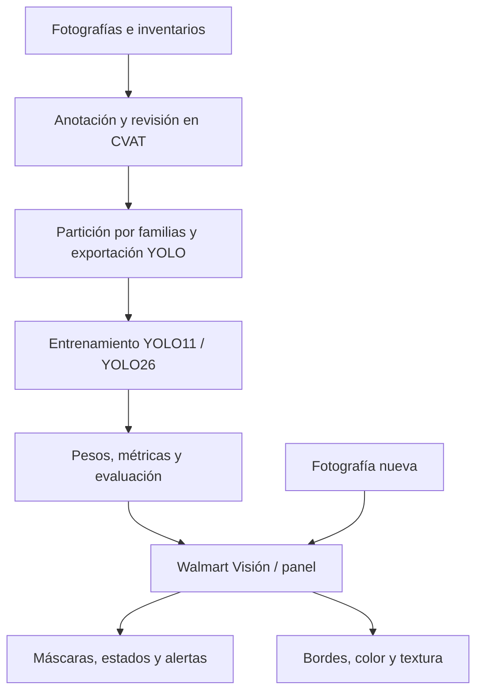

# 🛒 Walmart Computer Vision

**Análisis de disponibilidad en góndolas mediante visión por computador**

Proyecto Capstone de **DUOC UC** orientado a apoyar la inspección visual de góndolas a partir de fotografías. El sistema utiliza modelos de segmentación YOLO para **identificar las repisas, delimitar sus contornos y clasificar su estado de disponibilidad**.

> **Estado del proyecto:** prototipo funcional en desarrollo. La aplicación de prueba está disponible para Windows x64 y con Docker para Mac Intel y Apple Silicon; la evaluación final y el manejo completo de obstáculos siguen pendientes.

**Estado local al 23 de octubre de 2026:** Walmart Visión utiliza los dos modelos V2 ya entrenados. En paralelo se prepara **V3**, con una sola clase `Nivel`, **458 imágenes** y reparto **327/68/63**; todavía no tiene entrenamiento aprobado. [Estado de datos](Datos/Registros/README.md) · [Mapa del proyecto](Documentacion/Desarrollo/Mapa_del_proyecto.md) · [Entrega local actual](Entregables/README.md).

| 🚀 Probar la aplicación | 🎬 Demostración en video | 📖 Entender el proyecto | 🧪 Explorar los resultados |
|:---:|:---:|:---:|:---:|
| [**Entrega local actual e instrucciones**](Entregables/README.md) | [**Ver video funcional (7 min)**](https://youtu.be/sN_6XPdxtKk) | [Guía conceptual](Documentacion/Guia_para_entender_el_proyecto.md) | [Experimentos y métricas](Experimentos/README.md) |
| Windows x64 · Mac con Docker · 2 modelos V2 en la entrega local | Recorrido de la app y casos del informe | Conceptos, arquitectura y código | Cuatro ensayos históricos YOLO11/YOLO26 · V1/V2 |

## Contenido

- [¿Qué hace el sistema?](#qué-hace-el-sistema)
- [Inicio rápido: Walmart Visión](#inicio-rápido-walmart-visión)
- [Versiones y estados](#versiones-y-estados)
- [Resultados obtenidos](#resultados-obtenidos)
- [Arquitectura](#arquitectura)
- [Datos y entrenamiento](#datos-y-entrenamiento)
- [Tecnologías](#tecnologías)
- [Laboratorio de desarrollo](#laboratorio-de-desarrollo)
- [Documentación y estructura](#documentación-y-estructura)
- [Limitaciones y próximos pasos](#limitaciones-y-próximos-pasos)
- [Equipo](#equipo)

---

## ¿Qué hace el sistema?

El objetivo es **facilitar la revisión de niveles con posibles faltantes visibles**, incluso cuando existe mercadería disponible en bodega. A partir de una fotografía, el sistema:

1. **Detecta** cada nivel de una góndola.
2. **Segmenta** su superficie mediante una máscara o contorno.
3. **Clasifica** el nivel según los estados aprendidos por el modelo.
4. **Visualiza** los resultados y señala los niveles que podrían requerir reposición.
5. **Permite explorar**, de manera opcional, bordes, color y textura dentro de las máscaras.

La solución incluye dos entornos con propósitos diferentes:

| Componente | Para qué sirve | Público |
|---|---|---|
| **Walmart Visión** | Probar fotografías y revisar máscaras, estados y mapas desde un visor local. | Usuarios y evaluadores. |
| **Laboratorio de desarrollo** | Preparar datos, anotar en CVAT, entrenar modelos, comparar ensayos y verificar resultados. | Equipo de desarrollo. |

**Importante:** el prototipo no cuenta unidades ni SKU, no mide profundidad y no consulta inventario. La confianza del modelo tampoco representa un porcentaje de ocupación.

## Inicio rápido: Walmart Visión

La release del 22 de octubre reúne Windows y macOS en un único ZIP. Muestra un porcentaje de **ocupación estimada por nivel**: rojo bajo el 30 %, verde desde el 30 % y gris sin medición. El desglose de área/ancho y la predicción original de YOLO quedan en los detalles. La estimación visual sigue pendiente de calibración.

La actualización local de Walmart Visión incluye solo los dos modelos V2 y abre directamente para analizar una foto. El paquete [Walmart_Vision_Actual_20261023.zip](Entregables/Walmart_Vision_Actual_20261023.zip) está preparado localmente; su publicación en GitHub está pendiente. Las versiones anteriores se conservan en [Releases](https://github.com/vcanio/Capstone2026/releases).

En Windows utiliza un iniciador automático; en Mac utiliza Docker Desktop. No requiere instalar CVAT ni Python previamente.

[**Paquete local actualizado**](Entregables/Walmart_Vision_Actual_20261023.zip) · [SHA-256](Entregables/Walmart_Vision_Actual_20261023.sha256) · [Release anterior con cuatro modelos](https://github.com/vcanio/Capstone2026/releases/tag/walmart-vision-2026-10-22)

**Windows:**

1. Obtén el paquete actualizado **`Walmart_Vision_Actual_20261023.zip`** indicado arriba.
2. Extrae el archivo ZIP completo.
3. Ejecuta **`Walmart_Vision/iniciar.cmd`**.
4. El visor abre directamente con **V2-YOLO26**. Carga una fotografía y pulsa **Analizar foto**; también puedes probar V2-YOLO11.
5. Revisa las pestañas **Original**, **Niveles**, **Bordes** y **Comparar**.

**Mac Intel y Apple Silicon:** instala y abre Docker Desktop, extrae el mismo ZIP y abre Terminal en la carpeta `Walmart_Vision`. Ejecuta:

```bash
docker compose up --build -d --wait
```

Abre http://localhost:8095. Para detener la aplicación, ejecuta `docker compose down`. La [guía Docker](Herramientas/Demo_lite/DOCKER.md) explica instalación, reinicio sin descargas y solución de problemas.

| Requisito | Detalle |
|---|---|
| Sistema | Windows x64 o Mac Intel/Apple Silicon con Docker Desktop. |
| Descarga | ZIP de aproximadamente **25 MiB**, con dos modelos V2 y visor local. |
| Primer inicio | Requiere Internet para preparar Python y las dependencias en Windows, o construir la imagen Docker en Mac. |
| Procesamiento | Inferencia local mediante CPU; las fotografías no se guardan. |
| Estado de verificación | Paquete actual comprobado en CPU local. Las pruebas Docker anteriores fueron en Linux AMD64 y ARM64 emulado; falta comprobar la instalación en otro computador físico y en macOS. |

> **Descarga correcta:** utiliza un paquete de Visión con sus pesos. El botón automático **“Source code (zip)”** de GitHub solo descarga el código fuente.

**Material para probar:** [6 imágenes de ejemplo en Google Drive](https://drive.google.com/drive/folders/1z0-GNiRUJcVwbjLVkiDc20G2F8f9QASS?usp=sharing) —3 fotografías reales y 3 variantes sintéticas—, con casos de reposición, disponibilidad suficiente y errores conocidos. Las imágenes se distribuyen fuera de Git.

Consulta la [guía completa de Walmart Visión](Documentacion/Usar_Walmart_Vision.md) para instrucciones, interpretación y resolución de problemas.

## Versiones y estados

Las categorías cambian entre versiones para estudiar un problema de etiquetado más simple.

| Versión | Estados | Situación |
|---|---|---|
| **V1** | `vacio`, `baja_disponibilidad`, `suficiente`, `no_evaluable` | Operativa. Distingue vacío, baja disponibilidad y niveles no evaluables. |
| **V2 base** | `reponer`, `suficiente` | Operativa. Agrupa los casos vacíos y de baja disponibilidad en una sola acción. |
| **V2 completa** | `reponer`, `suficiente`, `no_evaluable` | Antecedente de trabajo con obstáculos; no hay ensayo completo aprobado. |
| **V3 en preparación** | Una clase geométrica `Nivel`; ocupación después de localizar | **458 imágenes** en tareas 24, 27 y 28. Partición fijada; revisión y exportación compatibles pendientes. |

En el criterio inicial de anotación, `baja_disponibilidad` corresponde a producto visible que ocupa **menos del 30 % del ancho del nivel**; `suficiente` comienza en el 30 %. Ese umbral **aún requiere calibración** y no es una medición automática de ocupación.

## Resultados obtenidos

Se conservaron **cuatro ensayos de entrenamiento**: YOLO11 y YOLO26 para V1, y ambos modelos para V2 base.

| Modelo | Validación real | mAP50 máscara | mAP50–95 máscara | Niveles localizados | Estados correctos | Alertas de reposición |
|---|---|---:|---:|---:|---:|---|
| YOLO11 · V1 | 5 fotos · 36 niveles | 74,47 % | 56,59 % | 35/36 | 33/36 | 0 TP · 2 FP¹ |
| YOLO26 · V1 | 5 fotos · 36 niveles | 73,38 % | 62,40 % | 35/36 | 34/36 | 0 TP · 0 FP¹ |
| YOLO11 · V2 base | 10 fotos · 51 niveles | 98,44 % | 86,26 % | 51/51 | 48/51 | 1 TP · 4 FP |
| **YOLO26 · V2 base** | **10 fotos · 51 niveles** | **99,28 %** | **92,79 %** | **50/51** | **50/51** | **1 TP · 0 FP** |

<sub>¹ La validación real de V1 no contenía alertas positivas. TP = alerta correcta; FP = falsa alerta. Las métricas mAP y los conteos por nivel usan procedimientos y umbrales distintos.</sub>

**Lectura principal:** en la validación real de V2 base, YOLO26 localizó **50 de 51 niveles**, acertó los estados de esos 50 y detectó el único caso real de reposición, sin falsas alertas.

**Cómo interpretar estas cifras:** son resultados prometedores, pero solo hay **un caso positivo real de reposición** en esa validación. No permiten generalizar la precisión a otras tiendas. Además, V1 y V2 utilizan datasets, particiones y categorías diferentes: la comparación no aísla el efecto de cambiar de modelo o de fusionar clases. La validación sirvió para seleccionar modelos; **no reemplaza la prueba final**.

Fuentes y detalle: [índice de experimentos](Experimentos/README.md), archivos `metricas_validacion.json`, `metricas_alertas.json`, `evaluacion_por_imagen.json` y [guía de lectura de métricas](Documentacion/Guia_para_entender_el_proyecto.md#cómo-leer-los-resultados).

## Arquitectura

El flujo separa la **preparación y el entrenamiento** de la **inferencia sobre una fotografía nueva**:




Las anotaciones se importan desde CVAT y requieren revisión antes de exportarse. Cada ensayo conserva configuración, una copia fija de datos (*snapshot*), pesos y métricas. En la interfaz, los niveles detectados se numeran de abajo hacia arriba y de izquierda a derecha.

### Análisis de bordes experimental

El modo **“YOLO + detección de bordes”** analiza bordes Canny, color y textura dentro de las máscaras, sobre la imagen original. Produce mapas y señales experimentales de área y ancho. La **revisión 2** mejora las comprobaciones de brillo, textura y regiones inválidas, pero puede fallar con fondos texturados, carteles y estructuras.

> **Esta señal no es el porcentaje real de productos y no modifica el estado clasificado por YOLO.** No se ha demostrado una precisión global de ocupación.

Para probarlo en el panel de desarrollo: **V2 → Probar una foto → Método de análisis → YOLO + detección de bordes · experimental → Analizar foto**. Debe aparecer **“Revisión 2 · color y textura”**. Los análisis antiguos no se recalculan automáticamente.

En una comparación de desarrollo sobre 10 fotografías se mantuvieron clases, confianza e IoU de las **114 detecciones YOLO**; cambió únicamente la señal experimental de bordes. El conjunto de prueba final no se utilizó para ajustarla.

Código y evidencia: [script independiente](Experimentos/Bordes/gondola_bordes.py) · [integración YOLO](Herramientas/Modelos/ocupacion_paulo.py) · [ejecutor de comparaciones](Herramientas/Modelos/experimentar_paulo.py) · [revisión del 20 de octubre](Experimentos/Bordes/REVISION_20261020.md).

## Datos y entrenamiento

El proyecto combina capturas reales, variantes sintéticas y anotaciones manuales por nivel. Las fotografías originales y sus variaciones se agrupan por **familias** para reducir la fuga de información entre entrenamiento (`train`), validación (`val`) y prueba final (`test`).

| Conjunto | Composición | Preparación / uso |
|---|---|---|
| [V1](Datos/V1/README.md) | 37 fotografías reales y 72 variantes sintéticas. | 102 candidatas, 11 exclusiones; conjunto activo de **91 imágenes** (86 `train`, 5 reales `val`) y 719 niveles. |
| [V2 Líder Express](Datos/V2/lider_express_20261016/README.md) | 59 originales reales y 177 variantes IA (**236 imágenes**). | 59 familias, 19 grupos y **1.212 polígonos**. Incluye 160 `train`, 10 originales `val`, 30 variantes de diagnóstico y 36 imágenes `test`. |
| [V2 visibilidad limitada](Datos/V2/visibilidad_limitada_20261019/README.md) | 60 imágenes sintéticas con carros, personas o cajas. | 308 contornos etiquetados; estados pendientes de aprobación final. Destinos previstos: 41 `train`, 10 `val`, 9 `test`. |

**Inventario global verificado:** 567 archivos de imagen únicos (**218 reales y 349 sintéticos**), incluidos V1, V2 y los lotes nuevos de V3. Los 597 registros de los seis lotes incluyen 30 referencias reutilizadas. **El conjunto V3 es un subconjunto de 458**, con 181 reales y 277 sintéticas; no se suma de nuevo a los conjuntos anteriores. [Catálogo de procedencia](Datos/Registros/Lotes/README.md).

**Trabajo actual V3:** las 296 fotos de Líder Express y visibilidad se reutilizan con otro criterio; se añaden 40 variantes de superior vacío y 122 originales de Líder 2. Sus polígonos están en tareas 27, 24 y 28, respectivamente. La [partición vigente](Datos/Registros/Particiones/v3_458_20261023/README.md) conserva juntas las familias y escenas: **327 entrenamiento, 68 validación y 63 prueba**. Las métricas de la tabla anterior pertenecen a los ensayos V1/V2, no a V3.

La copia usada en los ensayos V2 base es `datos_20261019_234626_3df2e643` (`lista_niveles`). Los registros anteriores pueden tener otros conteos: no deben mezclarse. [Ver registro de partición](Datos/Registros/Particiones/lider_express_v2_20261019/README.md).

## Tecnologías

Trabajamos con niveles completos porque buscamos apoyar la reposición por repisa. Dibujar sus contornos permite considerar tanto el producto como los espacios vacíos; el conteo por SKU exigiría otras etiquetas y un catálogo de productos.

| Tecnología | Función en el proyecto | Por qué la elegimos |
|---|---|---|
| **YOLO11n-seg / YOLO26n-seg** | Segmentación y clasificación de niveles completos. | Permiten localizar cada nivel y predecir su estado con un mismo modelo. Comparamos ambas variantes Nano con los mismos datos dentro de cada versión para respaldar la elección con resultados. |
| **PyTorch + Ultralytics** | Ajuste de modelos preentrenados, entrenamiento e inferencia. | Permiten adaptar pesos generales ya entrenados a nuestras góndolas, en lugar de aprender desde cero, y conservar la configuración de cada ensayo. |
| **CVAT** | Anotación de polígonos y revisión humana. | Facilita que los integrantes trabajen sobre las mismas imágenes, dibujen contornos y revisen diferencias de etiquetado con un criterio común. |
| **OpenCV, Pillow, NumPy, Shapely** | Tratamiento de imágenes, máscaras y validación geométrica. | Permiten orientar fotografías, operar sobre píxeles y máscaras y comprobar las regiones que importamos, exportamos o analizamos. |
| **Canny + análisis de color y textura** | Estudio experimental de señales dentro de máscaras YOLO. | Añaden una señal visual para explorar productos y espacios dentro de los niveles localizados. Su utilidad se está evaluando: los fondos y envases claros pueden confundir el análisis, y la señal no equivale a ocupación real. |
| **Python + HTML/CSS/JavaScript** | Procesamiento y panel/visor local. | Conectan la inferencia y el procesamiento de imágenes con una interfaz de navegador donde una persona puede cargar fotos y revisar resultados sin ejecutar comandos para cada análisis. |
| **Docker Compose** | Configuración reproducible de servicios y ejecución de la entrega Docker. | Permite compartir una configuración de servicios y dependencias, facilitando preparar el entorno entre compañeros. La instalación en otro computador físico sigue pendiente de comprobación. |

La [guía conceptual](Documentacion/Guia_para_entender_el_proyecto.md#para-qué-sirve-cada-herramienta) y el [informe](Documentacion/Informe_Intermedio_Avance_20261020.md) desarrollan estas decisiones y sus límites.

**Entorno conservado de entrenamiento:** PyTorch `2.5.1+cu121` y Ultralytics `8.4.174`. Cada ensayo guarda `entorno.json` y `entrenamiento/args.yaml`.

## Laboratorio de desarrollo

Esta sección es **solo para el equipo técnico**. Para usar Walmart Visión no es necesario preparar el laboratorio.

### Requisitos

- Windows x64, PowerShell y Docker Desktop.
- Python 3.11 para reproducir el entorno de entrenamiento (los scripts locales admiten 3.11/3.12).
- Acceso a los paquetes de datos, pesos y resultados distribuidos separadamente al equipo.
- GPU NVIDIA correctamente expuesta a Docker **solo si se utiliza el modo GPU**; existe modo CPU.

La [guía de reproducción](Documentacion/Desarrollo/Replicar_proyecto.md#instalar-el-laboratorio-desde-una-copia-nueva) explica cómo preparar los activos con `--assets`. No se incluyen imágenes privadas, resultados de laboratorio ni credenciales en el repositorio público. CVAT es opcional cuando solo se ejecutan modelos ya preparados.

### 1. Preparar el entorno

```powershell
python -m venv .venv-modelo
& ./.venv-modelo/Scripts/python.exe -m pip install -r Herramientas/Modelos/requirements.txt
```

### 2. Iniciar el panel

```powershell
# CPU (construcción inicial)
& ./Herramientas/Modelos/iniciar_panel.ps1 -Cpu -Build

# Alternativa: GPU NVIDIA configurada
& ./Herramientas/Modelos/iniciar_panel.ps1 -Build
```

Abrir **<http://localhost:8090>** y seleccionar versión, modelo y fotografía.

**Caso de comprobación:** modelo `v2_base_yolo26n_01`, imagen `lider_express_040_0_original.jpg` y confianza `0,25`. La evaluación conservada espera **5 niveles**: 4 `suficiente` y 1 `reponer`. Una foto nueva sin anotaciones sirve para inspeccionar predicciones, no para medir precisión.

### 3. Ejecutar verificaciones

```powershell
& ./.venv-modelo/Scripts/python.exe Herramientas/verificar_proyecto.py
& ./.venv-modelo/Scripts/python.exe Herramientas/Datos/particionar_lider_express.py --verify
& ./.venv-modelo/Scripts/python.exe -m unittest discover -s Herramientas/Datos
& ./.venv-modelo/Scripts/python.exe -m unittest discover -s Herramientas/Modelos
```

Estas pruebas revisan archivos, enlaces, particiones y funcionamiento del código; **no equivalen a una evaluación del modelo en nuevas tiendas**. Ver [registro de verificación](Documentacion/Evidencias/verificacion_informe_20261020.json), [infraestructura Docker](Infraestructura/Docker/README.md) y [panel de modelos](Herramientas/Modelos/README.md).

## Documentación y estructura

### Guías recomendadas

| Necesidad | Recurso |
|---|---|
| Aprender los conceptos y leer métricas | [Guía para entender el proyecto](Documentacion/Guia_para_entender_el_proyecto.md) |
| Usar la aplicación | [Manual de Walmart Visión](Documentacion/Usar_Walmart_Vision.md) |
| Entender las diferencias V1/V2 y ubicar código | [Evolución del proyecto](Documentacion/Desarrollo/Evolucion_v1_v2.md#dónde-está-cada-parte-del-código) |
| Reproducir preparación y entrenamiento | [Laboratorio de desarrollo](Documentacion/Desarrollo/Replicar_proyecto.md) · [entrenamiento por consola](Documentacion/Desarrollo/Entrenamiento_niveles_v2.md) |
| Consultar evaluación y pesos por ensayo | [Índice de experimentos](Experimentos/README.md) |
| Colaborar y publicar | [Trabajo en equipo](Documentacion/Desarrollo/Trabajo_en_equipo.md) · [publicación en GitHub](Documentacion/Desarrollo/Publicar_GitHub.md) |
| Ver integridad de entrega | [Verificación](reproducibilidad/VERIFICACION.md) · [manifiesto de hashes](reproducibilidad/artefactos.json) |

### Carpetas principales

| Ruta | Contenido |
|---|---|
| [`Datos/`](Datos/README.md) | Inventarios, imágenes, anotaciones, particiones y versiones. |
| [`Herramientas/`](Herramientas/README.md) | Visor, panel, scripts de procesamiento y pruebas. |
| [`Infraestructura/`](Infraestructura/README.md) | Docker, servicios, CVAT y migración. |
| [`Modelos/`](Modelos/README.md) | Modelos generales y procedencia. |
| [`Experimentos/`](Experimentos/README.md) | Configuraciones, métricas y evidencias. |
| [`Documentacion/`](Documentacion/README.md) | Guías, planificación e informe. |
| [`Entregables/`](Entregables/README.md) | PDF del informe e índice de entregas. |
| [`reproducibilidad/`](reproducibilidad/README.md) | Manifiestos y registros de verificación. |

### Informe intermedio

El [informe con revisión del 21 de octubre de 2026](Documentacion/Informe_Intermedio_Avance_20261020.md) incorpora **10 casos favorables y 10 casos con errores de YOLO + detección de bordes**, resumidos con entrada, salida YOLO y mapa de señal. Conserva la planificación desde agosto y las métricas históricas de YOLO del 20 de octubre, separadas de esta revisión visual. No se calcula una precisión global nueva del método combinado. Puedes [leer o descargar el informe en PDF](Entregables/Informe_Intermedio_Avance_20261020.pdf) directamente desde el repositorio. El paquete completo `Walmart_Informe_YOLO_Bordes_20261021.zip`, que incluye Word, PDF y HTML, se comparte por separado con el equipo; la Release contiene la aplicación para probar los modelos.

Una vez disponibles los activos del equipo, se prepara con:

```powershell
python Herramientas/Reproducibilidad/preparar.py --assets D:/Transferencias/Walmart --paquetes informe
```

También están disponibles la [revisión de planificación](Documentacion/Evidencias/verificacion_planificacion_20261020.json), la [verificación de claridad](Documentacion/Evidencias/verificacion_claridad_20261020.json) y el [mapeo de requisitos del informe](Documentacion/Desarrollo/Revision_de_requisitos_informe.md). El generador `Herramientas/Informes/generar_informe_intermedio.py` puede regenerar Word y HTML desde Markdown con `python-docx` y `Pillow`; el PDF se exporta y revisa por separado.

La [evidencia de los nuevos casos](Documentacion/Evidencias/casos_yolo_bordes_20261021.json) conserva su procedencia y las correcciones de tablas y categorías. El caso de reemplazo de cuidado capilar es una variante sintética de diagnóstico; no se presenta como una foto real independiente. La [verificación documental de esta revisión](Documentacion/Evidencias/verificacion_informe_yolo_bordes_20261021.json) registra las comprobaciones del informe.

### Demostración funcional

- 🎬 [**Video de demostración funcional (7 min 01 s · YouTube)**](https://youtu.be/sN_6XPdxtKk): recorrido en ejecución local de **Walmart Visión** (carga de imagen, inferencia con `V2-YOLO26`, análisis experimental de bordes, comparación visual y revisión de dos casos favorables y dos casos con dificultades del informe).

## Limitaciones y próximos pasos

**Pendientes principales:**

- Cerrar la revisión de anotaciones de **V3**, definir el tratamiento de parciales y preparar su exportación y evaluación con una clase `Nivel`. Los modelos V1/V2 y sus métricas se conservan como antecedentes.
- Capturar más casos reales de reposición y evaluar en nuevas condiciones, sin depender de un único positivo.
- Comparar la eliminación de detecciones duplicadas y fijar ajustes antes de usar el conjunto `test` final.
- Calibrar y evaluar independientemente las señales de bordes, color y textura.
- Probar Walmart Visión en otro computador físico y registrar la [verificación externa](Documentacion/Usar_Walmart_Vision.md#comprobar-la-instalación-en-otro-computador).
- Documentar los términos de publicación de código propio, dataset y pesos; las dependencias de terceros conservan sus respectivas licencias.

La [planificación y Gantt](Documentacion/Planificacion_y_metodologia.md) conserva los hitos históricos y tareas propuestas. El trabajo se ha organizado de forma iterativa, inspirado en Scrum, con dos reuniones semanales; no se afirma una adopción formal completa del marco.

## Equipo

**Capstone DUOC UC · 2026**

| Rol | Integrantes |
|---|---|
| Desarrollo | **Vicente Canio**, **Paulo Guerra** y **Vicente Vilches** |
| Docente | **Arturo Vargas** |

---

<p align="center"><sub>Proyecto académico de visión por computador · Los resultados corresponden a un prototipo y deben interpretarse dentro de las limitaciones de su evaluación.</sub></p>
