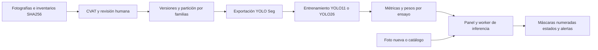

# Walmart Computer Vision

Laboratorio del proyecto Capstone DUOC UC para localizar niveles de góndola y clasificar su disponibilidad visual en fotografías. Equipo: Vicente Canio, Paulo Guerra y Vicente Vilches. Docente: Arturo Vargas. Contraparte: José Larraín.

**Entrega reproducible:** `avance-2026-10-20`, con dos modelos V1 y dos V2 base. Código y metadatos en Git; datos, pesos y documentos grandes en activos de la misma Release. La descarga remota requiere que esa Release haya sido publicada.

## Empezar desde otro computador

Para **probar fotografías sin instalar el laboratorio**, descargar `Walmart_Lite_V2_20261020.zip` de la [Release](https://github.com/vcanio/Capstone2026/releases/tag/avance-2026-10-20), extraer todo y ejecutar `Walmart_Lite/iniciar.cmd`. El primer inicio requiere Internet; usa Python privado y CPU. V2 base distingue reponer y suficiente, y no reconoce no evaluable.

Para **desarrollar, evaluar o entrenar**, instalar Git, Python 3.11/3.12 y Docker con contenedores Linux. En PowerShell:

```powershell
git clone https://github.com/vcanio/Capstone2026.git
cd Capstone2026
python Herramientas/Reproducibilidad/preparar.py
& ./Herramientas/Modelos/iniciar_panel.ps1 -Cpu -Build
```

Abrir http://localhost:8090. El preparador verifica hashes y conserva rutas y particiones. El inicio base no requiere tu cuenta ni los archivos privados del CVAT original. Para preparar sin descargas remotas, usar `--assets RUTA_A_LOS_ZIP`.

- [Instalación completa, ejemplo y repetición de entrenamientos](Documentacion/Replicar_proyecto.md).
- [Guía de commit, push y publicación de los activos](Documentacion/Publicar_GitHub.md).
- [Cómo trabajar en equipo: ramas, PR y actualizaciones](Documentacion/Trabajo_en_equipo.md) · [PDF](Documentacion/Trabajo_en_equipo.pdf).
- [Verificación de la entrega](reproducibilidad/VERIFICACION.md).
- [Manifiesto de archivos y hashes](reproducibilidad/artefactos.json).

## Informe intermedio

El informe histórico del 20 de octubre contiene 20 casos visuales y las limitaciones de la evaluación. Descargar `Walmart_Informe_20261020.zip` de la Release o instalarlo con `python Herramientas/Reproducibilidad/preparar.py --paquetes informe`.

- [Fuente Markdown](Documentacion/Informe_Intermedio_Avance_20261020.md).
- Versiones locales después de preparar: [PDF](Entregables/Informe_Intermedio_Avance_20261020.pdf), [Word](Entregables/Informe_Intermedio_Avance_20261020.docx) y [HTML](Entregables/Informe_Intermedio_Avance_20261020.html).

## Problema y objetivos

Una góndola puede presentar faltantes visibles aunque haya mercadería en bodega. El objetivo es apoyar la inspección mediante fotografías, localizando niveles, identificando disponibilidad crítica y mostrando resultados revisables. El proyecto incluye datos propios, anotación humana, comparación de modelos y una ejecución reproducible.

El prototipo clasifica estados aprendidos; no cuenta SKU, mide profundidad o consulta inventario. La confianza de YOLO no es el porcentaje de ocupación. El 30 % es un criterio inicial de anotación pendiente de calibración con el cliente.

| Perfil | Estados y criterio |
|---|---|
| V1 operativo | `vacio` sin producto visible propio; `baja_disponibilidad` con producto y menos del 30 % del ancho; `suficiente` desde el 30 %; `no_evaluable` cuando no se puede decidir. |
| V2 base operativo | `reponer` reúne vacío y baja; `suficiente` mantiene el criterio del 30 %. |
| V2 completo pendiente | Añade `no_evaluable` para oclusiones que pueden cambiar la decisión. |

## Tecnologías y justificación

| Tecnología o decisión | Función y motivo |
|---|---|
| YOLO11n-seg y YOLO26n-seg | Segmentan niveles completos bajo perspectiva. Se comparan variantes Nano con idéntica partición; sus checkpoints quedan conservados por ensayo. |
| PyTorch 2.5.1+cu121 y Ultralytics 8.4.174 | Entorno registrado de entrenamiento GPU. Transferencia desde pesos generales e inferencia CPU/GPU. Ver `entorno.json` y `entrenamiento/args.yaml` de cada ensayo. |
| Polígonos amodales por nivel | Incluyen tanto productos como espacio vacío y siguen bordes inclinados. La tarea responde a reposición por repisa sin exigir un catálogo etiquetado por SKU. |
| OpenCV, Pillow, NumPy y Shapely | Orientación EXIF, preparación de imágenes, máscaras y comprobaciones geométricas. |
| CVAT | Anotación colaborativa y revisión humana. Un hash verifica integridad de archivos, pero no demuestra que una etiqueta sea correcta. |
| Familias y grupos de escena | Mantienen original y variantes en el mismo destino y reducen fugas. La separación dentro de una captura no demuestra generalización entre locales. |
| Python y HTML/CSS/JavaScript | Panel local, importador, subprocesos de entrenamiento/inferencia y revisión de resultados. |
| Docker Compose | Facilita conservar dependencias. Datos, pesos y configuración deben estar disponibles por separado. |

Fusionar vacío y baja en `reponer` refleja la misma acción de reposición y reduce distinciones ambiguas. V1 y V2 también cambian dataset y partición, por lo que la mejora de métricas no puede atribuirse solo a esa fusión.

## Arquitectura y procesamiento




El panel importa anotaciones sin modificar dibujos en CVAT, valida el inventario y exige revisión antes de exportar. Cada ensayo conserva configuración, snapshot, versión, pesos y evaluación. En inferencia se orienta la fotografía, se ejecuta el modelo y se numeran las detecciones de abajo hacia arriba y de izquierda a derecha. La evaluación propia empareja máscaras de forma única con IoU ≥ 0,50 a confianza 0,25.

## Datos y preparación

| Lote | Procedencia y tamaño | Preparación y uso |
|---|---|---|
| [V1](Datos/V1/README.md) | 37 fotografías reales: 30 de desarrollo y 7 de reserva; 72 variantes sintéticas. | 102 candidatas; 11 exclusiones por calidad; copia activa de 91 imágenes: 86 train y 5 reales val, con 719 niveles. |
| [V2 Líder Express](Datos/V2/lider_express_20261016/README.md) | 59 originales reales y 177 variantes IA: 236 imágenes. | 59 familias y 19 grupos; copia de entrenamiento con 1.212 polígonos. 160 train; 10 originales val; 30 variantes de diagnóstico; 9 originales y 27 variantes de test. |
| [V2 visibilidad limitada](Datos/V2/visibilidad_limitada_20261019/README.md) | 60 ediciones sintéticas: 24 carros, 24 personas y 12 cajas. | 308 polígonos pendientes de cierre semántico. Destinos: 41 train, 10 val y 9 test. |

Total: **405 imágenes únicas** (96 reales y 309 sintéticas). Los **435 registros** de inventario incluyen referencias repetidas; no son 435 fotografías independientes. Los inventarios conservan origen, dimensiones, familia, ruta y SHA-256. Las variantes IA se revisan humanamente; A/B/C no determina su etiqueta.

El [registro de partición](Datos/Registros/Particiones/lider_express_v2_20261019/README.md) conserva tres grupos para val y dos para test. Hay un solo nivel real `reponer` en val y otro en test. El conjunto sintético se evalúa por separado.

La versión V2 base usada es `datos_20261019_234626_3df2e643`, con estado `lista_niveles`; sus manifiestos y exportaciones son la referencia del ensayo. Hay registros previos con conteos distintos y textos de lotes que aún indican exportación pendiente. Esa diferencia histórica no convierte la tarea 22 de oclusiones en un dataset aprobado.

## Estado y resultados

| Componente | Estado al corte |
|---|---|
| Inventarios, importador, exportador y particionador | Implementados con artefactos y verificadores locales. |
| Entrenamiento y comparación | Cuatro ensayos conservados: dos V1 y dos V2 base. |
| Panel e inferencia | Código y resultados disponibles; falta aceptación completa de V2 con oclusiones. |
| Docker y CVAT | Arranque base sin CVAT; conexión opcional por perfil y credenciales personales. |
| Walmart Lite | Paquete V1 histórico y nueva demo V1/V2 base; falta comprobarla en otro equipo físico. |
| Oclusiones, deduplicación y prueba final | En desarrollo o pendientes. |

| Modelo | Val real | mAP50 máscara | mAP50–95 máscara | Localizados | Estados exactos | Alertas TP y FP |
|---|---|---|---|---|---|---|
| YOLO11 V1 | 5 fotos, 36 niveles | 74,47 % | 56,59 % | 35/36 | 33/36 | 0 TP, 2 FP; sin alertas reales |
| YOLO26 V1 | 5 fotos, 36 niveles | 73,38 % | 62,40 % | 35/36 | 34/36 | 0 TP, 0 FP; sin alertas reales |
| YOLO11 V2 base | 10 fotos, 51 niveles | 98,44 % | 86,26 % | 51/51 | 48/51 | 1 TP, 4 FP; 1 alerta real |
| YOLO26 V2 base | 10 fotos, 51 niveles | 99,28 % | 92,79 % | 50/51 | 50/51 | 1 TP, 0 FP; 1 alerta real |

Fuentes: `metricas_validacion.json`, `metricas_alertas.json` y `evaluacion_por_imagen.json` de [Experimentos](Experimentos/README.md). mAP y conteos propios usan evaluadores distintos; no son equivalentes. El 100 % en alertas de YOLO26 V2 corresponde a **1/1** y no demuestra sensibilidad generalizable. La validación sirve para seleccionar modelos, no es test ciego. No se promedian métricas de V1 y V2 ni de imágenes reales y sintéticas.

## Organización del proyecto

```text
Contexto/          Enunciados y reunión con orientaciones
Datos/             V1, V2, inventarios, particiones y versiones
Herramientas/      Datos, Modelos, Demo_lite, CVAT e Informes
Infraestructura/   Docker y configuración local
Modelos/           Pesos generales gestionados por separado
Experimentos/      Configuración, métricas y pesos entrenados
Documentacion/     Guías, informe y evidencias
Entregables/       PDF, Word, HTML y demo portátil
```

## Instalación y ejecución

Se requiere Windows x64 con PowerShell y Docker Desktop para los comandos de inicio. El entorno de entrenamiento conservado usa Python 3.11; los scripts locales admiten Python 3.11/3.12. La GPU NVIDIA requiere acceso desde Docker; el modo CPU evita ese requisito. No se certifica aquí un límite de RAM/VRAM ni la latencia en hardware externo.

Un clon del código necesita también las imágenes, versiones exportadas y pesos de los ensayos. El manifiesto reproducibilidad/artefactos.json fija las descargas de la Release. Antes de publicarla, se puede usar --assets con los ZIP transferidos. No se distribuyen credenciales del equipo. CVAT es opcional para ejecutar pesos y versiones ya exportadas.

### Preparar Python local

```powershell
python -m venv .venv-modelo
& ./.venv-modelo/Scripts/python.exe -m pip install -r Herramientas/Modelos/requirements.txt
```

### Iniciar el panel

```powershell
# CPU y construcción inicial de la imagen
& ./Herramientas/Modelos/iniciar_panel.ps1 -Cpu -Build
# GPU NVIDIA configurada
& ./Herramientas/Modelos/iniciar_panel.ps1 -Build
```

Abrir http://localhost:8090. Elegir V1 o V2, seleccionar modelo y analizar una fotografía. Para modificar anotaciones se necesita CVAT y su configuración: consultar [Docker](Infraestructura/Docker/README.md) y la [guía del panel](Herramientas/Modelos/README.md). La inferencia con pesos y datos ya disponibles no requiere editar CVAT.

**Ejemplo comprobable:** elegir `v2_base_yolo26n_01`, usar `lider_express_040_0_original.jpg` y confianza 0,25. La evaluación conservada espera cinco niveles: cuatro suficientes y uno reponer. Revisar el primer caso del informe. Una foto propia sin anotación permite revisar predicciones, pero no medir precisión.

### Verificar integridad y pruebas

```powershell
& ./.venv-modelo/Scripts/python.exe Herramientas/verificar_proyecto.py
& ./.venv-modelo/Scripts/python.exe Herramientas/Datos/particionar_lider_express.py --verify
& ./.venv-modelo/Scripts/python.exe -m unittest discover -s Herramientas/Datos
& ./.venv-modelo/Scripts/python.exe -m unittest discover -s Herramientas/Modelos
```

El [registro de verificación del informe](Documentacion/Evidencias/verificacion_informe_20261020.json) conserva lo ejecutado y sus límites. Un test de código aprobado no prueba precisión del modelo ni independencia física de las escenas.

### Demo portátil y regeneración del informe

La nueva entrega es `Walmart_Lite_V2_20261020.zip`, con los cuatro modelos V1/V2 base; extraerla y ejecutar `Walmart_Lite/iniciar.cmd`. El ZIP del 15 de octubre conserva su alcance histórico V1. El primer arranque descarga dependencias. Ver [guía](Herramientas/Demo_lite/LEEME.md) y [límites](Herramientas/Demo_lite/VERIFICACION.md).

Con `python-docx` y `Pillow`, ejecutar `Herramientas/Informes/generar_informe_intermedio.py` para regenerar Word y HTML desde el Markdown, sin consultar modelos ni la reserva final. Exportar el Word a PDF y revisar el formato antes de distribuirlo.

## Próximos pasos

Cerrar revisión de tarea 22, ampliar faltantes reales, entrenar tres estados, evaluar deduplicación sobre val, acordar criterios de aceptación y congelar el modelo antes de test. Después, demostrar ejecución en otro equipo y publicar el código con los activos preparados. La [Carta Gantt y los responsables propuestos](Documentacion/Informe_Intermedio_Avance_20261020.md) están en el informe.

Los componentes de terceros conservan las licencias de sus distribuciones. Los términos de publicación del dataset, código propio y pesos deben documentarse en la entrega.
