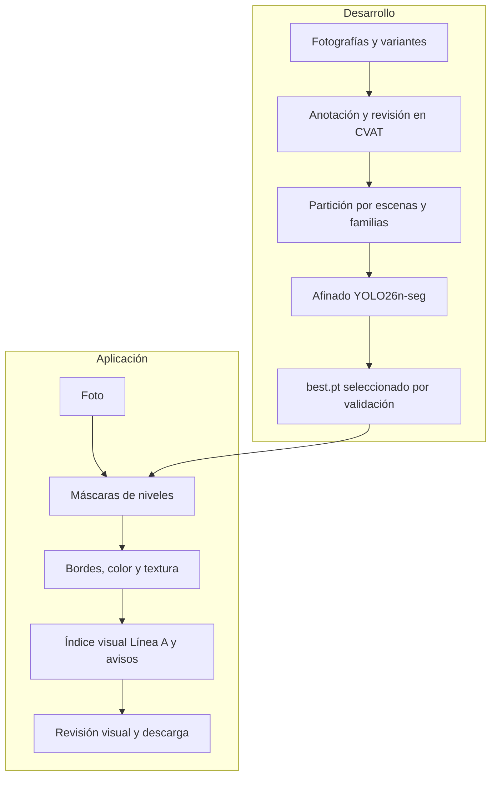
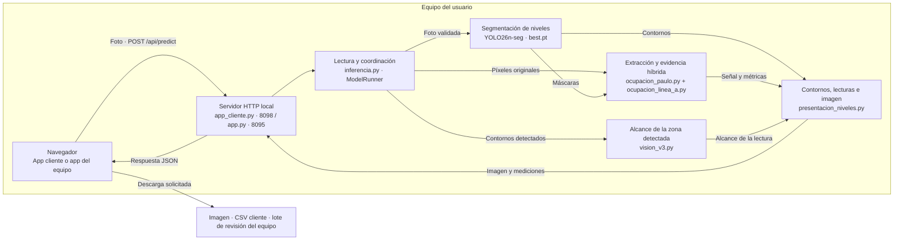

# 🛒 Walmart Computer Vision

**Análisis de disponibilidad en góndolas mediante visión por computador**

Estado actualizado al **10 de noviembre de 2026** · proyecto académico · versión de prueba r2 con licencias.

Proyecto Capstone de **DUOC UC** orientado a apoyar la inspección visual de góndolas a partir de fotografías. **Walmart Visión** reúne una app cliente y una mesa de revisión del equipo. Ambas identifican los niveles, delimitan sus áreas útiles y calculan un índice visual para ayudar a revisar posibles faltantes.

| 🚀 Probar la aplicación | 🎬 Demostración en video | 📖 Entender el proyecto | 🧪 Explorar los resultados |
|:---:|:---:|:---:|:---:|
| [**Descargar apps cliente y equipo**](https://github.com/vcanio/Capstone2026/releases/download/walmart-vision-apps-prueba-2026-11-10-r2/Walmart_Vision_Cliente_y_Equipo_20261110_r2_licencias.zip) | [**Ver video funcional (7 min)**](https://youtu.be/sN_6XPdxtKk) | [**Guía de funcionamiento**](Documentacion/Guia_para_entender_el_proyecto.md) | [**Modelo actual y métricas**](Documentacion/Modelo_V3_actual.md) |
| Windows x64 · Docker · [Prueba del 10/11](https://github.com/vcanio/Capstone2026/releases/tag/walmart-vision-apps-prueba-2026-11-10-r2) | Recorrido de la versión anterior V2; la interfaz V3 ya cambió | Niveles, ocupación, señal y visibilidad | Último afinado V3 · evaluación y límites |

## Prueba de cliente y equipo · 10 de noviembre

[**Descargar ambas apps con el modelo**](https://github.com/vcanio/Capstone2026/releases/download/walmart-vision-apps-prueba-2026-11-10-r2/Walmart_Vision_Cliente_y_Equipo_20261110_r2_licencias.zip) · [Notas y SHA-256](https://github.com/vcanio/Capstone2026/releases/tag/walmart-vision-apps-prueba-2026-11-10-r2).

Extrae todo. Windows x64: `Walmart_Vision/iniciar_cliente.cmd` (8098) o `Walmart_Vision/iniciar_equipo.cmd` (8095). El primer inicio prepara Python/dependencias y requiere Internet. Docker: `docker compose -f compose.apps.yaml up --build -d --wait` desde `Walmart_Vision`.

[App cliente](Aplicacion_Cliente/README.md): prioridades, checklist y CSV. [App del equipo](Aplicacion/Documentacion/REVISION_EQUIPO.md): comparación, marcado por nivel/zona y lotes de revisión. Cada colega ejecuta su copia local; no hay sincronización ni alojamiento web. Carga fotos propias: el dataset no se incluye.

Ambas usan el modelo oficial del 5/11 y Línea A del 8/11, índice visual preliminar 0–100, umbral 52. No mide porcentaje físico de stock ni detecta personas u obstáculos. Requiere revisión visual. No es una evaluación final. La [release del 5/11](https://github.com/vcanio/Capstone2026/releases/tag/walmart-vision-v3-2026-11-05) se conserva como antecedente con su estimador anterior y sus archivos.

## Explorar las carpetas

[**App cliente**](Aplicacion_Cliente/README.md) · [**App del equipo**](Aplicacion/README.md) · [**Laboratorio**](Laboratorio/README.md) · [**Datos**](Datos/README.md) · [**Modelo vigente**](Modelos/Actual/README.md) · [**Entregables**](Entregables/README.md) · [**Histórico**](Historico/README.md)

Las fuentes actuales se organizan por función y los antecedentes se reúnen en Histórico. Consulta el [mapa del proyecto](Documentacion/Desarrollo/Mapa_del_proyecto.md).

## Contenido

- [¿Qué hace el sistema?](#qué-hace-el-sistema)
- [Inicio rápido: Walmart Visión](#inicio-rápido-walmart-visión)
- [Qué consideramos un nivel](#qué-consideramos-un-nivel)
- [Interpretar los resultados](#interpretar-los-resultados)
- [Modelo actual y resultados](#modelo-actual-y-resultados)
- [Arquitectura y funcionamiento](#arquitectura-y-funcionamiento)
- [Datos y entrenamiento](#datos-y-entrenamiento)
- [Tecnologías](#tecnologías)
- [Decisiones técnicas y alternativas](#decisiones-técnicas-y-alternativas)
- [Documentación y recursos](#documentación-y-recursos)
- [Estado actual de la implementación](#estado-actual-de-la-implementación)
- [Limitaciones y próximos pasos](#limitaciones-y-próximos-pasos)
- [Equipo](#equipo)
- [Licencia y autoría](#licencia-y-autoría)

---

## ¿Qué hace el sistema?

El objetivo es **facilitar la revisión de niveles con posibles faltantes visibles**. A partir de una fotografía, el sistema:

1. **Detecta** cada nivel y **segmenta** su área útil, incluidos los espacios sin producto.
2. **Analiza** bordes, color y textura dentro de los niveles detectados.
3. **Estima** la ocupación visual y señala posibles necesidades de reposición.
4. **Muestra** contornos, índices y avisos para que una persona revise el resultado.
5. **Organiza el trabajo:** el cliente prioriza fotos y genera una hoja CSV; el equipo compara resultados, marca fallos y exporta lotes de revisión.

Trabajamos por nivel de góndola para ubicar posibles faltantes en una repisa completa. El sistema **no cuenta unidades, no identifica SKU, no mide profundidad ni consulta inventario**.

Las dos apps comparten motor y modelo; el laboratorio tiene otro propósito:

| Componente | Para qué sirve | Público |
|---|---|---|
| **App cliente · 8098** | Priorizar fotos, revisar niveles, marcar «Repuesto» y descargar hoja CSV. | Supervisores y equipos de reposición, en pruebas. |
| **App del equipo · 8095** | Comparar análisis, revisar bordes, marcar fallos por nivel/zona y exportar lotes ZIP. | Equipo de desarrollo y evaluadores. |
| **Laboratorio de desarrollo** | Preparar datos, revisar anotaciones, entrenar y evaluar modelos. | Equipo de desarrollo. |

**Para usar la app no necesitas instalar el laboratorio ni CVAT.**

## Inicio rápido: Walmart Visión

La entrega actual es la [**prueba r2 de cliente y equipo del 10/11**](https://github.com/vcanio/Capstone2026/releases/tag/walmart-vision-apps-prueba-2026-11-10-r2). Incluye ambas apps, un único modelo oficial y los textos de licencia. Cada persona ejecuta su copia local; GitHub distribuye los archivos y no aloja un servicio de análisis ni sincroniza sesiones.

### Windows x64

1. Descarga [Walmart_Vision_Cliente_y_Equipo_20261110_r2_licencias.zip](https://github.com/vcanio/Capstone2026/releases/download/walmart-vision-apps-prueba-2026-11-10-r2/Walmart_Vision_Cliente_y_Equipo_20261110_r2_licencias.zip) y extrae **todo** el contenido.
2. Abre `Walmart_Vision/iniciar_cliente.cmd` para la app cliente, o `Walmart_Vision/iniciar_equipo.cmd` para la app del equipo.
3. El primer inicio prepara Python 3.12 y las dependencias dentro de la carpeta; necesita Internet. Deja abierta la consola mientras uses la app.
4. Carga fotos JPG, PNG o WebP de hasta **10 MB cada una** y 24 megapíxeles. Revisa los contornos y la visibilidad antes de interpretar la lectura.

| Aplicación | Dirección | Flujo principal |
|---|---|---|
| Cliente | [http://127.0.0.1:8098](http://127.0.0.1:8098) | Prioridades de reposición, detalle por nivel, checklist y CSV. |
| Equipo | [http://127.0.0.1:8095](http://127.0.0.1:8095) | Original/Niveles/Bordes/Comparar, marcado por nivel o zona y lotes ZIP. |

En ambas apps la confianza inicial de YOLO es **0,60**. El cliente la usa preconfigurada; la app del equipo permite ajustarla desde **0,25**. No es el índice visual ni una medida de stock.

### Docker, incluido macOS

Con Docker Desktop abierto, desde la carpeta `Walmart_Vision` extraída:

```bash
docker compose -f compose.apps.yaml up --build -d --wait
```

Abre las dos direcciones de la tabla. Para detener ambas apps:

```bash
docker compose -f compose.apps.yaml down
```

Se validó la configuración Compose. El ZIP r2 se probó mediante HTTP e inferencia CPU desde una extracción limpia en este equipo; no se repitió un build Docker ni una prueba física en Mac porque Docker estaba apagado. Las pruebas de macOS de releases anteriores siguen siendo antecedentes, no una verificación nueva de esta entrega.

### Desde un clon

El repositorio incluye el peso oficial y el preparador Windows. Ejecuta `Aplicacion_Cliente/iniciar_cliente.cmd` o `Aplicacion/iniciar.cmd`. En Docker, ejecuta el comando anterior desde la raíz del clon, donde está `compose.apps.yaml`.

### Fotografías y privacidad

Toma fotos **frontales o casi frontales**, con la cámara nivelada, ambos extremos del tramo y las superficies de apoyo visibles. Evita desenfoque, reflejos fuertes y tomas oblicuas. Para una góndola larga, utiliza varias tomas de tramos completos. No existe un ángulo máximo validado ni un detector automático que certifique la visibilidad.

Las fotos se procesan en el equipo y no se incorporan al entrenamiento. La app del equipo guarda la sesión del lote en el navegador local y permite eliminarla; el cliente mantiene el lote y el checklist durante la sesión de la página. No hay sincronización entre computadores. Para devolver observaciones del modelo se comparte manualmente el lote ZIP exportado por la app del equipo.

El dataset y el catálogo local de demostración no vienen en el ZIP: carga fotos propias. Hay una [selección histórica de seis imágenes de ejemplo](https://drive.google.com/drive/folders/1z0-GNiRUJcVwbjLVkiDc20G2F8f9QASS?usp=sharing), tres reales y tres sintéticas, para explorar casos de la demostración anterior; no acredita precisión de la versión actual.

[Guía cliente](Aplicacion_Cliente/README.md) · [Guía de revisión del equipo](Aplicacion/Documentacion/REVISION_EQUIPO.md) · [Descargas e historial](Entregables/README.md).

La [distribución del 5/11](https://github.com/vcanio/Capstone2026/releases/tag/walmart-vision-v3-2026-11-05) conserva su estimador anterior y su estructura con `iniciar.cmd`; las instrucciones anteriores de ese paquete no sustituyen las de la entrega conjunta r2.

## ¿Qué consideramos un nivel?

Un **nivel** es el área útil de una repisa donde pueden existir **productos y huecos**. Se dibuja un polígono para el espacio completo del mismo tramo de góndola, siguiendo su perspectiva; no se dibuja una máscara por envase ni solo la banda frontal del estante.

| Límite | Criterio de anotación |
|---|---|
| Inferior | Superficie donde apoyan los productos, **por encima del portaprecio**. Se excluyen la franja del precio y el espesor frontal del estante. |
| Superior, cuando existe | Cara inferior de la repisa o cubierta física que cierra el espacio. |
| Laterales | Límites interiores del mismo tramo; no se amplía la zona hasta pilares, suelo u otras góndolas. |
| Huecos | Forman parte del área útil, aunque no haya productos. Un nivel vacío sigue siendo un nivel. |

La región se define por la estructura y la convención de anotación, sin ajustarla a la altura de los envases. Un cartel o panel sin una superficie de apoyo asociada no crea otro nivel. Las barandas que atraviesan un nivel pueden quedar dentro de su región y deben tratarse en el análisis de señal; su exclusión automática todavía es imperfecta.

### Superior abierto: por qué acordamos usar la mediana

En una repisa superior sin techo claro era difícil fijar un límite consistente: una persona podía seguir las tapas de los envases, otra un cartel y otra una altura elegida a ojo. Al retirar los productos, esas referencias desaparecían y el mismo nivel lleno o vacío podía terminar con áreas diferentes. Eso introduce una contradicción en los ejemplos usados para enseñar al modelo.

La solución acordada fue una **convención de anotación reproducible**:

1. Si hay una cubierta o un límite físico superior claro, se respeta.
2. Si falta, se miden las alturas verticales de los niveles inferiores del **mismo tramo**. Con perspectiva se mide la altura en el centro de cada polígono.
3. Se calcula la **mediana**, conservando decimales. Con cuatro referencias de 190, 195, 210 y 220 píxeles, la mediana es **202,5 píxeles**.
4. Desde el apoyo del superior, situado **sobre el portaprecio**, se proyecta esa altura hacia arriba. No se utiliza como base, sin comprobarlo, el borde del polígono de abajo: puede representar la cara inferior del estante.
5. Se mantiene el criterio en el original y sus variantes llenas o vacías. Si la proyección sale de la foto, se recorta al encuadre y se marca **parcial**; no se reduce la altura para hacerla caber.

La mediana reduce la influencia de una altura inferior excepcional frente a un promedio simple. **No demuestra la altura física real de un espacio abierto:** fija una región comparable para anotar. Se utilizan habitualmente al menos tres inferiores medibles; las excepciones autorizadas con dos referencias son casos documentados, no una regla general.

**La app no recalcula ni fuerza la mediana al analizar una foto.** YOLO predice sus propias máscaras a partir de lo aprendido; puede omitir un superior o delimitarlo mal. Esos errores se conservan como limitaciones y deben revisarse visualmente.

[Criterio de anotación V3](Documentacion/Desarrollo/Criterio_V3_niveles.md) · [Regla completa de mediana](Documentacion/Desarrollo/Regla_nivel_superior_mediana_V3.md)

## Interpretar los resultados

Los niveles se numeran **de abajo hacia arriba** y de izquierda a derecha cuando comparten fila. La versión actual usa **Línea A**, revisión `linea_a_20261108_contornos_conservados`, para un índice visual de **0 a 100**, con umbral **52**.

| Resultado | Significado |
|---|---|
| **Reponer** | Índice menor a 52, cuando la señal permite decidir. |
| **Suficiente** | Índice desde 52, sujeto a las reglas de revisión; no certifica stock físico. |
| **Revisar / Verificar** | Señal ambigua, contorno recortado o falta de medición; requiere revisión humana. |
| **Sin niveles detectados** | Se solicita otra toma. No detectar un nivel no significa que esté vacío. |

La app cliente traduce estas lecturas a prioridades y acciones de reposición. La app del equipo conserva el detalle técnico, los mapas y las herramientas de revisión. Los mensajes sobre huecos o frentes son interpretaciones de señal visible y requieren comprobar la foto.

### Cómo se obtiene el índice

1. **YOLO delimita niveles** mediante máscaras. El análisis utiliza los píxeles originales dentro de esas áreas, sin medir los colores o rótulos dibujados sobre el resultado.
2. **Se extraen bordes, gradiente, color y textura.** Se conserva Canny y la exclusión estructural de rieles para reducir su contribución a la señal.
3. **Línea A comparte la normalización entre niveles de la misma góndola**, combina evidencia híbrida y penaliza huecos continuos.
4. **Se aplican las guardas de señal ambigua y de encuadre.** Cuando la lectura lo permite, se compara el índice con 52; en los casos ambiguos se solicita revisión.

El fucsia de la vista Bordes representa la evidencia visual combinada. No confirma por sí mismo la presencia de producto. El índice no cuenta unidades, no reconstruye profundidad ni mide el inventario detrás de lo visible. Un valor 70/100 **no significa 70 % físico de stock**. La confianza YOLO de 0,60 es otro parámetro.

[Implementación portable de Línea A](Aplicacion/ocupacion_linea_a.py) · [Extracción de señal](Aplicacion/ocupacion_paulo.py) · [Integración y límites](Aplicacion/Documentacion/LINEA_A_20261108.md).

### Evidencia disponible y límites

El umbral tiene **ajuste preliminar**. En 112 niveles etiquetados de validación con máscaras humanas se detectaron 15 de 16 alertas, sin falsas alertas en esa muestra; se detectó solo **1 de 2 críticos reales**. La muestra incluye casos sintéticos y usa máscaras humanas: no acredita por sí sola el flujo completo con máscaras predichas por YOLO, ni equivalencia con el baseline histórico.

Carteles, fondos, barandas y envases lisos todavía pueden confundir la señal. Las guardas de ambigüedad no son detectores automáticos de personas, obstáculos o carteles. El modelo tampoco determina si la góndola está completa. El test final permanece reservado y no se presenta una evaluación final del sistema.

## Modelo actual y resultados

Ambas apps comparten un único modelo oficial: el **best.pt del refuerzo de geometría terminado el 5 de noviembre**, derivado de `yolo26n-seg.pt` a través del afinado del 2/11. Su clase aprendida es **Nivel**; la ocupación se calcula después y sigue siendo experimental.

| Modelo | Afinado | Validación | Distribución |
|---|---|---|---|
| YOLO26n-seg V3 | 171 fotos, 40 épocas | 59 reales + 34 sintéticas, separadas | [Cliente y equipo r2](https://github.com/vcanio/Capstone2026/releases/tag/walmart-vision-apps-prueba-2026-11-10-r2) |

| Máscaras | Fotos | mAP50 | mAP50–95 |
|---|---:|---:|---:|
| Validación real | 59 | 99,50 % | 89,95 % |
| Diagnóstico sintético | 34 | 99,50 % | 93,14 % |

Estas cifras evalúan geometría, no ocupación ni reposición. La partición de desarrollo cambió; no se comparan directamente con los agregados históricos. La reserva final de **63 fotos de test permanece sin utilizar**. La adopción expresa de Vicente no certifica ausencia de errores.

SHA-256 del peso: `7ec03c8b6aa1164bc8589faf1e3dc904aefe4d6d8b781c1e1df1aff320dad40a`.

[Ficha del modelo](Documentacion/Modelo_V3_actual.md) · [Adopción y procedencia](Documentacion/Desarrollo/Modelo_oficial_V3_20261105.md).

## Arquitectura y funcionamiento

Separamos **aprender a localizar niveles** de **analizar una fotografía nueva**:



El modelo conserva sus máscaras originales. La estimación se calcula sobre los píxeles de la foto dentro de esas áreas; no sobre los contornos coloreados ni los rótulos dibujados en el resultado.

En las anotaciones, el superior abierto se delimita por la mediana de las alturas inferiores cuando no hay un techo físico claro. **La app no impone esa mediana durante la predicción**: el modelo puede desviarse del criterio aprendido.

[Explicación del funcionamiento](Documentacion/Guia_para_entender_el_proyecto.md) · [Criterio de niveles V3](Documentacion/Desarrollo/Criterio_V3_niveles.md) · [Regla de mediana](Documentacion/Desarrollo/Regla_nivel_superior_mediana_V3.md)

### Componentes de la aplicación

Las dos apps funcionan en el equipo del usuario. Sus servidores HTTP locales comparten `inferencia.py`, el modelo oficial y Línea A. El cliente presenta prioridades y exporta CSV; la mesa del equipo permite comparar, registrar fallos y exportar lotes de revisión.



El diagrama representa las responsabilidades y los datos que intercambian los módulos. `ModelRunner` localiza niveles y calcula la señal visual; la persona debe revisar obstáculos y zonas tapadas. La presentación combina geometría, métricas y alcance para mostrar la lectura final. La descarga del resultado es una acción del usuario. La mesa del equipo conserva la sesión del lote en el navegador local. El cliente mantiene el lote durante la sesión de la página. Los archivos se comparten solo cuando el usuario los exporta y entrega.

CVAT, las particiones y el entrenador pertenecen al flujo de desarrollo del primer diagrama. **No son dependencias del visor durante la inferencia**: la app distribuida incluye el modelo y los módulos que necesita para analizar fotos.

## Datos y entrenamiento

El modelo oficial parte del best.pt aceptado el 3 de noviembre. El refuerzo seleccionó **171 fotos para entrenar**, con evaluación separada sobre **59 reales y 34 sintéticas**, usando la partición de desarrollo por escenas `v3_refuerzo_geometria_20261104`. El conjunto incorpora la revisión geométrica y repaso de escenas anteriores. R254 permanece excluida. La reserva final de 63 fotos no se utilizó.

Las nuevas revisiones y lotes no se incorporan automáticamente al modelo: requieren selección y revisión explícitas. Solo Vicente inicia entrenamiento desde el panel. Los inventarios históricos y sus particiones se conservan para reproducir los ensayos anteriores. Las cifras de 469 imágenes que siguen describen el catálogo de octubre, no la selección del modelo oficial de noviembre.

### Origen y composición del catálogo V3 de octubre

Las fotografías originales fueron tomadas por el equipo en locales Líder, y las anotaciones fueron realizadas por el equipo usando CVAT, según lo confirmado por Vicente. El corpus incluye variantes sintéticas generadas a partir de esas capturas. La autoría y las condiciones de uso están documentadas en [Licencias y procedencia](LICENCIAS.md). Los registros distinguen **Líder Express**, el lote identificado localmente como **Líder 2** y un refuerzo de papeles/servilletas. El nombre Líder 2 es un identificador del lote; no se presenta como el nombre oficial de una sucursal. El corpus operativo V3 es propio del proyecto; los pesos generales preentrenados se utilizan como punto de partida del modelo, no como fotografías adicionales de este catálogo.

| Procedencia | Reales | Sintéticas | Total | Aporte al conjunto |
|---|---:|---:|---:|---|
| Líder Express, captura del 16 de octubre | 59 | 177 | 236 | Originales y variantes A/B/C con distintos escenarios de disponibilidad. |
| Visibilidad limitada, derivada de Líder Express | 0 | 60 | 60 | Ediciones con personas, carros y cajas delante de la góndola. |
| Superiores vacíos D, derivados de Líder Express | 0 | 40 | 40 | Ejemplos para mantener la detección del superior aunque no tenga productos. |
| Líder 2, captura del 17 de octubre | 122 | 0 | 122 | Otras estructuras y distribuciones de productos, incluidos los ejemplos de huevos. |
| Refuerzo de papeles/servilletas del 25 de octubre | 11 | 0 | 11 | Nuevas tomas reales relacionadas con escenas de papeles ya registradas. |
| **Total del catálogo V3** | **192** | **277** | **469** | Imágenes catalogadas; una permanece desactivada para entrenamiento. |

Las variantes A/B/C, los obstáculos y los superiores vacíos son **ediciones generadas con IA**; no son nuevas capturas reales. Sus nombres y prompts describen la edición solicitada, sin asignar automáticamente una etiqueta verdadera de ocupación. Las seis fotos de huevos y las 32 superiores vacías de la selección final ya pertenecen al catálogo: no se suman otra vez a las 469 imágenes.

### Limpieza, etiquetado y preparación

1. **Inventario e integridad.** Se registran procedencia, nombres, dimensiones y SHA-256, se comprueba que las imágenes se puedan abrir y se contrastan hashes para detectar duplicados exactos. Las vistas distintas de una misma escena se conservan, pero se agrupan; un archivo distinto no se considera automáticamente un ejemplo independiente.
2. **Revisión de variantes.** Se identifican las imágenes sintéticas y su original. Se revisa su geometría y no se copian polígonos sin comprobar que la edición conserve encuadre, dimensiones y perspectiva.
3. **Etiquetado en CVAT.** Se utiliza una sola clase de segmentación, `Nivel`, con polígonos del área útil completa, incluidos los huecos. Los atributos `delimitacion` y `Occluded` registran revisión y oclusión; no son clases que YOLO prediga. Se aplica el criterio de apoyo sobre el portaprecio y la mediana del superior abierto descritos arriba.
4. **Control de calidad antes de exportar.** Las anotaciones requieren revisión humana. Se aparta la foto completa ante límites pendientes o dudosos, desactivación o geometría incompatible. Una región parcial bien delimitada o un perímetro ocluido recuperable puede utilizarse para localizar niveles tras revisión explícita; eso no permite conocer el producto oculto. La exclusión de una foto no cambia su partición.
5. **Separación por familias y escenas.** Originales, variantes y vistas relacionadas heredan grupo y partición, evitando que la misma góndola aparezca a ambos lados de una comparación como si fuera independiente. Las 11 fotos nuevas se agruparon conservadoramente con la escena de papeles relacionada. Se mantienen **337 train / 69 val / 63 test**, con una train desactivada, y las sintéticas se evalúan separadas de las reales.
6. **Copias reproducibles para el ensayo.** Se exportan imágenes y polígonos revisados, se comprueba su correspondencia y se congelan selección, configuración y hashes. La orientación EXIF se resuelve en copias del ensayo para coincidir con la vista anotada; se conservan los originales. El afinado de octubre seleccionó 113 fotos de train con validación de 22 reales y 47 sintéticas; el refuerzo vigente de noviembre usa los recuentos indicados arriba. Los píxeles de test no entran en el dataset del ensayo ni en los ajustes de modelo u ocupación.

Esta preparación controla la coherencia y la trazabilidad de los datos; no convierte una variante sintética en evidencia de generalización ni certifica la exactitud de la ocupación. El uso de fotos con obstáculos para aprender geometría tampoco constituye entrenamiento de un detector automático de visibilidad.

[Datos actuales](Datos/README.md) · [Registros V3](Datos/Registros/README.md) · [Resumen numérico](Documentacion/Estado_V3_actual.json)

## Tecnologías

| Tecnología | Función actual | Por qué se utiliza |
|---|---|---|
| **YOLO26n-seg** | Segmentar una clase: Nivel. | Localiza el área útil de cada repisa, incluyendo espacios sin producto. |
| **PyTorch + Ultralytics** | Afinado del modelo e inferencia. | Permiten adaptar pesos preentrenados y conservar la configuración del ensayo. |
| **OpenCV + NumPy** | Bordes, color y textura dentro de las máscaras. | Aportan las señales visuales para estimar superficie y cobertura horizontal. |
| **Pillow** | Lectura, orientación y presentación de fotografías. | Permite preparar la imagen y dibujar contornos, rótulos y resultados descargables. |
| **Python + HTML/CSS/JavaScript** | Procesamiento local e interfaz de navegador. | Permiten cargar y revisar fotos sin ejecutar comandos para cada análisis. |
| **Docker** | Alternativa de ejecución del paquete. | Agrupa las dependencias para preparar el entorno. |
| **CVAT** | Anotación y revisión de datos durante el desarrollo. | Mantiene un criterio común de polígonos y atributos; no se necesita para usar la app. |

### Decisiones técnicas y alternativas

La selección técnica responde al objetivo de **revisar faltantes visibles por nivel con un conjunto acotado de imágenes y ejecución local**. Las ventajas siguientes explican el diseño; no sustituyen la evaluación de precisión ni justifican dar por resueltos los pendientes.

| Decisión | Alternativa considerada | Justificación, ventaja y límite |
|---|---|---|
| **Segmentar el área útil del nivel** | Usar solo cajas rectangulares o delimitar únicamente el frente del estante. | Una máscara permite seguir la perspectiva y definir dónde medir, incluidos los huecos; una caja puede incorporar fondo o zonas ajenas. Una banda frontal exigiría reconstruir después el espacio de productos y no resuelve el superior abierto. La máscara predicha puede equivocarse y debe revisarse. |
| **Una clase geométrica Nivel, separada de la reposición** | Aprender directamente estados como Reponer y Suficiente, como en V1/V2. | Permite mantener el mismo objetivo de localización en fotos llenas y vacías, e inspeccionar por separado un fallo de contorno y uno de ocupación. También permite modificar la interpretación de señal sin reentrenar el localizador. A cambio, la medición posterior necesita su propia validación: un buen mAP de niveles no acredita alertas correctas. |
| **YOLO26n-seg y ajuste fino de pesos existentes** | Entrenar desde cero o partir siempre de una arquitectura mayor. | Se prioriza una variante pequeña para una aplicación local y se reutilizan características aprendidas para adaptarlas a las góndolas con los datos disponibles. El último afinado parte de pesos propios V3, con optimizador nuevo y repaso de escenas anteriores. Esto evita reiniciar el aprendizaje desde cero; no demuestra que YOLO26 sea universalmente superior ni que el afinado haya mejorado globalmente al padre. |
| **Señal clásica con OpenCV y NumPy** | Entrenar otro modelo específico de ocupación o de productos. | Permite inspeccionar bordes, color y textura y ajustar reglas sin entrenar otro modelo, antes de contar con una evaluación específica de ocupación suficientemente revisada. Línea A combina evidencia híbrida con normalización por góndola y penalización por huecos; sigue siendo sensible a carteles, fondos y envases lisos. Su índice 0–100 y umbral 52 tienen ajuste preliminar. |
| **CVAT y revisión explícita de polígonos** | Exportar preanotaciones o aceptar etiquetas automáticas sin revisión. | Hace posible mantener una clase y un criterio comunes, registrar delimitaciones y oclusiones y verificar las correcciones sin confundir borrador con aprobación. La mediana aporta consistencia al superior abierto, conservando un techo físico real cuando existe. Requiere trabajo humano y no elimina la incertidumbre del contenido oculto. |
| **Python con PyTorch/Ultralytics y una interfaz web local** | Usar un servicio remoto para cada fotografía o exigir comandos en cada análisis. | El entorno integra entrenamiento e inferencia y permite compartir funciones de geometría y presentación entre laboratorio y visor. La interfaz de navegador facilita revisar fotos y descargar resultados; Pillow resuelve lectura/orientación y composición. Tras instalar dependencias, el análisis permanece en el equipo y no necesita enviar las imágenes a un servicio externo. La velocidad depende del hardware disponible. |
| **Docker como vía de ejecución en macOS** | Exigir la instalación manual de cada biblioteca y sus versiones. | Agrupa el entorno y conserva el mismo visor y modelo distribuido, reduciendo diferencias de dependencias entre equipos. La entrega conjunta incorpora Compose para las dos apps. La configuración se validó; el build actual y la prueba física en Mac siguen pendientes. La primera construcción requiere conexión y los recursos del contenedor siguen dependiendo del computador. |
| **Partición por escenas y evaluación separada de sintéticas** | Repartir cada imagen al azar y sumar todas las métricas. | Evita que variantes casi idénticas o vistas del mismo tramo inflen la evaluación al aparecer en train y val. Separar reales y sintéticas muestra qué evidencia sostiene cada resultado, mientras el test permanece reservado. Faltan escenas independientes de papeles y huevos para evaluar su generalización. |

## Documentación y recursos

| Necesidad | Recurso |
|---|---|
| Usar las apps actuales | [Cliente](Aplicacion_Cliente/README.md) · [Revisión del equipo](Aplicacion/Documentacion/REVISION_EQUIPO.md) |
| Consultar el manual general y antecedentes | [Manual de Walmart Visión](Documentacion/Usar_Walmart_Vision.md) |
| Entender el cálculo y sus límites | [Guía de funcionamiento](Documentacion/Guia_para_entender_el_proyecto.md) |
| Consultar entrenamiento y métricas vigentes | [Modelo V3 actual](Documentacion/Modelo_V3_actual.md) |
| Ubicar datos, herramientas y documentos | [Mapa del proyecto](Documentacion/Desarrollo/Mapa_del_proyecto.md) |
| Consultar estado de distribución | [Entregables](Entregables/README.md) |
| Continuar el desarrollo o preparar el laboratorio | [Referencia técnica](Documentacion/Desarrollo/README.md) |
| Revisar decisiones y etapas anteriores | [Archivo documental](Historico/Documentacion/README.md) |

### Carpetas principales

| Ruta | Contenido |
|---|---|
| [`Aplicacion/`](Aplicacion/README.md) | Mesa del equipo (8095), motor compartido, modelo oficial, revisión y lotes ZIP. |
| [`Aplicacion_Cliente/`](Aplicacion_Cliente/README.md) | Cliente de prueba (8098), prioridades, checklist y hoja CSV. |
| [`Datos/`](Datos/README.md) | Procedencias, anotaciones, particiones y selección del afinado. |
| [`Documentacion/`](Documentacion/README.md) | Guías de uso, criterios V3, decisiones técnicas y documentación de desarrollo. |
| [`Entregables/`](Entregables/README.md) | Acceso a la distribución publicada de la app y entregas académicas. |
| [`Fase 1/`](Fase%201/) | Material académico de la primera fase, conservado en su ubicación original. |
| [`Fase 2/`](Fase%202/) | Material académico de la segunda fase, conservado en su ubicación original. |
| [`Historico/`](Historico/README.md) | Documentación, experimentos y registros de reproducibilidad de etapas anteriores. |
| [`Infraestructura/`](Infraestructura/README.md) | Configuración técnica de servicios y entornos. |
| [`Laboratorio/`](Laboratorio/README.md) | Herramientas de datos, CVAT, entrenamiento, evaluación y reproducibilidad; incluye [experimentos](Laboratorio/Experimentos/README.md). |
| [`Modelos/`](Modelos/README.md) | Referencia del modelo V3 vigente y preentrenados generales para desarrollo. |

### Material académico y demostración

- 🎬 [**Demostración funcional (7 min 01 s)**](https://youtu.be/sN_6XPdxtKk): recorrido de la app y casos del informe en la versión anterior V2. Conserva valor como demostración del proyecto; no muestra la interfaz V3 actual.
- 📄 [**Informe intermedio en PDF**](Entregables/Informe_Intermedio_Avance_20261020.pdf) · [fuente del informe](Documentacion/Informe_Intermedio_Avance_20261020.md): resultados y casos fechados, conservados como antecedente académico.
- 📅 [**Planificación y metodología**](Documentacion/Planificacion_y_metodologia.md): hitos y organización del trabajo.
- 🖼️ [**Imágenes de ejemplo**](https://drive.google.com/drive/folders/1z0-GNiRUJcVwbjLVkiDc20G2F8f9QASS?usp=sharing) · [procedencia](Documentacion/Ejemplos/README.md): selección real y sintética de la demostración anterior.

## Estado actual de la implementación

| Componente | Estado actual | Alcance o pendiente |
|---|---|---|
| App cliente | **Publicada como prueba r2** | Carga de fotos, prioridades, checklist «Repuesto» y CSV. Requiere revisión visual. |
| Mesa del equipo | **Publicada como prueba r2** | Comparación, mapas, marcado por nivel/zona, atajos, recuperación de sesión y lotes ZIP. |
| Segmentación de niveles | **Operativa** | Modelo V3 oficial, clase Nivel. Puede omitir o delimitar mal; no se impone la mediana al predecir. |
| Línea A | **Operativa, preliminar** | Índice visual 0–100 y umbral 52; guardas de ambigüedad/recorte. Validación limitada, con fallos reales pendientes. |
| Personas y obstáculos | **Revisión humana** | No hay detector automático en el flujo estable. |
| Ejecución e instalación | **HTTP e inferencia CPU comprobados desde el ZIP en este equipo** | Preparador Windows incluido; primer inicio con Internet. Compose validado; sin nueva construcción Docker ni prueba física en Mac. |
| Modelo y preparación | **Ensayo oficial terminado** | 171 train, 59 val reales y 34 sintéticas. Usar las apps no inicia entrenamiento. |
| Evaluación final | **Pendiente** | Test de 63 fotos reservado; hacen falta escenas independientes. |
| Licencias | **Código bajo AGPL-3.0; procedencia de pesos documentada** | Autoría de datos documentada; licencia pública del dataset no concedida. Véase [LICENCIAS.md](LICENCIAS.md). |

GitHub conserva las fuentes, el peso operativo y los paquetes publicados. **No constituye un respaldo completo de los datasets, fotografías privadas, entornos ni resguardos locales.** Las releases anteriores conservan sus bytes y su alcance histórico.

## Limitaciones y próximos pasos

- **Ampliar la validación de Línea A:** carteles, fondos y envases pueden confundir la señal. El umbral 52 sigue siendo preliminar; la validación disponible solo detectó 1 de 2 críticos reales.
- **Automatizar y validar la visibilidad:** actualmente no se detectan personas u obstáculos de forma automática.
- **Revisar superiores:** en la familia `le_g10`, la foto 029 puede quedar sobredelimitada y la 030 omitir el superior.
- **Evaluar generalización:** faltan escenas independientes de papeles y huevos. El test se mantiene reservado.
- **Probar instalación en otros equipos y Docker/macOS:** las comprobaciones de esta revisión no sustituyen una nueva prueba física de la entrega conjunta en Mac.

El prototipo orienta la revisión visual. Sus índices y avisos requieren comprobar la foto y no sustituyen una medición de inventario.

## Equipo

**Capstone DUOC UC · 2026**

| Rol | Integrantes |
|---|---|
| Desarrollo | **Vicente Canio**, **Paulo Guerra** y **Vicente Vilches** |
| Docente | **Arturo Vargas** |


## Licencia y autoría

El código original del equipo se publica bajo [AGPL-3.0-only](LICENSE), por acuerdo confirmado el 10/11/2026. [Procedencia de fotos, anotaciones y pesos, alcance y condiciones](LICENCIAS.md) · [Avisos de terceros](NOTICE.md). El proyecto tiene finalidad académica; AGPL permite también usos comerciales sujetos a sus condiciones. Las fotografías y anotaciones no reciben una licencia pública por este acuerdo sobre el código.
