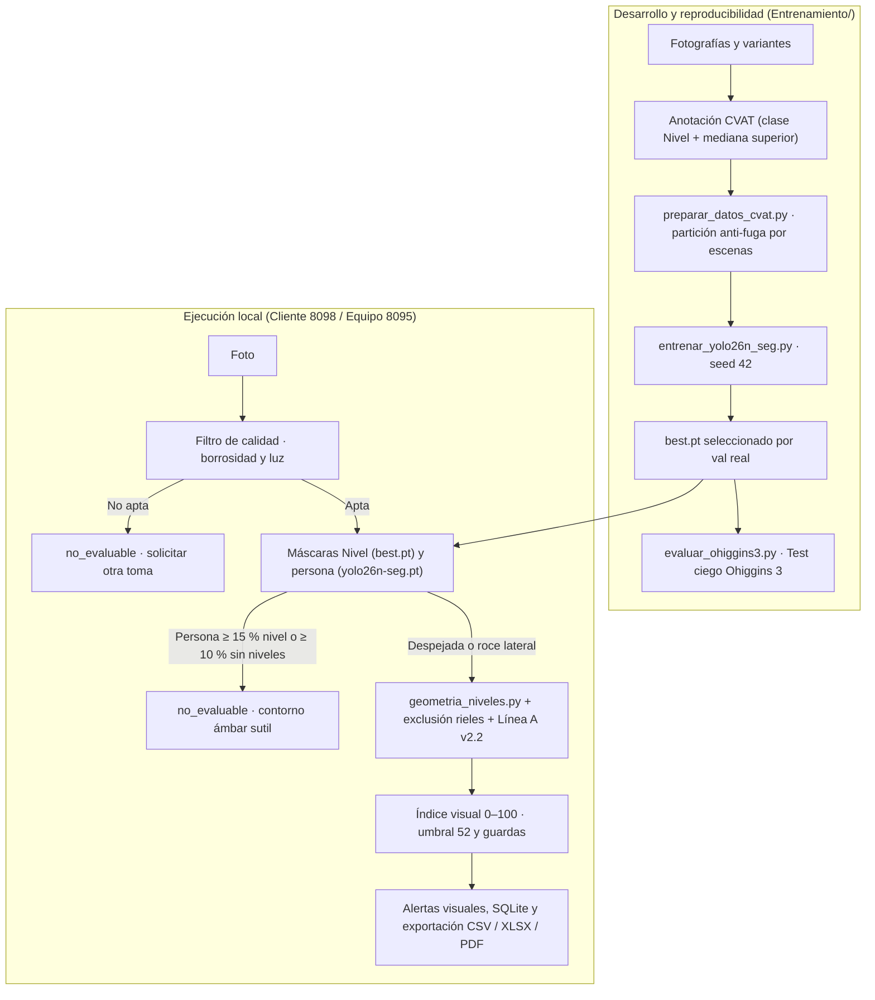
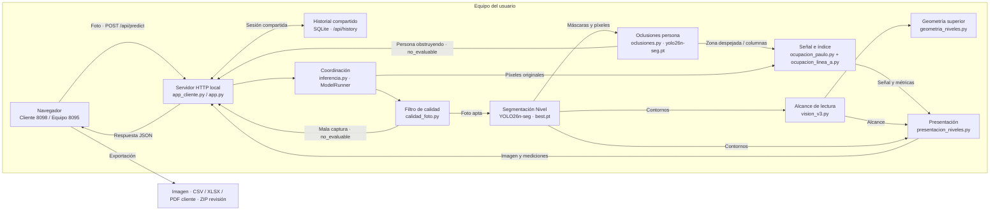

# 🛒 Walmart Computer Vision

**Análisis de disponibilidad en góndolas mediante visión por computador**

Proyecto Capstone de **DUOC UC** orientado a apoyar la inspección visual de góndolas a partir de fotografías. **Walmart Visión** reúne una app cliente y una mesa de revisión del equipo: ambas segmentan niveles de góndola, delimitan su área útil y calculan un índice visual para detectar posibles faltantes y apoyar la reposición.

| 🚀 Probar la aplicación | 🎬 Demostración en video | 📖 Entender el proyecto | 🧪 Modelo y métricas |
|:---:|:---:|:---:|:---:|
| [**Descargar apps cliente y equipo**](https://github.com/vcanio/Capstone2026/releases/download/walmart-vision-mvp-2026-11-16/Walmart_Vision_Cliente_y_Equipo_MVP_20261116.zip) | [**Ver video funcional (7 min)**](https://youtu.be/sN_6XPdxtKk) | [**Guía de funcionamiento**](Documentacion/Guia_para_entender_el_proyecto.md) | [**Modelo actual y métricas**](Documentacion/Modelo_V3_actual.md) |
| Windows x64 · Docker · [Notas MVP](https://github.com/vcanio/Capstone2026/releases/tag/walmart-vision-mvp-2026-11-16) | Recorrido V2; la interfaz V3 ya cambió | Niveles, ocupación y límites | V3 oficial · evaluación y límites |

[**App cliente**](Aplicacion_Cliente/README.md) · [**App del equipo**](Aplicacion/README.md) · [**Entregables**](Entregables/README.md) · [**Documentación**](Documentacion/README.md)

## Contenido

- [Problemática y descripción de la solución](#problemática-y-descripción-de-la-solución)
- [Descarga e inicio rápido](#descarga-e-inicio-rápido)
- [Estrategia y justificación técnica](#estrategia-y-justificación-técnica)
- [Arquitectura de la solución](#arquitectura-de-la-solución)
- [Datasets y preparación](#datasets-y-preparación)
- [Evaluación y métricas](#evaluación-y-métricas)
  - [Casos límite y escenarios donde falla o requiere revisión](#casos-límite-y-escenarios-donde-falla-o-requiere-revisión)
- [Estado actual de la implementación](#estado-actual-de-la-implementación)
- [Documentación y estructura](#documentación-y-estructura)
- [Equipo y licencia](#equipo-y-licencia)

---

## Problemática y descripción de la solución

### Problemática y objetivo

En supermercados, los quiebres de stock visibles a simple vista generan pérdidas de venta y una mala experiencia de compra. Inspeccionar pasillos manualmente para detectar espacios vacíos es lento, costoso y poco escalable frente a la cantidad de locales y góndolas que deben monitorearse, especialmente cuando las capturas presentan variaciones de perspectiva, ángulo, iluminación y formatos de envase.

El **objetivo** de este proyecto es determinar, a partir de fotografías reales de góndolas, si existe disponibilidad visual suficiente por nivel de repisa y generar alertas de reposición bajo un umbral técnicamente justificado. Queda **fuera de alcance** la integración productiva con sistemas de inventario, el conteo unitario de envases o la identificación de SKU específicos.

### Funcionalidades principales

A partir de una fotografía frontal de góndola, el sistema ejecuta cuatro etapas:

1. **Filtro previo de calidad:** [`calidad_foto.py`](Aplicacion/calidad_foto.py) detecta capturas severamente borrosas, oscuras o quemadas y las marca como `no_evaluable` antes de inferir.
2. **Segmentación por nivel de góndola:** `YOLO26n-seg` delimita el área útil completa de cada repisa, incluyendo tanto productos como huecos vacíos.
3. **Estimación visual de ocupación:** **Línea A** combina bordes, gradiente, color y textura dentro de cada máscara para calcular un índice visual de `0` a `100` (umbral `52`), descuenta o deriva a `Revisar` zonas obstruidas ([`oclusiones.py`](Aplicacion/oclusiones.py)) y verifica geometría de nivel superior abierto ([`geometria_niveles.py`](Aplicacion/geometria_niveles.py)).
4. **Flujos de operación y revisión:**
   - **App cliente (`8098`):** consulta de alertas estrictamente del modelo (`Reponer`, `Suficiente`, `Revisar`), foto `no_evaluable` automática ante obstrucción de personas con contorno ámbar sutil, guía móvil de captura en tres pasos con selector de lente trasera, persistencia compartida en servidor (`SQLite`) y exportación a **CSV, Excel (`.xlsx`) y PDF**.
   - **App del equipo (`8095`):** comparación entre ejecuciones y algoritmos ([Línea A vs basal experimental](Aplicacion/Documentacion/COMPARACION_BASAL_20261112.md)), autocompletado por lotes, mapas de señal, marcado de errores por nivel/zona y exportación de lotes ZIP.

---

## Descarga e inicio rápido

Descarga el paquete [**Walmart_Vision_Cliente_y_Equipo_MVP_20261116.zip**](https://github.com/vcanio/Capstone2026/releases/download/walmart-vision-mvp-2026-11-16/Walmart_Vision_Cliente_y_Equipo_MVP_20261116.zip) ([notas y SHA-256](https://github.com/vcanio/Capstone2026/releases/tag/walmart-vision-mvp-2026-11-16)), extrae **todo** el contenido y carga fotos propias (el dataset no se incluye).

> La entrega final MVP (`walmart-vision-mvp-2026-11-16`) incluye el modelo oficial **`V3-cierre-revisado-20261110`**, el filtro previo de calidad ([`calidad_foto.py`](Aplicacion/calidad_foto.py)), detección automática de personas con `yolo26n-seg.pt` ([`oclusiones.py`](Aplicacion/oclusiones.py), bloqueando la foto como `no_evaluable` con silueta ámbar sutil si obstruye la góndola), verificación geométrica de nivel superior abierto ([`geometria_niveles.py`](Aplicacion/geometria_niveles.py)), **Línea A v2.2** (`linea_a_20261116_v2_2_cajas_sacos_picada`), app cliente con resultados directos del modelo, persistencia compartida en `SQLite`, reportes **CSV / Excel (`.xlsx`) / PDF**, scripts reproducibles en [`Entrenamiento/`](Entrenamiento/README.md) e integración continua en [GitHub Actions](.github/workflows/comprobar.yml).

### Windows x64

1. Ejecuta `Walmart_Vision/iniciar_cliente.cmd` (`8098`) o `Walmart_Vision/iniciar_equipo.cmd` (`8095`).
2. El primer inicio prepara Python 3.12 y sus dependencias dentro de la carpeta (requiere Internet). Mantén la consola abierta mientras uses la app.
3. Abre [http://127.0.0.1:8098](http://127.0.0.1:8098) (cliente) o [http://127.0.0.1:8095](http://127.0.0.1:8095) (equipo).
4. Carga imágenes **JPG, PNG o WebP** de hasta **10 MB** y 24 megapíxeles.

### Docker (incluido macOS)

Desde la carpeta `Walmart_Vision` extraída (o desde la raíz de un clon con `compose.apps.yaml`):

```bash
docker compose -f compose.apps.yaml up --build -d --wait
```

Para detener ambas apps:

```bash
docker compose -f compose.apps.yaml down
```

### Desde un clon y recomendaciones de uso

- En Windows, ejecuta `Aplicacion_Cliente/iniciar_cliente.cmd` o `Aplicacion/iniciar.cmd`. La confianza inicial de YOLO es **0,60** (fija en cliente; ajustable desde **0,25** en la app del equipo).
- Toma fotos **frontales o casi frontales** con ambos extremos del tramo visibles, evitando reflejos fuertes o desenfoque.
- Las fotografías se procesan **localmente** en el equipo del usuario; cada navegador guarda su sesión en local (`IndexedDB`) y la sincroniza con el historial compartido del servidor (`SQLite` en cliente, con botón *Limpiar pasillo*).
- Para pruebas rápidas sin fotos propias existe una [selección histórica de seis imágenes de ejemplo](https://drive.google.com/drive/folders/1z0-GNiRUJcVwbjLVkiDc20G2F8f9QASS?usp=sharing).

---

## Estrategia y justificación técnica

### Estrategia algorítmica

1. **Definición geométrica de `Nivel`:** cada polígono cubre el área útil de una repisa desde la superficie de apoyo **sobre el portaprecio** hasta la cara inferior del estante superior (o la **mediana de altura** de los inferiores del mismo tramo cuando el superior es abierto, para mantener consistencia entre fotos llenas y vacías). En inferencia, [`geometria_niveles.py`](Aplicacion/geometria_niveles.py) verifica truncamientos anómalos del nivel superior abierto (`check_open_top_shelf`) sin alterar los contornos crudos de YOLO.
2. **Filtro de calidad y zonas no evaluables:** [`calidad_foto.py`](Aplicacion/calidad_foto.py) evalúa nitidez (varianza del Laplaciano y Tenengrad) e iluminación extrema en HSV (`0` falsos rechazos sobre `294` capturas reales) para bloquear fotos ilegibles como `no_evaluable`. Si un contorno toca el encuadre (`near_frame` en [`vision_v3.py`](Aplicacion/vision_v3.py)) o tiene señal ambigua, pasa a `Revisar`. [`oclusiones.py`](Aplicacion/oclusiones.py) segmenta personas con el peso COCO auxiliar `yolo26n-seg.pt` (`person`, clase `0`): si una persona obstruye frontalmente la góndola (`≥ 15 %` de algún nivel o `≥ 10 %` del encuadre sin niveles) marca la foto completa como `no_evaluable`; si roza lateralmente (`5–15 %`) descuenta esas columnas del cálculo. Carros u otros obstáculos sin máscara de persona siguen sujetos a revisión visual.
3. **Cálculo de ocupación (`Línea A v2.2`, revisión `linea_a_20261116_v2_2_cajas_sacos_picada`):** ejecuta cinco etapas deterministas dentro de cada máscara segmentada por YOLO:
   1. **Grilla de celdas y señales direccionales ([`ocupacion_paulo.py`](Aplicacion/ocupacion_paulo.py) + `extract_cell_features`):** excluye rieles/barandas horizontales sobre los píxeles originales y mide por cada celda usable densidad de bordes Canny (`d`), gradiente Sobel (`g`), saturación HSV (`c`), desviación estándar local (`t`), gradientes direccionales (`gx`, `gy`), fracción de bordes verticales (`vx`) y blancura sin saturación (`bu`).
   2. **Anclaje intra-góndola (`P10–P90`) y evidencia híbrida (`compute_cell_maps`):** normaliza `d`, `g`, `c` y `t` compartiendo los percentiles `P10–P90` entre todos los niveles de la **misma góndola** (`gondola_feature_bounds`), calcula el puntaje ponderado `cell_score = 0,35·dn + 0,28·gn + 0,17·cn + 0,20·tn` y activa la evidencia híbrida `hyb_ev = abs_ev | (cell_score ≥ 0,36)` (exigiendo respaldo mínimo de borde o gradiente/textura al color para evitar tableros lisos vacíos).
   3. **Bandas adaptativas, filtros estructurales y protecciones `v2.2`:**
      - Sigue bandas verticales relativas por columna (`_relative_vertical_bands`, `body` `[0,22..0,90]` y `support` `[0,30..0,94]`) para adaptarse a estantes inclinados.
      - Suprime **cielo raso abierto** únicamente en el nivel superior (`_open_ceiling_mask_v2`, factor `0,25`) y **bandeja o piso expuesto** en vista picada (`_exposed_floor_mask`, cuando `gx/gy < 0,68`, `vx ≤ 0,18` y sin detalle vertical arriba).
      - Protege **paquetes y sacos blancos apilados** bajo sombra en niveles no superiores (`_is_white_stocked_packages`), reconoce **cajas máster bicolor impresas** acreditando su bloque de color cuando existe franja clara superior y banda de logos (`vx ≥ 0,25`, `_is_bicolor_printed_box`), y desplaza la banda a `[0,04..0,62]` / `[0,06..0,65]` si el producto está retraído al fondo sobre bandeja oscura en vista picada (`_has_recessed_upper_product`).
   4. **Cobertura horizontal, puenteo de islas y hueco efectivo (`analyze_column_gaps`):** una columna de `support` cuenta como cubierta desde `22 %` de celdas activas (`col_frac ≥ 0,22`). Neutraliza islas aisladas de `1` columna o de hasta `2` columnas débiles (`col_frac < 0,35`) entre tramos vacíos y obtiene la cobertura frontal (`front_hyb_pct`), el hueco continuo máximo (`max_gap_pct`), la suma de huecos significativos (`significant_gaps_pct`, tramos `≥ 15 %`) y el hueco efectivo `effective_gap_pct = max(max_gap_pct, 0,85 × significant_gaps_pct)`.
   5. **Índice visual (`0–100`), decisión combinada y severidad (`score_level_from_features`):**
      - Combina llenado vertical `fill_pct = 0,50·hyb_body_pct + 0,50·min(100, 100·mean(cell_score) / 0,55)` y lo acota por el hueco efectivo: `pct = min(fill_pct, 100 - effective_gap_pct)` (conservado siempre en `raw_pct`).
      - **`Revisar` (`operational_severity = verificar`):** recorte junto al encuadre (`near_frame`), concentración superior ambigua (`upper_band_only`, salvo producto retraído en vista picada), cartel colgante sobre banda vacía (`hollow_banner`), falta de respaldo central (`peripheral_ambiguity`) o frente oscuro continuo de bajo contraste (`low_contrast_continuous_front`: `bu < 0,15`, `36 ≤ pct < 52`, `max_gap_pct < 33 %` y `front_hyb_pct ≥ 65 %`).
      - **`Reponer`:** se dispara si `pct < 52` o si hay quiebre parcial de frente (`facing_gap_alert`: `max_gap_pct ≥ 35 %` con `front_hyb_pct < 68 %`, o `significant_gaps_pct ≥ 45 %`), clasificando severidad **`critica`** (`pct ≤ 15 %` o `max_gap_pct ≥ 60 %`) o **`alta`**.
      - **`Suficiente` (`operational_severity = normal`):** cuando `pct ≥ 52` sin alerta de frente ni guardas de revisión.

[Implementación de Línea A](Aplicacion/ocupacion_linea_a.py) · [Extracción de señal](Aplicacion/ocupacion_paulo.py) · [Filtro de calidad](Aplicacion/calidad_foto.py) · [Integración y límites](Aplicacion/Documentacion/LINEA_A_20261108.md)

### Justificación de decisiones técnicas

| Decisión técnica | Alternativa descartada | Por qué se eligió y qué ventaja aporta |
|---|---|---|
| **Segmentación por máscaras de clase única `Nivel`** | Cajas rectangulares (`bbox`) o clasificar directamente `Reponer`/`Suficiente` en YOLO. | Las máscaras siguen la perspectiva de la góndola y excluyen zonas ajenas. Separar geometría (`Nivel`) de ocupación permite anotar con el mismo criterio repisas llenas o vacías, auditar por separado errores de contorno y ocupación, y ajustar reglas de alerta sin reentrenar YOLO. |
| **`YOLO26n-seg` con ajuste fino** | Entrenar desde cero o usar modelos pesados dependientes de servidor GPU. | Su tamaño liviano permite inferencia local rápida tanto en CPU como en GPU (`77 ms` GPU / `226 ms` CPU) y aprovecha pesos preentrenados para adaptarse con un dataset acotado de tienda. |
| **Señal clásica explicable (`Línea A` con OpenCV + NumPy) y umbral `52`** | Segundo modelo de Deep Learning para ocupación o mantener el umbral inicial genérico de `30 %`. | Evita entrenar y distribuir un segundo modelo pesado, mantiene trazabilidad determinista de bordes/huecos por repisa y normaliza la iluminación dentro de la misma góndola. Sobre el umbral `52` calibrado en desarrollo (`112` niveles), la evaluación ciega en `Ohiggins 3` pasó de `F1 88,24 %` en la línea base a `F1 94,59 %` (`Recall 97,22 %`) con la revisión `v2.2` (`193` fotos / `893` niveles revisados en 3 capturas de tienda), conservando el basal de `30 %` como referencia experimental en la app del equipo. |
| **Compuerta de calidad (`calidad_foto.py`) y estado `Revisar`** | Inferir todas las fotos por igual y emitir siempre `Reponer` o `Suficiente`. | Evita generar falsas alertas de quiebre sobre fotografías borrosas, quemadas, oscuras o recortadas, diferenciando falta de evidencia visual de falta de producto. |
| **Ejecución web local (`Python` + `Docker`)** | Servicio externo en la nube o ejecución solo por consola. | Mantiene las fotografías en el equipo sin latencia de red ni envío a terceros, ofrece interfaz visual directa para supervisores y empaqueta dependencias reproducibles entre equipos. |

### Tecnologías utilizadas

| Tecnología | Función en el sistema | Justificación |
|---|---|---|
| **YOLO26n-seg (`PyTorch` + `Ultralytics`)** | Segmentación de instancias de cada `Nivel` y ajuste fino de pesos. | Baja latencia local en CPU/GPU y compatibilidad directa entre entrenamiento e inferencia. |
| **OpenCV + NumPy** | Calidad de captura (`calidad_foto.py`), bordes, gradientes, color/textura y exclusión de rieles. | Procesamiento matricial determinista, liviano y auditable por repisa. |
| **Pillow** | Lectura de imágenes, normalización EXIF y renderizado de contornos/rótulos. | Manejo consistente de orientación de cámara móvil y generación rápida de salidas visuales. |
| **Python + HTML/CSS/JS + SQLite** | Servidores HTTP locales (`app_cliente.py`, `app.py`), historial compartido (`sqlite3`) y exportación CSV/XLSX/PDF. | Flujo multi-dispositivo en red local sin dependencias externas de base de datos ni oficina. |
| **Docker (`compose.apps.yaml`)** | Contenerización conjunta de ambas aplicaciones. | Aísla versiones de Python y librerías para ejecución reproducible multiplataforma. |
| **GitHub Actions + CVAT** | CI automático (`comprobar.yml`), empaquetado verificado y trazabilidad de polígonos. | Valida integridad, pruebas unitarias, scripts reproducibles y arranque HTTP/CPU en cada cambio. |

---

## Arquitectura de la solución

El flujo de entrenamiento ([`Entrenamiento/`](Entrenamiento/README.md)) y el de aplicación están desacoplados: CVAT, el laboratorio de entrenamiento y los datasets **no son dependencias** en tiempo de ejecución.



### Módulos internos en ejecución local

Ambas aplicaciones comparten `inferencia.py`, el modelo oficial, el detector auxiliar de personas (`oclusiones.py`) y el motor de ocupación:



---

## Datasets y preparación

- **Origen de los datos:** fotografías reales de góndolas capturadas por el equipo en tienda y variantes sintéticas controladas (generadas e identificadas explícitamente como apoyo al entrenamiento, sin asumirlas como evidencia de generalización real).
- **Cantidades utilizadas:**
  - **Cadena acumulada (3 etapas propias sobre `yolo26n-seg.pt`):** **519 fuentes de entrenamiento** distintas por SHA-256 (`299` reales y `220` sintéticas).
  - **Último afinado (`V3-cierre-revisado-20261110`, 40 épocas):** **256 imágenes de `train`** (`203` reales / `53` sintéticas, **1.298 polígonos**) y **11 fotos reales de `val`** (`55` polígonos, 3 escenas).
  - **Test independiente (`Ohiggins 3`):** **68 fotos reales** y **354 polígonos `Nivel`** con `0` coincidencia en `train` o `val`.
- **Limpieza, etiquetado y preparación:**
  1. **Integridad y deduplicación:** registro de dimensiones y huella SHA-256 para evitar duplicados exactos entre particiones.
  2. **Limpieza y normalización:** exclusión documentada de tomas dudosas o no aptas y resolución de orientación EXIF en copias de preparación conservando originales intactos.
  3. **Partición anti-fuga por escenas:** originales, vistas cercanas y variantes sintéticas se agrupan por escena/familia para no filtrar el mismo tramo entre `train`, `val` y `test`.
  4. **Etiquetado en CVAT:** clase única `Nivel`, delimitada sobre el portaprecio, excluyendo espesor frontal y aplicando la mediana en niveles superiores abiertos.

[Catálogo del modelo oficial](Documentacion/Evidencias/catalogo_modelo_oficial_cierre_20261110.json) · [Metodología de desarrollo y revisión](Documentacion/Metodologia_desarrollo_y_revision.md)

---

## Evaluación y métricas

Modelo oficial vigente: **`V3-cierre-revisado-20261110`** (SHA-256 `dc679fe73a7525dcffefe0381edfc39309d2ebe3f5115387100ae53cf4550af5`).

### Segmentación de niveles (`YOLO26n-seg`)

| Conjunto | Fotos | Niveles | mAP50 | mAP50–95 (M) | Emparejamiento (`conf = 0,60`) |
|---|---:|---:|---:|---:|---|
| Validación real | 11 | 55 | 99,50 % | 90,04 % | `54 TP, 0 FP, 1 FN` |
| **Test independiente (`Ohiggins 3`)** | **68** | **354** | **99,50 %** | **90,36 %** | **`354 TP, 0 FP, 0 FN`** (`68/68` exactos · `IoU` medio `93,90 %`) |

En `Ohiggins 3`, `YOLO26n-seg` alcanzó `Precision 0,9991` y `Recall 1,0000`, con latencia media de `YOLO.predict` de **77,15 ms** en GPU (`GTX 1660 SUPER`) y **225,94 ms** en CPU (`AMD Ryzen 5 3600`, muestra de 15 fotos).

**Desempeño operativo multi-fecha y multi-sucursal (`3` sets reales sin post-proceso, `conf = 0,60`):**

| Set real | Fotos | Niveles detectados | Promedio / foto | Rango por foto | Fotos con niveles segmentados |
|---|---:|---:|---:|---:|---:|
| `9_11 Ohiggins` (`Ohiggins 3` · CVAT) | 68 | 354 | 5,21 | 4–6 | 68 / 68 |
| `14_11 Ohiggins` | 46 | 215 | 4,67 | 2–7 | 46 / 46 |
| `15_11 Marcoleta` (sucursal nueva) | 79 | 324 | 4,10 | 2–6 | 79 / 79 |
| **Total acumulado** | **193** | **893** | **4,63** | **2–7** | **193 / 193 (`100 %`)** |

### Clasificación de ocupación (`Línea A`, umbral 52)

Calibrada en desarrollo (112 niveles con máscaras humanas: 15/16 alertas, 0 falsas alertas, 1/2 críticos reales) y evaluada sobre los **354 niveles predichos por YOLO en `Ohiggins 3`** (más comparación cualitativa sobre **193 fotos / 893 niveles** en 3 capturas de tienda: `Ohiggins 9/11`, `Ohiggins 14/11` y `Marcoleta 15/11`):

| Revisión Línea A (`Ohiggins 3`, 354 niveles) | TP / FP / FN / TN | Accuracy | Precision | Recall | F1 |
|---|---|---:|---:|---:|---:|
| Línea base ciega (`linea_a_20261113_techo_y_panel_liso`) | `30 / 2 / 6 / 316` | 97,74 % | 93,75 % | 83,33 % | 88,24 % |
| **Vigente v2.2 (`linea_a_20261116_v2_2_cajas_sacos_picada`)** | **`35 / 3 / 1 / 315`** | **98,87 %** | **92,11 %** | **97,22 %** | **94,59 %** |

- **Por foto completa (línea base ciega `2026-11-13`):** Accuracy **92,65 %** · **F1 89,80 %**.
- **Latencia E2E (`YOLO + Línea A` línea base):** **1.371,9 ms/foto** en GPU y **1.442,5 ms/foto** en CPU (muestra de 15 fotos).

### Casos límite y escenarios donde falla o requiere revisión

Para uso en tienda y auditoría técnica, estos son los límites observados del sistema actual:

#### A. Segmentación de niveles (`YOLO26n-seg`)

| Caso / Escenario | Evidencia observada | Qué ocurre y cómo lo maneja el sistema |
|---|---|---|
| **Nivel superior abierto sin techo físico claro** | `1 FN` en validación (`55` niveles); casos puntuales en desarrollo (`R065`, `le_g10` 029/030). | Cuando el último estante superior está vacío contra cielo raso abierto, YOLO puede acortar su altura o omitirlo; [`geometria_niveles.py`](Aplicacion/geometria_niveles.py) verifica en inferencia si queda truncado respecto a la mediana de los niveles inferiores y lo deriva a `Revisar · nivel superior abierto` sin alterar las máscaras crudas. |
| **Holgura en bordes superiores o laterales** | `IoU` mínimo `72,98 %` en `20261109_133429.jpg`; `7` contornos con desajuste menor en `3/68` fotos de `Ohiggins 3`. | Aunque todas las instancias superan `IoU ≥ 0,50` (`354/354 TP`), el polígono puede abarcar una franja de cielo raso o poste lateral. `Línea A v2.2` amortigua este efecto con `_open_ceiling_mask_v2` y bandas relativas. |
| **Repisas cortadas por el borde de la foto (`near_frame`)** | Toma cercana o descentrada que recorta un extremo. | YOLO segmenta solo la porción visible y [`vision_v3.py`](Aplicacion/vision_v3.py) deriva el nivel a `Revisar · zona visible` sin inventar stock fuera de cámara. |
| **Perspectiva muy oblicua o captura degradada** | Tomas picadas en `N5`/`N6` o fotos movidas/oscuras. | El polígono sigue la inclinación real y puede estrecharse verticalmente hacia un extremo; si la toma está severamente borrosa, oscura o quemada, [`calidad_foto.py`](Aplicacion/calidad_foto.py) la bloquea antes de YOLO como `no_evaluable`. |

#### B. Cálculo de ocupación y alertas (`Línea A v2.2`)

| Caso / Escenario | Evidencia observada | Qué ocurre y cómo lo maneja el sistema |
|---|---|---|
| **Falta de stock en profundidad (espejado / solo primera fila)** | Restricción física de vista frontal 2D. | `Línea A` mide disponibilidad visual frontal (`0–100`), no volumen en profundidad: una primera fila completa con fondo vacío se clasifica como `Suficiente`. |
| **Envases oscuros o baja iluminación sobre frente continuo** | `2 FP` de la línea base en `Ohiggins 3` (`20261109_133300.jpg` N4 y `20261109_133413.jpg` N6). | Productos negros o de bajo contraste interno pueden caer bajo el umbral `52`; `v2.2` los intercepta (`low_contrast_continuous_front`) y los deriva a `Revisar` conservando `raw_pct`. |
| **Casos residuales en `Ohiggins 3`** | `1 FN` sobre `36` alertas reales y `3 FP` sobre `318` niveles abastecidos en `v2.2`. | Un hueco parcial menor a `35 %` rodeado de envases con textura muy alta puede superar `52` (`FN`), mientras sombras profundas o separadores anchos entre productos pueden disparar la alerta de frente (`FP`). |
| **Carteles colgantes, reflejos y oclusiones (`persona` / `carro`)** | Dependiente de visibilidad humana. | Carteles altos sobre banda vacía se derivan a `Revisar` (`hollow_banner`). Personas frente al estante (`≥ 15 %` de un nivel o `≥ 10 %` sin niveles) marcan la foto como `no_evaluable` vía `yolo26n-seg.pt`; carros sin máscara de persona siguen requiriendo revisión visual humana. |

[Evaluación en Ohiggins 3](Documentacion/Evidencias/evaluacion_test_ohiggins3_20261114.md) · [Ficha del modelo](Documentacion/Modelo_V3_actual.md) · [Registro de adopción](Documentacion/Evidencias/adopcion_cierre_revisado_20261110.md)

---

## Estado actual de la implementación

| Componente / Capacidad | Estado | Alcance operativo o pendiente |
|---|---|---|
| **App cliente (`8098`)** | **Operativa** | Alertas visuales estrictamente del modelo, vista `Huecos`, severidad operativa (`Crítica`/`Alta`/`Normal`/`Verificar`), índice bruto (`raw_pct`), flujo móvil en 3 pasos, selector de lente trasera, persistencia local (`IndexedDB`) sincronizada en servidor (`SQLite`), reanálisis automático y exportación **CSV / Excel (`.xlsx`) / PDF**. |
| **App del equipo (`8095`)** | **Operativa** | Comparación `Línea A` vs `Basal · experimental`, autocompletado por lotes, mapas de bordes, marcado por nivel/zona y lotes ZIP. |
| **Segmentación `YOLO26n-seg` V3** | **Operativa** | Peso oficial `V3-cierre-revisado-20261110` evaluado en `Ohiggins 3` (`mAP50 99,50 %`, `354/354 TP`); incluye verificación geométrica de nivel superior abierto en [`geometria_niveles.py`](Aplicacion/geometria_niveles.py). |
| **Filtro de calidad (`calidad_foto.py`)** | **Operativo** | Bloquea fotos borrosas, oscuras o quemadas como `no_evaluable` antes de inferir (`0` falsos rechazos en `294` capturas reales). |
| **Ocupación `Línea A` (`v2.2`, umbral `52`)** | **Operativa** | Revisión `linea_a_20261116_v2_2_cajas_sacos_picada` con filtro de bandejas expuestas, protección de sacos blancos y cajas bicolor, banda picada para producto retraído y severidad operativa (`Ohiggins 3`: **F1 94,59 %**, **Recall 97,22 %**, `35 TP / 3 FP / 1 FN / 315 TN`). |
| **Empaquetado Windows y Docker** | **Operativo** | Entrega final MVP [`walmart-vision-mvp-2026-11-16`](https://github.com/vcanio/Capstone2026/releases/tag/walmart-vision-mvp-2026-11-16) verificada con CI automático (`.github/workflows/comprobar.yml`); Docker Compose (`:8095` y `:8098`) y ejecutables Windows preparados. |
| **Detector de oclusiones (`oclusiones.py`)** | **Operativo** | Usa `yolo26n-seg.pt` (COCO clase `0`: `person`): marca la foto como `no_evaluable` con contorno ámbar sutil si la persona obstruye `≥ 15 %` de un nivel (o `≥ 10 %` sin niveles) y descuenta bordes menores (`5–15 %`). |
| **Persistencia compartida (`SQLite`) y reportes** | **Operativo** | Historial persistente compartido en servidor (`SQLite` vía `/api/history`), reportes ejecutivos en **Excel (`.xlsx`)** y **PDF**, y scripts reproducibles en [`Entrenamiento/`](Entrenamiento/README.md). |

---

## Documentación y estructura

| Carpeta / Recurso | Contenido |
|---|---|
| [`Aplicacion/`](Aplicacion/README.md) | App del equipo (`8095`), motor compartido, modelo oficial y pruebas ([guía de revisión](Aplicacion/Documentacion/REVISION_EQUIPO.md)). |
| [`Aplicacion_Cliente/`](Aplicacion_Cliente/README.md) | App cliente (`8098`), filtros de alertas del modelo, cámara móvil, `SQLite`, CSV/XLSX/PDF y pruebas. |
| [`Entrenamiento/`](Entrenamiento/README.md) | Scripts reproducibles de conversión CVAT-YOLO (`seed=42`, mediana, anti-fuga) y evaluación sobre `Ohiggins 3`. |
| [`Documentacion/`](Documentacion/README.md) | [Manual de uso](Documentacion/Usar_Walmart_Vision.md), [guía funcional](Documentacion/Guia_para_entender_el_proyecto.md), [modelo V3](Documentacion/Modelo_V3_actual.md), [metodología](Documentacion/Metodologia_desarrollo_y_revision.md) y [planificación](Documentacion/Planificacion_y_metodologia.md). |
| [`Entregables/`](Entregables/README.md) | Releases publicados, paquetes descargables y entregas académicas. |
| [`Fase 1/`](Fase%201/) · [`Fase 2/`](Fase%202/) | Material académico de etapas anteriores conservado en su ubicación original. |

### Material de demostración

- 🎬 [**Demostración funcional en video (7 min)**](https://youtu.be/sN_6XPdxtKk): recorrido de la versión anterior V2 (la interfaz V3 actual ya cambió).
- 🖼️ [**Imágenes de ejemplo**](https://drive.google.com/drive/folders/1z0-GNiRUJcVwbjLVkiDc20G2F8f9QASS?usp=sharing): selección histórica real y sintética para pruebas rápidas.

---

## Equipo y licencia

**Capstone DUOC UC · 2026** — Desarrollo: **Vicente Canio**, **Paulo Guerra** y **Vicente Vilches** · Docente: **Arturo Vargas**.

El código original del equipo se distribuye bajo [AGPL-3.0-only](LICENSE) ([alcance, autoría de datos y pesos](LICENCIAS.md) · [avisos de terceros](NOTICE.md)). Las fotografías y anotaciones mantienen su autoría y no reciben licencia pública mediante este repositorio.
