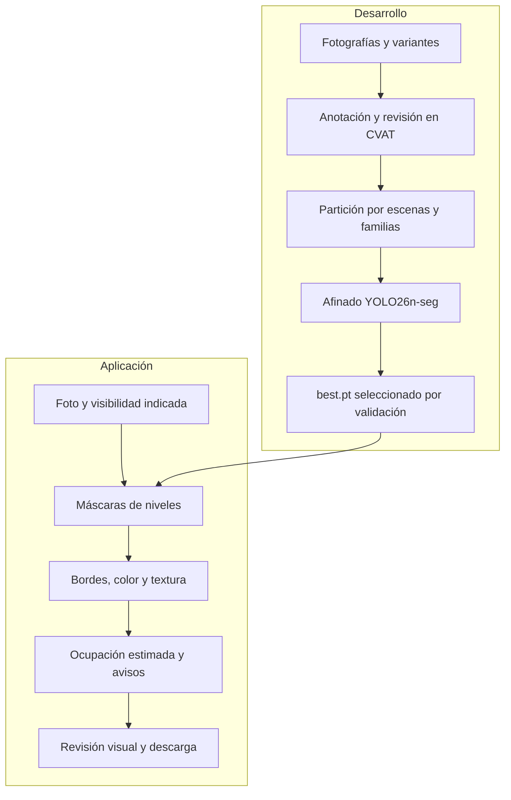

# 🛒 Walmart Computer Vision

**Análisis de disponibilidad en góndolas mediante visión por computador**

Proyecto Capstone de **DUOC UC** orientado a apoyar la inspección visual de góndolas a partir de fotografías. La aplicación **Walmart Visión** identifica los niveles, delimita sus áreas útiles y estima su ocupación visible para ayudar a revisar posibles faltantes.

| 🚀 Probar la aplicación | 🎬 Demostración en video | 📖 Entender el proyecto | 🧪 Explorar los resultados |
|:---:|:---:|:---:|:---:|
| [**Cómo usar Walmart Visión**](Documentacion/Usar_Walmart_Vision.md) | [**Ver video funcional (7 min)**](https://youtu.be/sN_6XPdxtKk) | [**Guía de funcionamiento**](Documentacion/Guia_para_entender_el_proyecto.md) | [**Modelo actual y métricas**](Documentacion/Modelo_V3_actual.md) |
| Windows x64 · Docker · [Estado del paquete V3](Entregables/README.md) | Recorrido de la versión anterior V2; la interfaz V3 ya cambió | Niveles, ocupación, señal y visibilidad | Último afinado V3 · evaluación y límites |

## Contenido

- [¿Qué hace el sistema?](#qué-hace-el-sistema)
- [Inicio rápido: Walmart Visión](#inicio-rápido-walmart-visión)
- [Interpretar los resultados](#interpretar-los-resultados)
- [Modelo actual y resultados](#modelo-actual-y-resultados)
- [Arquitectura y funcionamiento](#arquitectura-y-funcionamiento)
- [Datos y entrenamiento](#datos-y-entrenamiento)
- [Tecnologías](#tecnologías)
- [Documentación y recursos](#documentación-y-recursos)
- [Limitaciones y próximos pasos](#limitaciones-y-próximos-pasos)
- [Equipo](#equipo)

---

## ¿Qué hace el sistema?

El objetivo es **facilitar la revisión de niveles con posibles faltantes visibles**, incluso cuando existe mercadería disponible en bodega. A partir de una fotografía, el sistema:

1. **Detecta** cada nivel y **segmenta** su área útil, incluidos los espacios sin producto.
2. **Analiza** bordes, color y textura dentro de los niveles detectados.
3. **Estima** la ocupación visual y señala posibles necesidades de reposición.
4. **Muestra** contornos, porcentajes y avisos para que una persona revise el resultado.
5. **Permite comparar** el original con el análisis y descargar la imagen resultante.

Trabajamos por nivel de góndola para ubicar posibles faltantes en una repisa completa. El sistema **no cuenta unidades, no identifica SKU, no mide profundidad ni consulta inventario**.

La aplicación y el entorno técnico tienen funciones diferentes:

| Componente | Para qué sirve | Público |
|---|---|---|
| **Walmart Visión** | Analizar fotos y revisar niveles, ocupación estimada y avisos. | Usuarios y evaluadores. |
| **Laboratorio de desarrollo** | Preparar datos, revisar anotaciones, entrenar y evaluar modelos. | Equipo de desarrollo. |

**Para usar la app no necesitas instalar el laboratorio ni CVAT.**

## Inicio rápido: Walmart Visión

El equipo tiene preparado el paquete `Walmart_Vision_V3_20261026.zip`, con un único modelo vigente y una interfaz simplificada. **Todavía no está publicado en Releases**. Consulta el [estado de distribución](Entregables/README.md) para distinguirlo de las entregas anteriores.

### Windows

Si el equipo te entregó el paquete V3:

1. Extrae **todo** el archivo ZIP.
2. Ejecuta **`Walmart_Vision/iniciar.cmd`**.
3. Selecciona una foto JPG, PNG o WebP de hasta **15 MB**.
4. Indica si la góndola se ve completa, recortada o tapada.
5. Pulsa **Analizar foto** y revisa **Original**, **Niveles**, **Bordes** y **Comparar**.

El modelo, el análisis de niveles y bordes y la confianza **0,60** están fijados. No necesitas elegir un modelo ni ajustar parámetros.

### Docker, incluido macOS

Con Docker Desktop abierto, entra en la carpeta `Walmart_Vision` extraída y ejecuta:

```bash
docker compose up --build -d --wait
```

Abre [http://127.0.0.1:8095](http://127.0.0.1:8095). Para detener la aplicación, ejecuta `docker compose down`. La instalación de V3 en macOS y en otro equipo físico sigue pendiente de comprobación.

| Requisito | Detalle |
|---|---|
| Paquete | V3 preparado por el equipo, con visor y pesos. La nueva release sigue pendiente. |
| Windows | Iniciador automático para Windows x64. |
| Docker | Alternativa de ejecución incluida en el paquete. |
| Primer inicio | Conexión para preparar las dependencias o construir la imagen Docker. |
| Fotografías | JPG, PNG o WebP de hasta 15 MB; se procesan localmente en memoria. |
| Privacidad | La app no guarda las fotos ni las incorpora al entrenamiento. |

> **Descarga correcta:** el archivo automático **“Source code (zip)”** de GitHub contiene fuentes, sin el modelo operativo necesario para ejecutar el candidato V3.

**Material para explorar:** [6 imágenes de ejemplo en Google Drive](https://drive.google.com/drive/folders/1z0-GNiRUJcVwbjLVkiDc20G2F8f9QASS?usp=sharing), con tres fotografías reales y tres variantes sintéticas. Fueron seleccionadas para una demostración anterior; sirven para inspeccionar casos, no para acreditar precisión de la V3 ni como evaluación independiente.

[**Guía completa de uso**](Documentacion/Usar_Walmart_Vision.md) · [**Estado de las descargas**](Entregables/README.md) · [**Video de demostración**](https://youtu.be/sN_6XPdxtKk)

## Interpretar los resultados

Los niveles se numeran **de abajo hacia arriba** y de izquierda a derecha cuando comparten fila.

| Resultado | Significado |
|---|---|
| **Reponer** | Ocupación estimada menor al 30 % en el área detectada, cuando la visibilidad permite medirla. |
| **Suficiente** | Ocupación estimada desde el 30 %. Es una referencia experimental, no una certificación de stock. |
| **Revisar** | Recorte, señal ambigua o falta de medición: no se puede confirmar el resultado completo. |
| **Góndola tapada** | La persona usuaria indicó una persona tapando la góndola. Se pide otra foto, sin contornos ni ocupación. |
| **Sin niveles detectados** | Se solicita otra toma. No detectar un nivel no significa que esté vacío. |

**Original** muestra la foto; **Niveles**, los contornos y avisos; **Bordes**, las señales utilizadas; y **Comparar**, ambas imágenes juntas. La descarga conserva la presentación del resultado.

### ¿Qué es el mapa de señal?

El amarillo destaca zonas donde el algoritmo encuentra **bordes, cambios de color y textura** dentro de cada nivel. Los envases pueden activar esa señal, igual que un cartel o un fondo con dibujos.

La ocupación combina **70 % de superficie con señal y 30 % de cobertura horizontal**. El amarillo no confirma productos y una zona sin amarillo tampoco garantiza que esté vacía.

Para evitar lecturas engañosas como un superior vacío con cartel, la app muestra **Revisar · señal ambigua**, sin porcentaje presentado, cuando casi toda la señal se concentra en la mitad superior. Es una abstención experimental; no identifica automáticamente carteles ni niveles vacíos.

### ¿Por qué se pregunta por la visibilidad?

El modelo fue entrenado para delimitar niveles, incluyendo imágenes con obstáculos. No tiene una salida que determine automáticamente si la góndola está tapada.

Por eso la persona indica la visibilidad: **recorte** limita la lectura a lo visible y marca Revisar; **objeto delante** suspende la medición; **persona tapando** solicita otra foto.

## Modelo actual y resultados

La app local utiliza **V3-YOLO26**, el `best.pt` del afinado de papeles, huevos y superiores vacíos. Su única clase aprendida es **Nivel**: las decisiones de reposición se calculan después.

| Modelo vigente | Entrenamiento del último afinado | Validación | Estado |
|---|---|---|---|
| **YOLO26n-seg V3** | **113 fotos**, 29 épocas completadas | **22 reales + 47 sintéticas**, evaluadas por separado | Integrado en local; nueva release pendiente |

| Segmentación de máscaras | Fotos | mAP50 | mAP50–95 |
|---|---:|---:|---:|
| Validación real | 22 | 99,50 % | 88,96 % |
| Diagnóstico sintético | 47 | 99,46 % | 85,33 % |

**Cómo leer estas cifras:** evalúan la delimitación de niveles, no la precisión de los porcentajes de ocupación ni de las alertas de reposición. La reserva final de **63 fotos de test permanece sin utilizar**.

El afinado se adoptó tras revisión visual con limitaciones aceptadas. En la validación común, el mAP50–95 de máscaras bajó de 90,49 a 88,96 % en reales y de 86,01 a 85,33 % en sintéticas: **no se presenta como una mejora global** frente al padre.

La [ficha del modelo actual](Documentacion/Modelo_V3_actual.md) conserva el ensayo fuente, el hash exacto del peso, la configuración y los límites de la evaluación.

## Arquitectura y funcionamiento

Separamos **aprender a localizar niveles** de **analizar una fotografía nueva**:



El modelo conserva sus máscaras originales. La estimación se calcula sobre los píxeles de la foto dentro de esas áreas; no sobre los contornos coloreados ni los rótulos dibujados en el resultado.

En las anotaciones, el superior abierto se delimita por la mediana de las alturas inferiores cuando no hay un techo físico claro. **La app no impone esa mediana durante la predicción**: el modelo puede desviarse del criterio aprendido.

[Explicación del funcionamiento](Documentacion/Guia_para_entender_el_proyecto.md) · [Criterio de niveles V3](Documentacion/Desarrollo/Criterio_V3_niveles.md) · [Regla de mediana](Documentacion/Desarrollo/Regla_nivel_superior_mediana_V3.md)

## Datos y entrenamiento

El catálogo vigente reúne **469 imágenes: 192 reales y 277 sintéticas**. Las vistas de la misma escena y sus variantes se mantienen juntas para reducir la fuga de información entre aprendizaje, validación y prueba.

| Partición actual | Imágenes | Uso |
|---|---:|---|
| **Train** | **337** | Aprendizaje: una imagen está desactivada; 336 son exportables. |
| **Val** | **69** | Selección y revisión: 22 reales y 47 sintéticas. |
| **Test** | **63** | Reserva para evaluación final, sin utilizar. |

El último afinado seleccionó **113 fotos de train: 67 reales y 46 sintéticas**, compuestas por 32 superiores vacíos, 11 tomas reales nuevas, seis fotos de huevos y 64 de repaso. El repaso cubre las 26 escenas del entrenamiento anterior.

Las sintéticas son variantes de fuentes existentes; no se consideran capturas independientes. Las imágenes conservan sus ubicaciones de procedencia y no se suman de nuevo por reutilizarse con el criterio V3.

[Datos actuales](Datos/README.md) · [Registros V3](Datos/Registros/README.md) · [Resumen numérico](Documentacion/Estado_V3_actual.json)

## Tecnologías

| Tecnología | Función actual | Por qué se utiliza |
|---|---|---|
| **YOLO26n-seg** | Segmentar una clase: Nivel. | Localiza el área útil de cada repisa, incluyendo espacios sin producto. |
| **PyTorch + Ultralytics** | Afinado del modelo e inferencia. | Permiten adaptar pesos preentrenados y conservar la configuración del ensayo. |
| **OpenCV + NumPy** | Bordes, color y textura dentro de las máscaras. | Aportan las señales visuales para estimar superficie y cobertura horizontal. |
| **Pillow** | Lectura, orientación y presentación de fotografías. | Permite preparar la imagen y dibujar contornos, rótulos y resultados descargables. |
| **Python + HTML/CSS/JavaScript** | Procesamiento local e interfaz de navegador. | Permiten cargar y revisar fotos sin ejecutar comandos para cada análisis. |
| **Docker** | Alternativa de ejecución del paquete. | Agrupa las dependencias para preparar el entorno. |
| **CVAT** | Anotación y revisión de datos durante el desarrollo. | Mantiene un criterio común de polígonos y atributos; no se necesita para usar la app. |

## Documentación y recursos

| Necesidad | Recurso |
|---|---|
| Usar la aplicación y resolver problemas | [Manual de Walmart Visión](Documentacion/Usar_Walmart_Vision.md) |
| Entender el cálculo y sus límites | [Guía de funcionamiento](Documentacion/Guia_para_entender_el_proyecto.md) |
| Consultar entrenamiento y métricas vigentes | [Modelo V3 actual](Documentacion/Modelo_V3_actual.md) |
| Ubicar datos, herramientas y documentos | [Mapa del proyecto](Documentacion/Desarrollo/Mapa_del_proyecto.md) |
| Consultar estado de distribución | [Entregables](Entregables/README.md) |
| Continuar el desarrollo o preparar el laboratorio | [Referencia técnica](Documentacion/Desarrollo/README.md) |
| Revisar decisiones y etapas anteriores | [Archivo documental](Documentacion/Historico/README.md) |

### Carpetas principales

| Ruta | Contenido |
|---|---|
| [`Datos/`](Datos/README.md) | Procedencias, anotaciones, particiones y selección del afinado. |
| [`Herramientas/`](Herramientas/README.md) | Visor, laboratorio, procesamiento y verificadores. |
| [`Modelos/`](Modelos/README.md) | Identidad del modelo vigente y recursos generales de desarrollo. |
| [`Experimentos/`](Experimentos/README.md) | Resultados y trazabilidad de los ensayos. |
| [`Documentacion/`](Documentacion/README.md) | Guías, criterios, planificación y material académico. |
| [`Entregables/`](Entregables/README.md) | Estado de distribución de la app y material académico. |
| [`Infraestructura/`](Infraestructura/README.md) | Configuración técnica de servicios y entornos. |
| [`reproducibilidad/`](reproducibilidad/README.md) | Manifiestos y comprobaciones de entregas fechadas. |

### Material académico y demostración

- 🎬 [**Demostración funcional (7 min 01 s)**](https://youtu.be/sN_6XPdxtKk): recorrido de la app y casos del informe en la versión anterior V2. Conserva valor como demostración del proyecto; no muestra la interfaz V3 actual.
- 📄 [**Informe intermedio en PDF**](Entregables/Informe_Intermedio_Avance_20261020.pdf) · [fuente del informe](Documentacion/Informe_Intermedio_Avance_20261020.md): resultados y casos fechados, conservados como antecedente académico.
- 📅 [**Planificación y metodología**](Documentacion/Planificacion_y_metodologia.md): hitos y organización del trabajo.
- 🖼️ [**Imágenes de ejemplo**](https://drive.google.com/drive/folders/1z0-GNiRUJcVwbjLVkiDc20G2F8f9QASS?usp=sharing) · [procedencia](Documentacion/Ejemplos/README.md): selección real y sintética de la demostración anterior.

## Limitaciones y próximos pasos

- **Calibrar la ocupación en V3:** carteles, fondos y envases pueden confundir la señal. El 30 % sigue siendo experimental.
- **Automatizar y validar la visibilidad:** actualmente se confirma manualmente; no se detectan personas u obstáculos de forma automática.
- **Revisar superiores:** en la familia `le_g10`, la foto 029 puede quedar sobredelimitada y la 030 omitir el superior.
- **Evaluar generalización:** faltan escenas independientes de papeles y huevos. El test se mantiene reservado.
- **Comprobar instalación externa:** pendiente en otro computador físico y en macOS para V3.
- **Cerrar las pruebas antes de publicar:** el candidato local no se ha convertido todavía en una nueva release.

El prototipo orienta la revisión visual. Sus porcentajes y avisos requieren comprobar la foto y no sustituyen una medición de inventario.

## Equipo

**Capstone DUOC UC · 2026**

| Rol | Integrantes |
|---|---|
| Desarrollo | **Vicente Canio**, **Paulo Guerra** y **Vicente Vilches** |
| Docente | **Arturo Vargas** |
