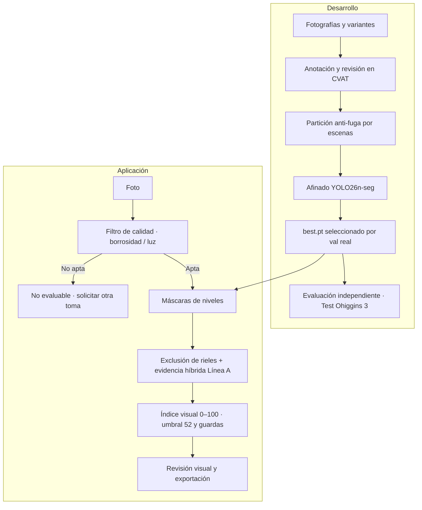
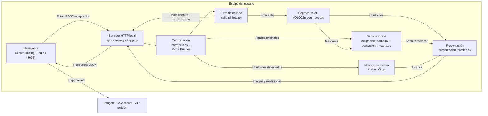

# 🛒 Walmart Computer Vision

**Análisis de disponibilidad en góndolas mediante visión por computador**

Proyecto Capstone de **DUOC UC** orientado a apoyar la inspección visual de góndolas a partir de fotografías. **Walmart Visión** reúne una app cliente y una mesa de revisión del equipo: ambas segmentan niveles de góndola, delimitan su área útil y calculan un índice visual para detectar posibles faltantes y apoyar la reposición.

| 🚀 Probar la aplicación | 🎬 Demostración en video | 📖 Entender el proyecto | 🧪 Modelo y métricas |
|:---:|:---:|:---:|:---:|
| [**Descargar apps cliente y equipo**](https://github.com/vcanio/Capstone2026/releases/download/walmart-vision-apps-2026-11-13/Walmart_Vision_Cliente_y_Equipo_20261113.zip) | [**Ver video funcional (7 min)**](https://youtu.be/sN_6XPdxtKk) | [**Guía de funcionamiento**](Documentacion/Guia_para_entender_el_proyecto.md) | [**Modelo actual y métricas**](Documentacion/Modelo_V3_actual.md) |
| Windows x64 · Docker · [Notas de la versión](https://github.com/vcanio/Capstone2026/releases/tag/walmart-vision-apps-2026-11-13) | Recorrido V2; la interfaz V3 ya cambió | Niveles, ocupación y límites | V3 oficial · evaluación y límites |

[**App cliente**](Aplicacion_Cliente/README.md) · [**App del equipo**](Aplicacion/README.md) · [**Entregables**](Entregables/README.md) · [**Documentación**](Documentacion/README.md)

## Contenido

- [Problemática y descripción de la solución](#problemática-y-descripción-de-la-solución)
- [Descarga e inicio rápido](#descarga-e-inicio-rápido)
- [Estrategia y justificación técnica](#estrategia-y-justificación-técnica)
- [Arquitectura de la solución](#arquitectura-de-la-solución)
- [Datasets y preparación](#datasets-y-preparación)
- [Evaluación y métricas](#evaluación-y-métricas)
- [Estado actual de la implementación](#estado-actual-de-la-implementación)
- [Documentación y estructura](#documentación-y-estructura)
- [Equipo y licencia](#equipo-y-licencia)

---

## Problemática y descripción de la solución

### Problemática y objetivo

En supermercados, los quiebres de stock visibles a simple vista generan pérdidas de venta y una mala experiencia de compra. Inspeccionar pasillos manualmente para detectar espacios vacíos es lento, costoso y poco escalable frente a la cantidad de locales y góndolas que deben monitorearse, especialmente cuando las capturas presentan variaciones de perspectiva, ángulo, iluminación y formatos de envase.

El **objetivo** de este proyecto es determinar, a partir de fotografías reales de góndolas, si existe disponibilidad visual suficiente por nivel de repisa y generar alertas de reposición bajo un umbral técnicamente justificado. Queda **fuera de alcance** la integración productiva con sistemas de inventario, el conteo unitario de envases o la identificación de SKU específicos.

### Funcionalidades principales

A partir de una fotografía frontal de góndola, el sistema ejecuta cuatro etapas:

1. **Filtro previo de calidad:** [`calidad_foto.py`](Aplicacion/calidad_foto.py) detecta capturas severamente borrosas, oscuras o quemadas y las marca como `no_evaluable` antes de inferir.
2. **Segmentación por nivel de góndola:** `YOLO26n-seg` delimita el área útil completa de cada repisa, incluyendo tanto productos como huecos vacíos.
3. **Estimación visual de ocupación:** **Línea A** combina bordes, gradiente, color y textura dentro de cada máscara para calcular un índice visual de `0` a `100` (umbral `52`) y derivar casos ambiguos o recortados a `Revisar`.
4. **Flujos de operación y revisión:**
   - **App cliente (`8098`):** consulta de alertas (`Reponer`, `Suficiente`, `Revisar`), guía móvil de captura en tres pasos con selector de lente trasera, registro de revisión humana independiente y exportación a CSV.
   - **App del equipo (`8095`):** comparación entre ejecuciones y algoritmos ([Línea A vs basal experimental](Aplicacion/Documentacion/COMPARACION_BASAL_20261112.md)), autocompletado por lotes, mapas de señal, marcado de errores por nivel/zona y exportación de lotes ZIP.

---

## Descarga e inicio rápido

Descarga el paquete [**Walmart_Vision_Cliente_y_Equipo_20261113.zip**](https://github.com/vcanio/Capstone2026/releases/download/walmart-vision-apps-2026-11-13/Walmart_Vision_Cliente_y_Equipo_20261113.zip) ([notas y SHA-256](https://github.com/vcanio/Capstone2026/releases/tag/walmart-vision-apps-2026-11-13)), extrae **todo** el contenido y carga fotos propias (el dataset no se incluye).

> El paquete publicado (`2026-11-13`) incluye el modelo oficial **`V3-cierre-revisado-20261110`** y la revisión base `linea_a_20261113_techo_y_panel_liso`. El código fuente actual del repositorio (y el arranque por Docker desde un clon) ya integra el filtro previo de calidad (`calidad_foto.py`) y **Línea A v2.1** (`linea_a_20261116_v2_1_cielo_piso_frente`).

### Windows x64

1. Ejecuta `Walmart_Vision/iniciar_cliente.cmd` (`8098`) o `Walmart_Vision/iniciar_equipo.cmd` (`8095`).
2. El primer inicio prepara Python 3.12 y sus dependencias dentro de la carpeta (requiere Internet). Mantén la consola abierta mientras uses la app.
3. Abre [http://127.0.0.1:8098](http://127.0.0.1:8098) (cliente) o [http://127.0.0.1:8095](http://127.0.0.1:8095) (equipo).
4. Carga imágenes **JPG, PNG o WebP** de hasta **10 MB** y 24 megapíxeles.

### Docker (incluido macOS)

Desde la carpeta `Walmart_Vision` extraída (o desde la raíz de un clon con `compose.apps.yaml`):

```bash
docker compose -f compose.apps.yaml up --build -d --wait
```

Para detener ambas apps:

```bash
docker compose -f compose.apps.yaml down
```

### Desde un clon y recomendaciones de uso

- En Windows, ejecuta `Aplicacion_Cliente/iniciar_cliente.cmd` o `Aplicacion/iniciar.cmd`. La confianza inicial de YOLO es **0,60** (fija en cliente; ajustable desde **0,25** en la app del equipo).
- Toma fotos **frontales o casi frontales** con ambos extremos del tramo visibles, evitando reflejos fuertes o desenfoque.
- Las fotografías se procesan **localmente** en el equipo del usuario; cada navegador guarda su sesión en local (`IndexedDB` en cliente, con botón *Limpiar pasillo*).
- Para pruebas rápidas sin fotos propias existe una [selección histórica de seis imágenes de ejemplo](https://drive.google.com/drive/folders/1z0-GNiRUJcVwbjLVkiDc20G2F8f9QASS?usp=sharing).

---

## Estrategia y justificación técnica

### Estrategia algorítmica

1. **Definición geométrica de `Nivel`:** cada polígono cubre el área útil de una repisa desde la superficie de apoyo **sobre el portaprecio** hasta la cara inferior del estante superior (o la **mediana de altura** de los inferiores del mismo tramo cuando el superior es abierto, para mantener consistencia entre fotos llenas y vacías). Durante la inferencia, la app no fuerza la mediana de forma artificial.
2. **Filtro de calidad y zonas no evaluables:** [`calidad_foto.py`](Aplicacion/calidad_foto.py) evalúa nitidez (varianza del Laplaciano y Tenengrad) e iluminación extrema en HSV (`0` falsos rechazos sobre `294` capturas reales) para bloquear fotos ilegibles como `no_evaluable`. Si un contorno toca el encuadre (`near_frame` en [`vision_v3.py`](Aplicacion/vision_v3.py)) o tiene señal ambigua, pasa a `Revisar`. Las obstrucciones por personas o carros quedan sujetas a revisión humana, sin interpretarse ni como falta de producto ni como stock suficiente.
3. **Cálculo de ocupación (`Línea A`, revisión `linea_a_20261116_v2_1_cielo_piso_frente`):**
   - [`ocupacion_paulo.py`](Aplicacion/ocupacion_paulo.py) lee los píxeles originales dentro de cada máscara, conserva bordes Canny y excluye rieles/barandas horizontales.
   - [`ocupacion_linea_a.py`](Aplicacion/ocupacion_linea_a.py) normaliza `P10–P90` entre todos los niveles de la **misma góndola**, sigue bandas verticales relativas en estantes inclinados, protege paquetes blancos con logo superior (`_is_white_stocked_packages`), suprime cielo abierto en el nivel superior (`_open_ceiling_mask_v2`) y bandejas/pisos expuestos en vista picada (`_exposed_floor_mask`), y neutraliza islas débiles de hasta 2 columnas entre huecos (`analyze_column_gaps`).
   - El criterio combinado dispara **Reponer** cuando el índice visual (`0–100`) cae bajo **`52`** o ante quiebre parcial de frente (`max_gap_pct ≥ 35 %` con `front_hyb_pct < 68 %`, o `significant_gaps_pct ≥ 45 %`), deriva frentes oscuros continuos de bajo contraste a **Revisar** (`low_contrast_continuous_front` conservando `raw_pct`), y asigna `operational_severity` (`critica`, `alta`, `verificar`, `normal`).

[Implementación de Línea A](Aplicacion/ocupacion_linea_a.py) · [Extracción de señal](Aplicacion/ocupacion_paulo.py) · [Filtro de calidad](Aplicacion/calidad_foto.py) · [Integración y límites](Aplicacion/Documentacion/LINEA_A_20261108.md)

### Justificación de decisiones técnicas

| Decisión técnica | Alternativa descartada | Por qué se eligió y qué ventaja aporta |
|---|---|---|
| **Segmentación por máscaras de clase única `Nivel`** | Cajas rectangulares (`bbox`) o clasificar directamente `Reponer`/`Suficiente` en YOLO. | Las máscaras siguen la perspectiva de la góndola y excluyen zonas ajenas. Separar geometría (`Nivel`) de ocupación permite anotar con el mismo criterio repisas llenas o vacías, auditar por separado errores de contorno y ocupación, y ajustar reglas de alerta sin reentrenar YOLO. |
| **`YOLO26n-seg` con ajuste fino** | Entrenar desde cero o usar modelos pesados dependientes de servidor GPU. | Su tamaño liviano permite inferencia local rápida tanto en CPU como en GPU (`77 ms` GPU / `226 ms` CPU) y aprovecha pesos preentrenados para adaptarse con un dataset acotado de tienda. |
| **Señal clásica explicable (`Línea A` con OpenCV + NumPy) y umbral `52`** | Segundo modelo de Deep Learning para ocupación o mantener el umbral inicial genérico de `30 %`. | Evita entrenar y distribuir un segundo modelo pesado, mantiene trazabilidad determinista de bordes/huecos por repisa y normaliza la iluminación dentro de la misma góndola. Sobre el umbral `52` calibrado en desarrollo (`112` niveles), la evaluación ciega en `Ohiggins 3` pasó de `F1 88,24 %` en la línea base a `F1 94,59 %` (`Recall 97,22 %`) con la revisión `v2.1` (`193` fotos / `893` niveles revisados en 3 capturas de tienda), conservando el basal de `30 %` como referencia experimental en la app del equipo. |
| **Compuerta de calidad (`calidad_foto.py`) y estado `Revisar`** | Inferir todas las fotos por igual y emitir siempre `Reponer` o `Suficiente`. | Evita generar falsas alertas de quiebre sobre fotografías borrosas, quemadas, oscuras o recortadas, diferenciando falta de evidencia visual de falta de producto. |
| **Ejecución web local (`Python` + `Docker`)** | Servicio externo en la nube o ejecución solo por consola. | Mantiene las fotografías en el equipo sin latencia de red ni envío a terceros, ofrece interfaz visual directa para supervisores y empaqueta dependencias reproducibles entre equipos. |

### Tecnologías utilizadas

| Tecnología | Función en el sistema | Justificación |
|---|---|---|
| **YOLO26n-seg (`PyTorch` + `Ultralytics`)** | Segmentación de instancias de cada `Nivel` y ajuste fino de pesos. | Baja latencia local en CPU/GPU y compatibilidad directa entre entrenamiento e inferencia. |
| **OpenCV + NumPy** | Calidad de captura (`calidad_foto.py`), bordes, gradientes, color/textura y exclusión de rieles. | Procesamiento matricial determinista, liviano y auditable por repisa. |
| **Pillow** | Lectura de imágenes, normalización EXIF y renderizado de contornos/rótulos. | Manejo consistente de orientación de cámara móvil y generación rápida de salidas visuales. |
| **Python + HTML/CSS/JS** | Servidores HTTP locales (`app_cliente.py`, `app.py`) e interfaces web. | Flujo interactivo en navegador sin dependencias externas ni instalación compleja para el usuario final. |
| **Docker (`compose.apps.yaml`)** | Contenerización conjunta de ambas aplicaciones. | Aísla versiones de Python y librerías para ejecución reproducible multiplataforma. |
| **CVAT** | Anotación y revisión geométrica de polígonos durante el desarrollo. | Estandariza criterios de etiquetado (`Nivel`, portaprecio, oclusión) sin formar parte del runtime final. |

---

## Arquitectura de la solución

El flujo de entrenamiento y el de aplicación están desacoplados: CVAT, el laboratorio de entrenamiento y los datasets **no son dependencias** en tiempo de ejecución.



### Módulos internos en ejecución local

Ambas aplicaciones comparten `inferencia.py`, el modelo oficial y el motor de ocupación:



---

## Datasets y preparación

- **Origen de los datos:** fotografías reales de góndolas capturadas por el equipo en tienda y variantes sintéticas controladas (generadas e identificadas explícitamente como apoyo al entrenamiento, sin asumirlas como evidencia de generalización real).
- **Cantidades utilizadas:**
  - **Cadena acumulada (3 etapas propias sobre `yolo26n-seg.pt`):** **519 fuentes de entrenamiento** distintas por SHA-256 (`299` reales y `220` sintéticas).
  - **Último afinado (`V3-cierre-revisado-20261110`, 40 épocas):** **256 imágenes de `train`** (`203` reales / `53` sintéticas, **1.298 polígonos**) y **11 fotos reales de `val`** (`55` polígonos, 3 escenas).
  - **Test independiente (`Ohiggins 3`):** **68 fotos reales** y **354 polígonos `Nivel`** con `0` coincidencia en `train` o `val`.
- **Limpieza, etiquetado y preparación:**
  1. **Integridad y deduplicación:** registro de dimensiones y huella SHA-256 para evitar duplicados exactos entre particiones.
  2. **Limpieza y normalización:** exclusión documentada de tomas dudosas o no aptas y resolución de orientación EXIF en copias de preparación conservando originales intactos.
  3. **Partición anti-fuga por escenas:** originales, vistas cercanas y variantes sintéticas se agrupan por escena/familia para no filtrar el mismo tramo entre `train`, `val` y `test`.
  4. **Etiquetado en CVAT:** clase única `Nivel`, delimitada sobre el portaprecio, excluyendo espesor frontal y aplicando la mediana en niveles superiores abiertos.

[Catálogo del modelo oficial](Documentacion/Evidencias/catalogo_modelo_oficial_cierre_20261110.json) · [Metodología de desarrollo y revisión](Documentacion/Metodologia_desarrollo_y_revision.md)

---

## Evaluación y métricas

Modelo oficial vigente: **`V3-cierre-revisado-20261110`** (SHA-256 `dc679fe73a7525dcffefe0381edfc39309d2ebe3f5115387100ae53cf4550af5`).

### Segmentación de niveles (`YOLO26n-seg`)

| Conjunto | Fotos | Niveles | mAP50 | mAP50–95 (M) | Emparejamiento (`conf = 0,60`) |
|---|---:|---:|---:|---:|---|
| Validación real | 11 | 55 | 99,50 % | 90,04 % | `54 TP, 0 FP, 1 FN` |
| **Test independiente (`Ohiggins 3`)** | **68** | **354** | **99,50 %** | **90,36 %** | **`354 TP, 0 FP, 0 FN`** (`68/68` exactos · `IoU` medio `93,90 %`) |

En `Ohiggins 3`, `YOLO26n-seg` alcanzó `Precision 0,9991` y `Recall 1,0000`, con latencia media de `YOLO.predict` de **77,15 ms** en GPU (`GTX 1660 SUPER`) y **225,94 ms** en CPU (`AMD Ryzen 5 3600`, muestra de 15 fotos).

### Clasificación de ocupación (`Línea A`, umbral 52)

Calibrada en desarrollo (112 niveles con máscaras humanas: 15/16 alertas, 0 falsas alertas, 1/2 críticos reales) y evaluada sobre los **354 niveles predichos por YOLO en `Ohiggins 3`** (más comparación cualitativa sobre **193 fotos / 893 niveles** en 3 capturas de tienda: `Ohiggins 9/11`, `Ohiggins 14/11` y `Marcoleta 15/11`):

| Revisión Línea A (`Ohiggins 3`, 354 niveles) | TP / FP / FN / TN | Accuracy | Precision | Recall | F1 |
|---|---|---:|---:|---:|---:|
| Línea base ciega (`linea_a_20261113_techo_y_panel_liso`) | `30 / 2 / 6 / 316` | 97,74 % | 93,75 % | 83,33 % | 88,24 % |
| **Vigente v2.1 (`linea_a_20261116_v2_1_cielo_piso_frente`)** | **`35 / 3 / 1 / 315`** | **98,87 %** | **92,11 %** | **97,22 %** | **94,59 %** |

- **Por foto completa (línea base ciega `2026-11-13`):** Accuracy **92,65 %** · **F1 89,80 %**.
- **Latencia E2E (`YOLO + Línea A` línea base):** **1.371,9 ms/foto** en GPU y **1.442,5 ms/foto** en CPU (muestra de 15 fotos).

[Evaluación en Ohiggins 3](Documentacion/Evidencias/evaluacion_test_ohiggins3_20261114.md) · [Ficha del modelo](Documentacion/Modelo_V3_actual.md) · [Registro de adopción](Documentacion/Evidencias/adopcion_cierre_revisado_20261110.md)

---

## Estado actual de la implementación

| Componente / Capacidad | Estado | Alcance operativo o pendiente |
|---|---|---|
| **App cliente (`8098`)** | **Operativa** | Alertas visuales, flujo móvil en 3 pasos, selector de lente trasera, revisión humana, persistencia en navegador (`IndexedDB`) y exportación CSV. |
| **App del equipo (`8095`)** | **Operativa** | Comparación `Línea A` vs `Basal · experimental`, autocompletado por lotes, mapas de bordes, marcado por nivel/zona y lotes ZIP. |
| **Segmentación `YOLO26n-seg` V3** | **Operativa** | Peso oficial `V3-cierre-revisado-20261110` evaluado en `Ohiggins 3` (`mAP50 99,50 %`, `354/354 TP`); en escenas puntuales (`le_g10` 029/030) aún puede fallar el nivel superior. |
| **Filtro de calidad (`calidad_foto.py`)** | **Operativo** | Bloquea fotos borrosas, oscuras o quemadas como `no_evaluable` antes de inferir (`0` falsos rechazos en `294` capturas reales). |
| **Ocupación `Línea A` (`v2.1`, umbral `52`)** | **Operativa** | Revisión `linea_a_20261116_v2_1_cielo_piso_frente` con filtro de bandejas/pisos expuestos en vista picada, criterio de frente parcial y severidad operativa (`Ohiggins 3`: **F1 94,59 %**, **Recall 97,22 %**, `35 TP / 3 FP / 1 FN / 315 TN`). |
| **Empaquetado Windows y Docker** | **Operativo / parcial en Mac** | Instalador Windows y Docker Compose verificados en Windows/Linux; pendiente prueba física de la entrega conjunta en macOS. |
| **Detector de oclusiones (`persona` / `carro`)** | **Pendiente** | Las obstrucciones parciales por personas o carros siguen dependiendo de revisión visual humana. |
| **Persistencia compartida y más categorías** | **Pendiente** | Falta historial persistente en servidor (`SQLite`) para la app cliente y ampliar el test independiente a nuevas tiendas y categorías (papeles, huevos). |

---

## Documentación y estructura

| Carpeta / Recurso | Contenido |
|---|---|
| [`Aplicacion/`](Aplicacion/README.md) | App del equipo (`8095`), motor compartido, modelo oficial y pruebas ([guía de revisión](Aplicacion/Documentacion/REVISION_EQUIPO.md)). |
| [`Aplicacion_Cliente/`](Aplicacion_Cliente/README.md) | App cliente (`8098`), filtros de alertas, cámara móvil, revisión humana, CSV y pruebas. |
| [`Documentacion/`](Documentacion/README.md) | [Manual de uso](Documentacion/Usar_Walmart_Vision.md), [guía funcional](Documentacion/Guia_para_entender_el_proyecto.md), [modelo V3](Documentacion/Modelo_V3_actual.md), [metodología](Documentacion/Metodologia_desarrollo_y_revision.md) y [planificación](Documentacion/Planificacion_y_metodologia.md). |
| [`Entregables/`](Entregables/README.md) | Releases publicados, paquetes descargables y entregas académicas. |
| [`Fase 1/`](Fase%201/) · [`Fase 2/`](Fase%202/) | Material académico de etapas anteriores conservado en su ubicación original. |

### Material de demostración

- 🎬 [**Demostración funcional en video (7 min)**](https://youtu.be/sN_6XPdxtKk): recorrido de la versión anterior V2 (la interfaz V3 actual ya cambió).
- 🖼️ [**Imágenes de ejemplo**](https://drive.google.com/drive/folders/1z0-GNiRUJcVwbjLVkiDc20G2F8f9QASS?usp=sharing): selección histórica real y sintética para pruebas rápidas.

---

## Equipo y licencia

**Capstone DUOC UC · 2026** — Desarrollo: **Vicente Canio**, **Paulo Guerra** y **Vicente Vilches** · Docente: **Arturo Vargas**.

El código original del equipo se distribuye bajo [AGPL-3.0-only](LICENSE) ([alcance, autoría de datos y pesos](LICENCIAS.md) · [avisos de terceros](NOTICE.md)). Las fotografías y anotaciones mantienen su autoría y no reciben licencia pública mediante este repositorio.
