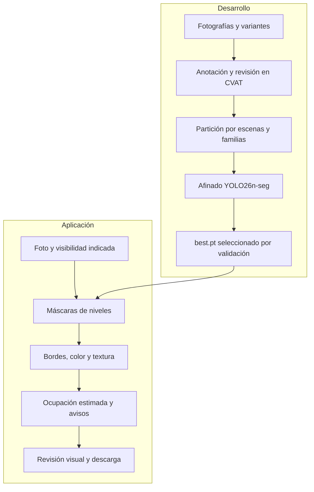
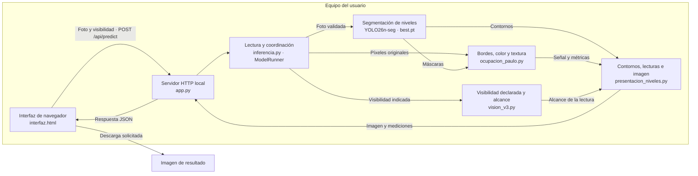

# 🛒 Walmart Computer Vision

**Análisis de disponibilidad en góndolas mediante visión por computador**

Proyecto Capstone de **DUOC UC** orientado a apoyar la inspección visual de góndolas a partir de fotografías. La aplicación **Walmart Visión** identifica los niveles, delimita sus áreas útiles y estima su ocupación visible para ayudar a revisar posibles faltantes.

| 🚀 Probar la aplicación | 🎬 Demostración en video | 📖 Entender el proyecto | 🧪 Explorar los resultados |
|:---:|:---:|:---:|:---:|
| [**Descargar Walmart Visión V3**](https://github.com/vcanio/Capstone2026/releases/download/walmart-vision-v3-2026-10-26/Walmart_Vision_V3_20261027.zip) | [**Ver video funcional (7 min)**](https://youtu.be/sN_6XPdxtKk) | [**Guía de funcionamiento**](Documentacion/Guia_para_entender_el_proyecto.md) | [**Modelo actual y métricas**](Documentacion/Modelo_V3_actual.md) |
| Windows x64 · Docker · [Release publicada](https://github.com/vcanio/Capstone2026/releases/tag/walmart-vision-v3-2026-10-26) | Recorrido de la versión anterior V2; la interfaz V3 ya cambió | Niveles, ocupación, señal y visibilidad | Último afinado V3 · evaluación y límites |

## Explorar las carpetas

[**Aplicación V3**](Aplicacion/README.md) · [**Laboratorio**](Laboratorio/README.md) · [**Datos**](Datos/README.md) · [**Modelo vigente**](Modelos/Actual/README.md) · [**Entregables**](Entregables/README.md) · [**Histórico**](Historico/README.md)

Las fuentes actuales se organizan por función y los antecedentes se reúnen en Histórico. Consulta el [mapa del proyecto](Documentacion/Desarrollo/Mapa_del_proyecto.md).

## Contenido

- [¿Qué hace el sistema?](#qué-hace-el-sistema)
- [Inicio rápido: Walmart Visión](#inicio-rápido-walmart-visión)
- [Qué consideramos un nivel](#qué-consideramos-un-nivel)
- [Interpretar los resultados](#interpretar-los-resultados)
- [Modelo actual y resultados](#modelo-actual-y-resultados)
- [Arquitectura y funcionamiento](#arquitectura-y-funcionamiento)
- [Datos y entrenamiento](#datos-y-entrenamiento)
- [Tecnologías](#tecnologías)
- [Decisiones técnicas y alternativas](#decisiones-técnicas-y-alternativas)
- [Documentación y recursos](#documentación-y-recursos)
- [Estado actual de la implementación](#estado-actual-de-la-implementación)
- [Limitaciones y próximos pasos](#limitaciones-y-próximos-pasos)
- [Equipo](#equipo)

---

## ¿Qué hace el sistema?

El objetivo es **facilitar la revisión de niveles con posibles faltantes visibles**. A partir de una fotografía, el sistema:

1. **Detecta** cada nivel y **segmenta** su área útil, incluidos los espacios sin producto.
2. **Analiza** bordes, color y textura dentro de los niveles detectados.
3. **Estima** la ocupación visual y señala posibles necesidades de reposición.
4. **Muestra** contornos, porcentajes y avisos para que una persona revise el resultado.
5. **Permite comparar** el original con el análisis y descargar la imagen resultante.

Trabajamos por nivel de góndola para ubicar posibles faltantes en una repisa completa. El sistema **no cuenta unidades, no identifica SKU, no mide profundidad ni consulta inventario**.

La aplicación y el entorno técnico tienen funciones diferentes:

| Componente | Para qué sirve | Público |
|---|---|---|
| **Walmart Visión** | Analizar fotos y revisar niveles, ocupación estimada y avisos. | Usuarios y evaluadores. |
| **Laboratorio de desarrollo** | Preparar datos, revisar anotaciones, entrenar y evaluar modelos. | Equipo de desarrollo. |

**Para usar la app no necesitas instalar el laboratorio ni CVAT.**

## Inicio rápido: Walmart Visión

**V3 ya está publicada.** Descarga [`Walmart_Vision_V3_20261027.zip`](https://github.com/vcanio/Capstone2026/releases/download/walmart-vision-v3-2026-10-26/Walmart_Vision_V3_20261027.zip): incluye la aplicación y el único modelo vigente para Windows x64 y macOS con Docker. [Ver la release y sus instrucciones](https://github.com/vcanio/Capstone2026/releases/tag/walmart-vision-v3-2026-10-26) · [Manual de uso](Documentacion/Usar_Walmart_Vision.md).

### Fotografías frontales

**Para usar esta versión, toma fotos frontales o casi frontales de la góndola.** Sitúate frente al tramo, mantén la cámara nivelada y procura que se vean sus dos extremos y las superficies de apoyo. Evita tomas desde un costado, desde muy arriba o abajo, panorámicas deformadas, desenfoque y reflejos fuertes. Si el mueble es largo, utiliza varias tomas frontales de tramos completos.

La perspectiva oblicua cambia las alturas y anchuras aparentes, oculta huecos detrás de los productos y puede desplazar las máscaras. El algoritmo estima una proporción de la imagen, sin reconstruir el volumen ni corregir automáticamente la perspectiva. Una foto frontal ayuda, pero no garantiza una detección correcta: revisa siempre los contornos y la visibilidad. No hay un ángulo máximo validado ni un detector automático que certifique que la toma sea frontal.

### Windows

Descarga el paquete V3 enlazado arriba y sigue estos pasos:

1. Extrae **todo** el archivo ZIP.
2. Ejecuta **`Walmart_Vision/iniciar.cmd`**.
3. Selecciona una foto JPG, PNG o WebP de hasta **15 MB**.
4. Indica si la góndola se ve completa, recortada o tapada.
5. Pulsa **Analizar foto** y revisa **Original**, **Niveles**, **Bordes** y **Comparar**.

El modelo y el análisis de niveles y bordes están fijados. La confianza inicial es **0,60** y puede ajustarse desde **0,40**.

### Docker, incluido macOS

Con Docker Desktop abierto, entra en la carpeta `Walmart_Vision` extraída y ejecuta:

```bash
docker compose up --build -d --wait
```

Abre [http://127.0.0.1:8095](http://127.0.0.1:8095). Para detener la aplicación, ejecuta `docker compose down`. El procedimiento Docker fue probado por Vicente en macOS con la release anterior y funcionó correctamente. V3 conserva ese mismo comando, las dependencias y la configuración de ejecución; incorpora los módulos del nuevo modelo.

| Requisito | Detalle |
|---|---|
| Paquete | [ZIP V3 publicado](https://github.com/vcanio/Capstone2026/releases/download/walmart-vision-v3-2026-10-26/Walmart_Vision_V3_20261027.zip), con visor y modelo. |
| Windows | Iniciador automático para Windows x64. |
| Docker | Alternativa de ejecución incluida en el paquete. |
| Primer inicio | Conexión para preparar las dependencias o construir la imagen Docker. |
| Fotografías | JPG, PNG o WebP de hasta 15 MB; se procesan localmente en memoria. |
| Privacidad | La sesión del lote, incluidas las fotos, se guarda en el navegador local y puede eliminarse desde la app; las fotos no se incorporan al entrenamiento. |

> **Para desarrollar:** el repositorio incluye el peso V3 y el preparador de Windows. El ZIP de la release conserva su version publicada y puede diferir de `main`.

**Material para explorar:** [6 imágenes de ejemplo en Google Drive](https://drive.google.com/drive/folders/1z0-GNiRUJcVwbjLVkiDc20G2F8f9QASS?usp=sharing), con tres fotografías reales y tres variantes sintéticas. Fueron seleccionadas para una demostración anterior; sirven para inspeccionar casos, no para acreditar precisión de la V3 ni como evaluación independiente.

[**Guía completa de uso**](Documentacion/Usar_Walmart_Vision.md) · [**Estado de las descargas**](Entregables/README.md) · [**Video de demostración**](https://youtu.be/sN_6XPdxtKk)

## ¿Qué consideramos un nivel?

Un **nivel** es el área útil de una repisa donde pueden existir **productos y huecos**. Se dibuja un polígono para el espacio completo del mismo tramo de góndola, siguiendo su perspectiva; no se dibuja una máscara por envase ni solo la banda frontal del estante.

| Límite | Criterio de anotación |
|---|---|
| Inferior | Superficie donde apoyan los productos, **por encima del portaprecio**. Se excluyen la franja del precio y el espesor frontal del estante. |
| Superior, cuando existe | Cara inferior de la repisa o cubierta física que cierra el espacio. |
| Laterales | Límites interiores del mismo tramo; no se amplía la zona hasta pilares, suelo u otras góndolas. |
| Huecos | Forman parte del área útil, aunque no haya productos. Un nivel vacío sigue siendo un nivel. |

La región se define por la estructura y la convención de anotación, sin ajustarla a la altura de los envases. Un cartel o panel sin una superficie de apoyo asociada no crea otro nivel. Las barandas que atraviesan un nivel pueden quedar dentro de su región y deben tratarse en el análisis de señal; su exclusión automática todavía es imperfecta.

### Superior abierto: por qué acordamos usar la mediana

En una repisa superior sin techo claro era difícil fijar un límite consistente: una persona podía seguir las tapas de los envases, otra un cartel y otra una altura elegida a ojo. Al retirar los productos, esas referencias desaparecían y el mismo nivel lleno o vacío podía terminar con áreas diferentes. Eso introduce una contradicción en los ejemplos usados para enseñar al modelo.

La solución acordada fue una **convención de anotación reproducible**:

1. Si hay una cubierta o un límite físico superior claro, se respeta.
2. Si falta, se miden las alturas verticales de los niveles inferiores del **mismo tramo**. Con perspectiva se mide la altura en el centro de cada polígono.
3. Se calcula la **mediana**, conservando decimales. Con cuatro referencias de 190, 195, 210 y 220 píxeles, la mediana es **202,5 píxeles**.
4. Desde el apoyo del superior, situado **sobre el portaprecio**, se proyecta esa altura hacia arriba. No se utiliza como base, sin comprobarlo, el borde del polígono de abajo: puede representar la cara inferior del estante.
5. Se mantiene el criterio en el original y sus variantes llenas o vacías. Si la proyección sale de la foto, se recorta al encuadre y se marca **parcial**; no se reduce la altura para hacerla caber.

La mediana reduce la influencia de una altura inferior excepcional frente a un promedio simple. **No demuestra la altura física real de un espacio abierto:** fija una región comparable para anotar. Se utilizan habitualmente al menos tres inferiores medibles; las excepciones autorizadas con dos referencias son casos documentados, no una regla general.

**La app no recalcula ni fuerza la mediana al analizar una foto.** YOLO predice sus propias máscaras a partir de lo aprendido; puede omitir un superior o delimitarlo mal. Esos errores se conservan como limitaciones y deben revisarse visualmente.

[Criterio de anotación V3](Documentacion/Desarrollo/Criterio_V3_niveles.md) · [Regla completa de mediana](Documentacion/Desarrollo/Regla_nivel_superior_mediana_V3.md)

## Interpretar los resultados

Los niveles se numeran **de abajo hacia arriba** y de izquierda a derecha cuando comparten fila.

| Resultado | Significado |
|---|---|
| **Reponer** | Ocupación estimada menor al 30 % en el área detectada, cuando la visibilidad permite medirla. |
| **Suficiente** | Ocupación estimada desde el 30 %. Es una referencia experimental, no una certificación de stock. |
| **Revisar** | Recorte, señal ambigua o falta de medición: no se puede confirmar el resultado completo. |
| **Góndola tapada** | La persona usuaria indicó una persona tapando la góndola. Se pide otra foto, sin contornos ni ocupación. |
| **Sin niveles detectados** | Se solicita otra toma. No detectar un nivel no significa que esté vacío. |

**Original** muestra la foto; **Niveles**, los contornos y avisos; **Bordes**, las señales utilizadas; y **Comparar**, ambas imágenes juntas. La descarga conserva la presentación del resultado.

### Qué significan los bordes y cómo se calcula la ocupación

En este proyecto, **bordes** son cambios de intensidad de la foto que pueden coincidir con aristas, etiquetas y contornos de envases. No son los contornos del nivel que predice YOLO. El análisis también utiliza color, variaciones locales de brillo y textura; por eso el fucsia de la vista Bordes es un **mapa combinado de señal**, no solamente el resultado de Canny.

El cálculo sigue estas etapas:

1. **YOLO delimita el nivel.** El algoritmo utiliza los píxeles originales dentro de esa máscara, sin analizar los rótulos o colores dibujados sobre el resultado.
2. **Filtra y organiza la señal.** Excluye un margen del contorno y algunas estructuras largas, divide la región en una grilla y calcula bordes, gradiente, color y textura. Los filtros no eliminan de forma fiable todos los carteles, barandas o laterales.
3. **Combina las señales por celda.** Normaliza sus intensidades dentro del nivel y aplica un umbral adaptativo. Después obtiene dos medidas: **A**, superficie con señal, ponderada por la cobertura válida de las celdas, y **W**, proporción de columnas con suficiente señal vertical.
4. **Calcula la estimación:** `ocupación estimada = 0,70 × A + 0,30 × W`. Por ejemplo, A = 40 % y W = 80 % producen **52 %**.
5. **Interpreta la lectura.** Por debajo del 30 % se muestra Reponer y desde el 30 %, Suficiente, siempre que la medición, la visibilidad y las reglas de abstención lo permitan.

El ancho no pregunta solo si una columna tiene algún píxel activo: exige un tramo continuo de señal en al menos el **45 % de la altura útil de la columna**. El área y el ancho aportan información distinta: unos productos bajos extendidos a lo largo del estante pueden cubrir poco área y mucho ancho.

<details>
<summary>Detalle técnico de la señal actual</summary>

La foto se limita a un lado máximo de 1.600 píxeles y la grilla usa celdas de aproximadamente 24 píxeles. Se combinan **35 % densidad de bordes Canny + 30 % gradiente de intensidad + 20 % color saturado + 15 % desviación local de textura**, después de normalizar cada característica por sus percentiles 10–90 dentro de las celdas utilizables. Canny usa 40/120; el umbral adaptativo de Otsu queda limitado a 0,35–0,62. El área se calcula tras un cierre morfológico 3×3 y el ancho usa las activaciones anteriores a ese cierre. Las exclusiones de estructura afectan a todas las señales y el denominador conserva la cobertura válida original.

Estos pesos describen la **construcción del mapa por celda**. Son distintos de la combinación final **70/30 de área y ancho**. [Implementación](Laboratorio/Modelos/ocupacion_paulo.py).

</details>

**El porcentaje no cuenta productos, no mide inventario ni está calibrado como proporción real de stock.** Carteles y fondos pueden activar la señal; productos claros o lisos pueden producir poca. Una zona con señal fucsia no confirma producto y una zona sin señal no garantiza vacío. Tampoco la confianza de YOLO de 0,60 equivale a un 60 % de ocupación.

### Cuándo se abstiene y pide revisión

La app conserva la señal bruta, pero muestra **Revisar · señal ambigua**, sin porcentaje ni decisión de reposición, cuando la señal se concentra casi totalmente arriba o queda en la periferia sin suficiente respaldo central e inferior. Son comprobaciones experimentales, no detectores automáticos de carteles ni de niveles vacíos. Pueden solicitar revisión con productos escasos o de poco contraste.

La última comparación utilizó **151 fotos de desarrollo y 754 detecciones**: las métricas brutas no cambiaron y se añadieron **35 revisiones**, sin nuevas transiciones a Reponer. No es una evaluación exhaustiva de precisión de ocupación. Los filtros agresivos probados no se integraron porque introdujeron nuevas alertas en los controles. La baranda del superior vacío 034 aún produce señal residual.

### ¿Por qué se pregunta por la visibilidad?

El modelo fue entrenado para delimitar niveles, incluyendo imágenes con obstáculos. No tiene una salida que determine automáticamente si la góndola está tapada.

Por eso la persona indica la visibilidad: **recorte** limita la lectura a lo visible y marca Revisar; **objeto delante** suspende la medición; **persona tapando** solicita otra foto.

## Modelo actual y resultados

La app local utiliza **V3-YOLO26**, el `best.pt` del afinado de papeles, huevos y superiores vacíos. Su única clase aprendida es **Nivel**: las decisiones de reposición se calculan después.

| Modelo vigente | Entrenamiento del último afinado | Validación | Estado |
|---|---|---|---|
| **YOLO26n-seg V3** | **113 fotos**, 29 épocas completadas | **22 reales + 47 sintéticas**, evaluadas por separado | [Disponible en la release V3](https://github.com/vcanio/Capstone2026/releases/tag/walmart-vision-v3-2026-10-26) |

| Segmentación de máscaras | Fotos | mAP50 | mAP50–95 |
|---|---:|---:|---:|
| Validación real | 22 | 99,50 % | 88,96 % |
| Diagnóstico sintético | 47 | 99,46 % | 85,33 % |

**Cómo leer estas cifras:** evalúan la delimitación de niveles, no la precisión de los porcentajes de ocupación ni de las alertas de reposición. La reserva final de **63 fotos de test permanece sin utilizar**.

El afinado se adoptó tras revisión visual con limitaciones aceptadas. En la validación común, el mAP50–95 de máscaras bajó de 90,49 a 88,96 % en reales y de 86,01 a 85,33 % en sintéticas: **no se presenta como una mejora global** frente al padre.

La [ficha del modelo actual](Documentacion/Modelo_V3_actual.md) conserva el ensayo fuente, el hash exacto del peso, la configuración y los límites de la evaluación.

## Arquitectura y funcionamiento

Separamos **aprender a localizar niveles** de **analizar una fotografía nueva**:



El modelo conserva sus máscaras originales. La estimación se calcula sobre los píxeles de la foto dentro de esas áreas; no sobre los contornos coloreados ni los rótulos dibujados en el resultado.

En las anotaciones, el superior abierto se delimita por la mediana de las alturas inferiores cuando no hay un techo físico claro. **La app no impone esa mediana durante la predicción**: el modelo puede desviarse del criterio aprendido.

[Explicación del funcionamiento](Documentacion/Guia_para_entender_el_proyecto.md) · [Criterio de niveles V3](Documentacion/Desarrollo/Criterio_V3_niveles.md) · [Regla de mediana](Documentacion/Desarrollo/Regla_nivel_superior_mediana_V3.md)

### Componentes de la aplicación

El visor funciona en el equipo del usuario. El navegador presenta la interfaz y envía la fotografía al servidor HTTP local; Python coordina la lectura, el modelo, la señal visual y la presentación del resultado.



El diagrama representa las responsabilidades y los datos que intercambian los módulos. `ModelRunner` decide qué etapas ejecutar: si la persona indica una góndola tapada por alguien, devuelve el aviso sin ejecutar YOLO ni ocupación; con un objeto delante conserva la localización de niveles y suspende la medición. La presentación combina geometría, métricas y alcance para mostrar la lectura final. La descarga del resultado es una acción del usuario. La sesión del lote, incluidas las fotografías, se guarda en el navegador local y se puede eliminar desde la aplicación.

CVAT, las particiones y el entrenador pertenecen al flujo de desarrollo del primer diagrama. **No son dependencias del visor durante la inferencia**: la app distribuida incluye el modelo y los módulos que necesita para analizar fotos.

## Datos y entrenamiento

El catálogo vigente reúne **469 imágenes: 192 reales y 277 sintéticas**. Las vistas de la misma escena y sus variantes se mantienen juntas para reducir la fuga de información entre aprendizaje, validación y prueba.

| Partición actual | Imágenes | Uso |
|---|---:|---|
| **Train** | **337** | Aprendizaje: una imagen está desactivada; 336 son exportables. |
| **Val** | **69** | Selección y revisión: 22 reales y 47 sintéticas. |
| **Test** | **63** | Reserva para evaluación final, sin utilizar. |

El último afinado seleccionó **113 fotos de train: 67 reales y 46 sintéticas**, compuestas por 32 superiores vacíos, 11 tomas reales nuevas, seis fotos de huevos y 64 de repaso. El repaso cubre las 26 escenas del entrenamiento anterior.

Las sintéticas son variantes de fuentes existentes; no se consideran capturas independientes. Las imágenes conservan sus ubicaciones de procedencia y no se suman de nuevo por reutilizarse con el criterio V3.

### Origen y composición del conjunto V3

Se utilizan fotografías de góndolas reunidas para el proyecto en locales Líder, junto con variantes sintéticas generadas a partir de esas capturas. Los registros distinguen **Líder Express**, el lote identificado localmente como **Líder 2** y un refuerzo de papeles/servilletas. El nombre Líder 2 es un identificador del lote; no se presenta como el nombre oficial de una sucursal. El corpus operativo V3 es propio del proyecto; los pesos generales preentrenados se utilizan como punto de partida del modelo, no como fotografías adicionales de este catálogo.

| Procedencia | Reales | Sintéticas | Total | Aporte al conjunto |
|---|---:|---:|---:|---|
| Líder Express, captura del 16 de octubre | 59 | 177 | 236 | Originales y variantes A/B/C con distintos escenarios de disponibilidad. |
| Visibilidad limitada, derivada de Líder Express | 0 | 60 | 60 | Ediciones con personas, carros y cajas delante de la góndola. |
| Superiores vacíos D, derivados de Líder Express | 0 | 40 | 40 | Ejemplos para mantener la detección del superior aunque no tenga productos. |
| Líder 2, captura del 17 de octubre | 122 | 0 | 122 | Otras estructuras y distribuciones de productos, incluidos los ejemplos de huevos. |
| Refuerzo de papeles/servilletas del 25 de octubre | 11 | 0 | 11 | Nuevas tomas reales relacionadas con escenas de papeles ya registradas. |
| **Total del catálogo V3** | **192** | **277** | **469** | Imágenes catalogadas; una permanece desactivada para entrenamiento. |

Las variantes A/B/C, los obstáculos y los superiores vacíos son **ediciones generadas con IA**; no son nuevas capturas reales. Sus nombres y prompts describen la edición solicitada, sin asignar automáticamente una etiqueta verdadera de ocupación. Las seis fotos de huevos y las 32 superiores vacías de la selección final ya pertenecen al catálogo: no se suman otra vez a las 469 imágenes.

### Limpieza, etiquetado y preparación

1. **Inventario e integridad.** Se registran procedencia, nombres, dimensiones y SHA-256, se comprueba que las imágenes se puedan abrir y se contrastan hashes para detectar duplicados exactos. Las vistas distintas de una misma escena se conservan, pero se agrupan; un archivo distinto no se considera automáticamente un ejemplo independiente.
2. **Revisión de variantes.** Se identifican las imágenes sintéticas y su original. Se revisa su geometría y no se copian polígonos sin comprobar que la edición conserve encuadre, dimensiones y perspectiva.
3. **Etiquetado en CVAT.** Se utiliza una sola clase de segmentación, `Nivel`, con polígonos del área útil completa, incluidos los huecos. Los atributos `delimitacion` y `Occluded` registran revisión y oclusión; no son clases que YOLO prediga. Se aplica el criterio de apoyo sobre el portaprecio y la mediana del superior abierto descritos arriba.
4. **Control de calidad antes de exportar.** Las anotaciones requieren revisión humana. Se aparta la foto completa ante límites pendientes o dudosos, desactivación o geometría incompatible. Una región parcial bien delimitada o un perímetro ocluido recuperable puede utilizarse para localizar niveles tras revisión explícita; eso no permite conocer el producto oculto. La exclusión de una foto no cambia su partición.
5. **Separación por familias y escenas.** Originales, variantes y vistas relacionadas heredan grupo y partición, evitando que la misma góndola aparezca a ambos lados de una comparación como si fuera independiente. Las 11 fotos nuevas se agruparon conservadoramente con la escena de papeles relacionada. Se mantienen **337 train / 69 val / 63 test**, con una train desactivada, y las sintéticas se evalúan separadas de las reales.
6. **Copias reproducibles para el ensayo.** Se exportan imágenes y polígonos revisados, se comprueba su correspondencia y se congelan selección, configuración y hashes. La orientación EXIF se resuelve en copias del ensayo para coincidir con la vista anotada; se conservan los originales. El afinado vigente seleccionó 113 fotos de train; la validación conserva 22 reales y 47 sintéticas. Los píxeles de test no entran en el dataset del ensayo ni en los ajustes de modelo u ocupación.

Esta preparación controla la coherencia y la trazabilidad de los datos; no convierte una variante sintética en evidencia de generalización ni certifica la exactitud de la ocupación. El uso de fotos con obstáculos para aprender geometría tampoco constituye entrenamiento de un detector automático de visibilidad.

[Datos actuales](Datos/README.md) · [Registros V3](Datos/Registros/README.md) · [Resumen numérico](Documentacion/Estado_V3_actual.json)

## Tecnologías

| Tecnología | Función actual | Por qué se utiliza |
|---|---|---|
| **YOLO26n-seg** | Segmentar una clase: Nivel. | Localiza el área útil de cada repisa, incluyendo espacios sin producto. |
| **PyTorch + Ultralytics** | Afinado del modelo e inferencia. | Permiten adaptar pesos preentrenados y conservar la configuración del ensayo. |
| **OpenCV + NumPy** | Bordes, color y textura dentro de las máscaras. | Aportan las señales visuales para estimar superficie y cobertura horizontal. |
| **Pillow** | Lectura, orientación y presentación de fotografías. | Permite preparar la imagen y dibujar contornos, rótulos y resultados descargables. |
| **Python + HTML/CSS/JavaScript** | Procesamiento local e interfaz de navegador. | Permiten cargar y revisar fotos sin ejecutar comandos para cada análisis. |
| **Docker** | Alternativa de ejecución del paquete. | Agrupa las dependencias para preparar el entorno. |
| **CVAT** | Anotación y revisión de datos durante el desarrollo. | Mantiene un criterio común de polígonos y atributos; no se necesita para usar la app. |

### Decisiones técnicas y alternativas

La selección técnica responde al objetivo de **revisar faltantes visibles por nivel con un conjunto acotado de imágenes y ejecución local**. Las ventajas siguientes explican el diseño; no sustituyen la evaluación de precisión ni justifican dar por resueltos los pendientes.

| Decisión | Alternativa considerada | Justificación, ventaja y límite |
|---|---|---|
| **Segmentar el área útil del nivel** | Usar solo cajas rectangulares o delimitar únicamente el frente del estante. | Una máscara permite seguir la perspectiva y definir dónde medir, incluidos los huecos; una caja puede incorporar fondo o zonas ajenas. Una banda frontal exigiría reconstruir después el espacio de productos y no resuelve el superior abierto. La máscara predicha puede equivocarse y debe revisarse. |
| **Una clase geométrica Nivel, separada de la reposición** | Aprender directamente estados como Reponer y Suficiente, como en V1/V2. | Permite mantener el mismo objetivo de localización en fotos llenas y vacías, e inspeccionar por separado un fallo de contorno y uno de ocupación. También permite modificar la interpretación de señal sin reentrenar el localizador. A cambio, la medición posterior necesita su propia validación: un buen mAP de niveles no acredita alertas correctas. |
| **YOLO26n-seg y ajuste fino de pesos existentes** | Entrenar desde cero o partir siempre de una arquitectura mayor. | Se prioriza una variante pequeña para una aplicación local y se reutilizan características aprendidas para adaptarlas a las góndolas con los datos disponibles. El último afinado parte de pesos propios V3, con optimizador nuevo y repaso de escenas anteriores. Esto evita reiniciar el aprendizaje desde cero; no demuestra que YOLO26 sea universalmente superior ni que el afinado haya mejorado globalmente al padre. |
| **Señal clásica con OpenCV y NumPy** | Entrenar otro modelo específico de ocupación o de productos. | Permite inspeccionar bordes, color y textura y ajustar reglas sin entrenar otro modelo, antes de contar con una evaluación específica de ocupación suficientemente revisada. Combinar área y ancho recoge tanto extensión vertical como distribución horizontal. El coste es sensibilidad a carteles, fondos y envases lisos; el 70/30 y el umbral 30 % siguen siendo experimentales. |
| **CVAT y revisión explícita de polígonos** | Exportar preanotaciones o aceptar etiquetas automáticas sin revisión. | Hace posible mantener una clase y un criterio comunes, registrar delimitaciones y oclusiones y verificar las correcciones sin confundir borrador con aprobación. La mediana aporta consistencia al superior abierto, conservando un techo físico real cuando existe. Requiere trabajo humano y no elimina la incertidumbre del contenido oculto. |
| **Python con PyTorch/Ultralytics y una interfaz web local** | Usar un servicio remoto para cada fotografía o exigir comandos en cada análisis. | El entorno integra entrenamiento e inferencia y permite compartir funciones de geometría y presentación entre laboratorio y visor. La interfaz de navegador facilita revisar fotos y descargar resultados; Pillow resuelve lectura/orientación y composición. Tras instalar dependencias, el análisis permanece en el equipo y no necesita enviar las imágenes a un servicio externo. La velocidad depende del hardware disponible. |
| **Docker como vía de ejecución en macOS** | Exigir la instalación manual de cada biblioteca y sus versiones. | Agrupa el entorno y conserva el mismo visor y modelo distribuido, reduciendo diferencias de dependencias entre equipos. Mantiene el procedimiento que el usuario probó en macOS con la release anterior. La primera construcción requiere conexión y los recursos del contenedor siguen dependiendo del computador. |
| **Partición por escenas y evaluación separada de sintéticas** | Repartir cada imagen al azar y sumar todas las métricas. | Evita que variantes casi idénticas o vistas del mismo tramo inflen la evaluación al aparecer en train y val. Separar reales y sintéticas muestra qué evidencia sostiene cada resultado, mientras el test permanece reservado. Faltan escenas independientes de papeles y huevos para evaluar su generalización. |

## Documentación y recursos

| Necesidad | Recurso |
|---|---|
| Usar la aplicación y resolver problemas | [Manual de Walmart Visión](Documentacion/Usar_Walmart_Vision.md) |
| Entender el cálculo y sus límites | [Guía de funcionamiento](Documentacion/Guia_para_entender_el_proyecto.md) |
| Consultar entrenamiento y métricas vigentes | [Modelo V3 actual](Documentacion/Modelo_V3_actual.md) |
| Ubicar datos, herramientas y documentos | [Mapa del proyecto](Documentacion/Desarrollo/Mapa_del_proyecto.md) |
| Consultar estado de distribución | [Entregables](Entregables/README.md) |
| Continuar el desarrollo o preparar el laboratorio | [Referencia técnica](Documentacion/Desarrollo/README.md) |
| Revisar decisiones y etapas anteriores | [Archivo documental](Historico/Documentacion/README.md) |

### Carpetas principales

| Ruta | Contenido |
|---|---|
| [`Aplicacion/`](Aplicacion/README.md) | Aplicación Walmart Visión V3: visor, análisis de fotos e iniciadores para Windows y Docker. |
| [`Datos/`](Datos/README.md) | Procedencias, anotaciones, particiones y selección del afinado. |
| [`Documentacion/`](Documentacion/README.md) | Guías de uso, criterios V3, decisiones técnicas y documentación de desarrollo. |
| [`Entregables/`](Entregables/README.md) | Acceso a la distribución publicada de la app y entregas académicas. |
| [`Fase 1/`](Fase%201/) | Material académico de la primera fase, conservado en su ubicación original. |
| [`Fase 2/`](Fase%202/) | Material académico de la segunda fase, conservado en su ubicación original. |
| [`Historico/`](Historico/README.md) | Documentación, experimentos y registros de reproducibilidad de etapas anteriores. |
| [`Infraestructura/`](Infraestructura/README.md) | Configuración técnica de servicios y entornos. |
| [`Laboratorio/`](Laboratorio/README.md) | Herramientas de datos, CVAT, entrenamiento, evaluación y reproducibilidad; incluye [experimentos](Laboratorio/Experimentos/README.md). |
| [`Modelos/`](Modelos/README.md) | Referencia del modelo V3 vigente y preentrenados generales para desarrollo. |

### Material académico y demostración

- 🎬 [**Demostración funcional (7 min 01 s)**](https://youtu.be/sN_6XPdxtKk): recorrido de la app y casos del informe en la versión anterior V2. Conserva valor como demostración del proyecto; no muestra la interfaz V3 actual.
- 📄 [**Informe intermedio en PDF**](Entregables/Informe_Intermedio_Avance_20261020.pdf) · [fuente del informe](Documentacion/Informe_Intermedio_Avance_20261020.md): resultados y casos fechados, conservados como antecedente académico.
- 📅 [**Planificación y metodología**](Documentacion/Planificacion_y_metodologia.md): hitos y organización del trabajo.
- 🖼️ [**Imágenes de ejemplo**](https://drive.google.com/drive/folders/1z0-GNiRUJcVwbjLVkiDc20G2F8f9QASS?usp=sharing) · [procedencia](Documentacion/Ejemplos/README.md): selección real y sintética de la demostración anterior.

## Estado actual de la implementación

| Componente | Estado actual | Alcance o pendiente |
|---|---|---|
| Visor, carga de fotos, comparación y descarga | **Implementado y distribuido en V3** | Ejecución local mediante Windows x64 o Docker; requiere que el usuario inicie la aplicación. |
| Localización y segmentación de niveles | **Operativo** | Una clase Nivel, con máscaras originales. Permanecen las incidencias conocidas de superiores; no se fuerza la mediana durante la inferencia. |
| Cálculo e interpretación de señal de ocupación | **Operativo, experimental** | Área/ancho 70/30, umbral 30 % y abstención por señal ambigua. Falta calibrar y evaluar su exactitud con referencias humanas de ocupación. |
| Manejo de visibilidad | **Operativo con declaración manual** | Recorte, objeto delante y persona tapando tienen tratamientos distintos. La detección automática de esas situaciones está pendiente. |
| Datos, anotación, preparación y afinado V3 | **Implementados; ensayo vigente terminado** | El modelo distribuido corresponde al último afinado cerrado. Nuevas incorporaciones requieren otra revisión y preparación; no se entrena al usar el visor. |
| Evaluación final y generalización | **Pendientes** | Test de 63 fotos reservado y necesidad de nuevas escenas independientes. Las métricas actuales corresponden a validación de máscaras. |

## Limitaciones y próximos pasos

- **Calibrar la ocupación en V3:** carteles, fondos y envases pueden confundir la señal. El 30 % sigue siendo experimental.
- **Automatizar y validar la visibilidad:** actualmente se confirma manualmente; no se detectan personas u obstáculos de forma automática.
- **Revisar superiores:** en la familia `le_g10`, la foto 029 puede quedar sobredelimitada y la 030 omitir el superior.
- **Evaluar generalización:** faltan escenas independientes de papeles y huevos. El test se mantiene reservado.
- **Mantener compatibilidad de instalación:** V3 conserva el procedimiento Docker que Vicente probó correctamente en macOS con la release anterior.

El prototipo orienta la revisión visual. Sus porcentajes y avisos requieren comprobar la foto y no sustituyen una medición de inventario.

## Equipo

**Capstone DUOC UC · 2026**

| Rol | Integrantes |
|---|---|
| Desarrollo | **Vicente Canio**, **Paulo Guerra** y **Vicente Vilches** |
| Docente | **Arturo Vargas** |

